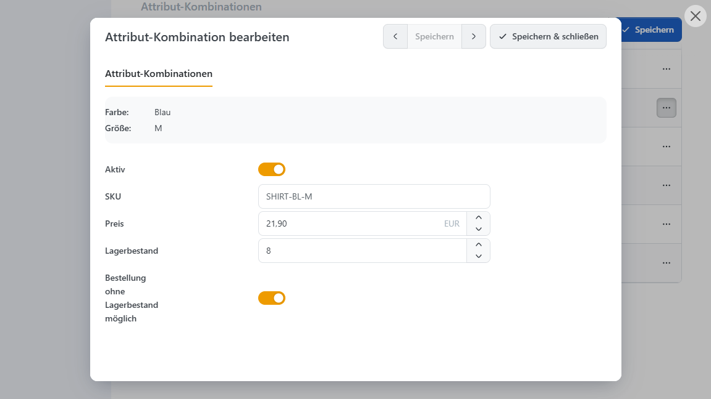

# Attributkombinationen verwalten

Legen Sie beispielsweise für das T-Shirt Blau + M eine Kombination an, wenn Sie dafür eine eigene SKU wie SHIRT-BL-M, einen abweichenden Preis oder einen getrennten Lagerbestand hinterlegen möchten. Für weitere Ausführungen mit eigenen Angaben, etwa Blau + L, legen Sie jeweils eine weitere Kombination an.

Richten Sie zunächst die auswählbaren Attribute und ihre Werte am Produkt ein. Die Schritte beschreibt [Attribute am Produkt einrichten](produktvarianten-einrichten.md). Den Zusammenhang zwischen Attributen, Werten und Kombinationen erklärt [Produktattribute und Varianten](./).

## Kombinationen anlegen und ergänzen 


**„Alle Kombinationen erstellen“ ersetzt vorhandene Kombinationen.**

Die Aktion löscht die bisherigen Kombinationen und erstellt sie neu. Bereits gepflegte Produktnummern, Preise, Bildzuordnungen und Bestände werden dabei nicht übernommen. Verwenden Sie diese Aktion für die erstmalige Einrichtung oder wenn Sie die Kombinationen bewusst vollständig neu aufbauen möchten.


1. Prüfen Sie zunächst die zugewiesenen Attribute und ihre Werte.
2. Erzeugen Sie über **Alle Kombinationen erstellen** sämtliche Zusammenstellungen der listenbasierten Attribute. Wenn Sie nur bestimmte Varianten anbieten möchten, legen Sie diese einzeln über **Hinzufügen** an.
3. Öffnen Sie die Kombination über **Bearbeiten** und hinterlegen Sie ihre abweichenden Daten.
4. Prüfen Sie aktive Kombinationen, Bestände und die Bestellung ohne Lagerbestand, bevor Sie die Varianten anbieten.

Automatisch erzeugte Kombinationen sind zunächst aktiv, haben den vorbelegten Bestand 10000 und erlauben Bestellungen ohne Lagerbestand. Diese Werte sind keine Übernahme Ihrer tatsächlichen Warenbestände und müssen vor dem Einsatz geprüft werden.

<figure><figcaption>
Attributkombinationen des T-Shirts mit eigenen Produktnummern, Preisen und Beständen; Blau + M ist zur Bearbeitung geöffnet.
</figcaption></figure>

Wenn später eine weitere Größe hinzukommt, ergänzen Sie die fehlenden Kombinationen einzeln. Für Größe XL und zwei Farben sind das Blau + XL und Weiß + XL. Die Daten der vorhandenen Kombinationen bleiben so erhalten. Freie Texte, Datumsangaben und Uploads werden nicht als eigene Variantenkombinationen vervielfacht.

## Abweichende Variantendaten hinterlegen 

Die Kombination verwendet die gemeinsamen Produktdaten, soweit keine abweichenden Werte gesetzt sind. Ein leerer optionaler Preis bedeutet beispielsweise, dass der Produktpreis weiter gilt; ein eingetragener Preis 0 ist dagegen ein eigener Preis von 0.

| **Feld**                             | **Wirkung**                                                                                                                       |
| ------------------------------------ | --------------------------------------------------------------------------------------------------------------------------------- |
| Aktiv                                | Erlaubt die Bestellung dieser Kombination. Eine deaktivierte Kombination kann nicht bestellt werden.                              |
| Bilder                               | Wählt aus den Produktbildern die Bilder für diese Kombination aus. Die Galerie wird beim Variantenwechsel entsprechend angepasst. |
| SKU / Produktnummer                  | Abweichende Produktnummer dieser Ausführung.                                                                                      |
| Hersteller-Produktnummer             | Abweichende Produktnummer des Herstellers.                                                                                        |
| EAN                                  | Abweichende EAN beziehungsweise GTIN oder vergleichbare Produktkennung.                                                           |
| Preis                                | Eigener Ausgangspreis der Kombination. Weitere Preisregeln können weiterhin wirken.                                               |
| Vergleichspreis                      | Abweichender Vergleichspreis für die Preisdarstellung.                                                                            |
| Lieferzeit                           | Abweichende Lieferzeit der Ausführung.                                                                                            |
| Verpackungseinheit                   | Abweichende Einheit für die Mengenangabe des Produkts.                                                                            |
| Grundeinheit                         | Abweichender Bezugswert für die Grundpreisberechnung.                                                                             |
| Menge                                | Abweichender Packungsinhalt für die Grundpreisberechnung.                                                                         |
| Gewicht                              | Abweichendes Gewicht dieser Ausführung.                                                                                           |
| Länge / Breite / Höhe                | Abweichende Abmessungen, jeweils in der hinterlegten Maßeinheit.                                                                  |
| Lagerbestand                         | Bestand dieser Kombination. Für automatische Bestandsbuchungen muss am Produkt Lagerbestand mit Attributen führen gewählt sein.   |
| Bestellung ohne Lagerbestand möglich | Erlaubt bei Variantenbestandsführung auch Bestellungen über den vorhandenen Bestand hinaus.                                       |

Grundpreis und Vergleichspreis werden unter [Produktpreis festlegen](../produktpreis-festlegen.md) erklärt. Für Bestände und automatische Bestandsbuchungen verwenden Sie [Lagerbestand führen](../lagerbestand-fuhren.md).

Ein Bild am Attributwert gestaltet dessen Auswahlfeld. Die Bilder an der Kombination steuern dagegen die Produktgalerie für die gewählte Ausführung. Ob zunächst alle Produktbilder oder nur allgemeine und zur Auswahl passende Bilder erscheinen, hängt von der Bildanzahl und den [Katalogeinstellungen](../../../konfiguration/einstellungen/katalogeinstellungen.md) ab.

## Bestellbare Kombinationen festlegen 

Mit **Attribut-Kombination ist erforderlich** bestimmen Sie, ob jede Auswahl als Kombination hinterlegt sein muss. Die Einstellung erscheint, sobald Kombinationen vorhanden sind.

| **Situation**                                                                                     | **Verhalten**                                                                                                                           |
| ------------------------------------------------------------------------------------------------- | --------------------------------------------------------------------------------------------------------------------------------------- |
| Die gewählte Kombination ist vorhanden und aktiv.                                                 | Sie kann bestellt werden, sofern Bestand und weitere Kaufbedingungen es erlauben.                                                       |
| Die gewählte Kombination ist vorhanden, aber inaktiv.                                             | Sie kann nicht bestellt werden.                                                                                                         |
| Für die Auswahl gibt es keine Kombination; Attribut-Kombination ist erforderlich ist aktiviert.   | Die Auswahl kann nicht bestellt werden.                                                                                                 |
| Für die Auswahl gibt es keine Kombination; Attribut-Kombination ist erforderlich ist deaktiviert. | Eine fehlende Kombination allein sperrt die Bestellung nicht. Die gemeinsamen Produktdaten und sonstigen Kaufbedingungen gelten weiter. |

Beispiel: Sie bieten Blau in S, M und L an, Weiß aber nur in S und M. Legen Sie diese fünf Kombinationen aktiv an und aktivieren Sie **Attribut-Kombination ist erforderlich**. Weiß + L kann dann nicht bestellt werden. Alternativ können Sie eine vorhandene Kombination Weiß + L ausdrücklich deaktivieren.

Mit **Attribut-Auswahlverhalten > Nicht verfügbare Attribute ausgrauen** können unpassende Auswahlwerte abhängig von der bereits getroffenen Auswahl gekennzeichnet werden. Das Ausgrauen ersetzt nicht die Prüfung beim Hinzufügen zum Warenkorb. Bei sehr vielen nicht verfügbaren Kombinationen kann die Vorschau aus Leistungsgründen eingeschränkt sein.

Für getrennte Variantenbestände wählen Sie unter **Inventar** die Methode **Lagerbestand mit Attributen führen**. Hat Blau + M keinen Bestand mehr und erlaubt keine Bestellung ohne Lagerbestand, bleibt beispielsweise Blau + L mit Bestand weiterhin bestellbar. Die Pflicht zur Auswahl eines Attributwerts und die Pflicht zu einer vorhandenen Kombination sind zwei unterschiedliche Einstellungen.
