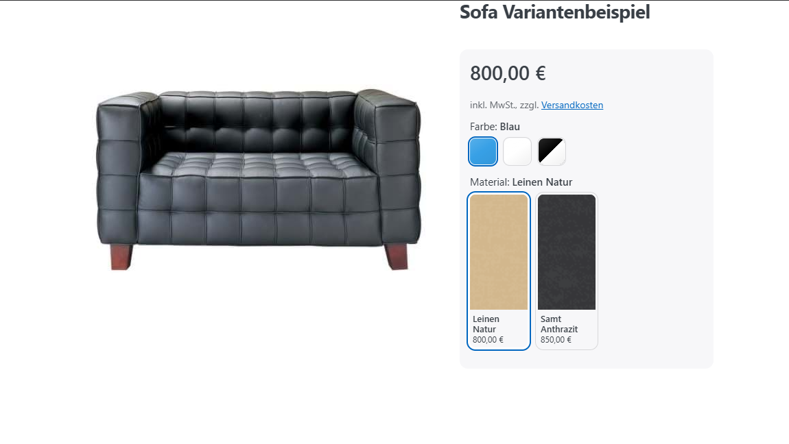
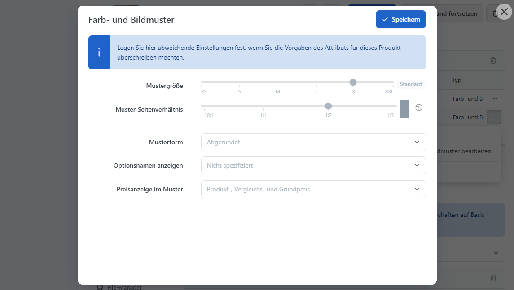
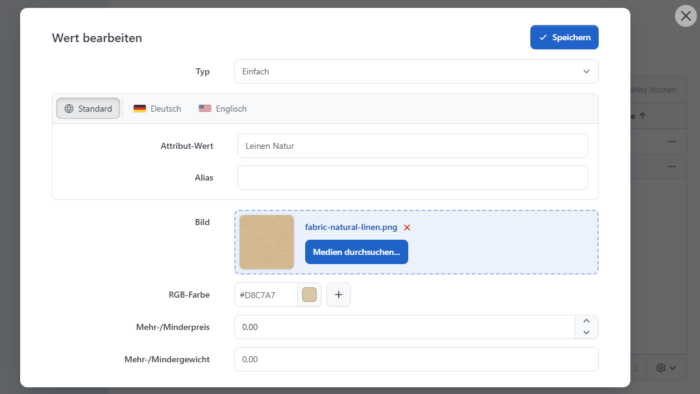
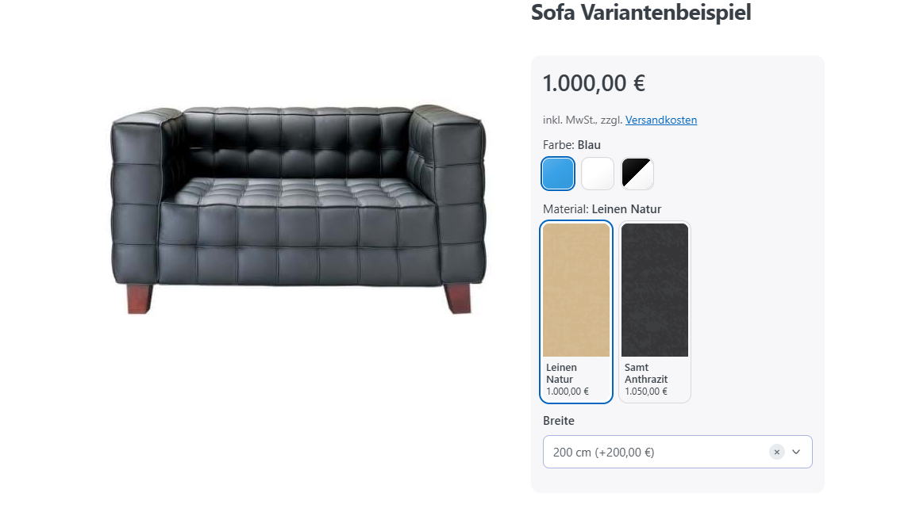

# Farb- und Bildmuster verwenden

Mit Farb- und Bildmustern stellen Sie Attributwerte als anklickbare Farben, Bilder oder Auswahlkarten dar. So können Kunden beispielsweise eine Stofffarbe erkennen oder verschiedene Oberflächen vergleichen. Die Funktion gehört zur regulären Attributdarstellung und benötigt kein zusätzliches Plugin.

Diese Seite erklärt die Darstellung von Produktattributen. Attribute zuweisen und Werte hinterlegen beschreibt [Attribute am Produkt einrichten](produktvarianten-einrichten.md). Eigene Produktdaten und die Bestellbarkeit je Ausführung erläutert [Attributkombinationen verwalten](attributkombinationen-verwalten.md).

## Die passende Darstellung wählen 

| **Darstellung**     | **Geeignet für**                                                          | **Beispiel**                                                                     |
| ------------------- | ------------------------------------------------------------------------- | -------------------------------------------------------------------------------- |
| Kompakte Farbmuster | Eine schnelle Auswahl bekannter Farben.                                   | Blau, Weiß und ein zweifarbiges Schwarz-Weiß-Muster beim T-Shirt.                |
| Kompakte Bildmuster | Materialien oder Oberflächen, die sich durch ihre Struktur unterscheiden. | Kleine Stoffaufnahmen für Leinen und Samt.                                       |
| Auswahlkarten       | Eine größere Vorschau mit Name und optionalen Preisinformationen.         | Stoffbild, Bezeichnung Samt Anthrazit und Preis für die gewählte Sofaausführung. |

<figure><figcaption>
Farb- und Bildmuster im Vergleich: kompakte Farbfelder, zweifarbiges Muster und größere Stoffkarten mit Namen und Preisen.
</figcaption></figure>

Alle Darstellungen wählen einen Attributwert aus. Eine größere Karte legt keine zusätzliche Variante an und ändert nicht die Preisberechnung oder Bestandsführung. Die angezeigten Informationen stammen aus den bereits eingerichteten Produktdaten und der jeweiligen Auswahl.

## Wo die Darstellung festgelegt wird 

| **Ort**                                                          | **Geltungsbereich**                                                                                                                                                                                                  |
| ---------------------------------------------------------------- | -------------------------------------------------------------------------------------------------------------------------------------------------------------------------------------------------------------------- |
| Konfiguration > Einstellungen > Katalog-Einstellungen            | Standardgröße und Standardform der Muster.                                                                                                                                                                           |
| Katalog > Produkt Attribute > Allgemein                          | Darstellung des jeweiligen zentralen Attributs: Größe, Seitenverhältnis, Form, Optionsnamen und Preise. Diese Einstellungen gelten für seine Verwendungen an Produkten, soweit dort keine Abweichungen gesetzt sind. |
| Produktbearbeitung > Attribute > Farb- und Bildmuster bearbeiten | Abweichende Darstellung dieses Attributs nur am aktuellen Produkt. Jede nicht überschriebene Einstellung wird weiterhin vom zentralen Attribut übernommen.                                                           |

<figure><figcaption>
Vererbung der Darstellung: globale Größe und Form, Einstellungen am Attribut Material und eine abweichende Mustergröße an einem einzelnen Sofa.
</figcaption></figure>

Beispiel: Für das zentrale Attribut Material stellen Sie große Bildkarten ein. Ein bestimmtes Sofa soll besonders große Vorschaubilder erhalten. Überschreiben Sie dort nur die Mustergröße. Eine spätere Änderung der zentralen Namens- oder Preisanzeige wirkt weiterhin auf dieses Sofa; seine abweichende Größe bleibt bestehen.

## Bilder oder Farben hinterlegen 

1. Öffnen Sie das Produkt und wechseln Sie zu **Attribute**. Wählen Sie für das betreffende Attribut den Typ **Farb- und Bildmuster**.
2. Öffnen Sie dessen Werteverwaltung und bearbeiten Sie einen Wert, beispielsweise Leinen Natur.
3. Hinterlegen Sie ein Bild oder wählen Sie die Hauptfarbe. Für mehrfarbige Muster ergänzen Sie bis zu drei weitere Farben.
4. Wiederholen Sie die Schritte für die übrigen Werte und prüfen Sie das Ergebnis im Shop.

<figure><figcaption>
Bearbeitung eines Attributwerts mit Stoffbild und Farbpalette; eine Hauptfarbe und bis zu drei zusätzliche Farben sind möglich.
</figcaption></figure>

Ein Bild eignet sich für eine Holzmaserung oder Stoffstruktur. Einfarbige oder mehrfarbige Flächen eignen sich für eindeutig erkennbare Farben. Bei mehreren Farben werden gleich große, scharf getrennte Flächen dargestellt. Ist zusätzlich ein Bild vorhanden, hat dieses bei der Darstellung Vorrang vor den Farbflächen.

Fehlen einem Wert sowohl Bild als auch Farbe, wird er als Textauswahl dargestellt. Größere Bildkarten sind dann für diese Attributauswahl nicht möglich.


Das Bild am Attributwert gestaltet das Auswahlfeld. Die Bilder einer Attributkombination bestimmen dagegen die Produktgalerie bei der gewählten Ausführung. Diese beiden Bildzuordnungen können unterschiedliche Zwecke erfüllen.


## Größe, Form und Beschriftung einstellen 

Legen Sie diese Einstellungen am zentralen Attribut unter [Produktattribute vorbereiten](../../produktattribute-verwalten.md) fest. Für eine Abweichung an einem Produkt öffnen Sie dort **Farb- und Bildmuster bearbeiten**.

| **Einstellung**         | **Wirkung**                                                                                                                                                   |
| ----------------------- | ------------------------------------------------------------------------------------------------------------------------------------------------------------- |
| Mustergröße             | Größe von XS bis XXL. Auswahlkarten mit Namen oder Preisen werden ab L verwendet, wenn alle Werte ein Bild oder eine Farbe besitzen.                          |
| Muster-Seitenverhältnis | Höhe im Verhältnis zur Breite der Karten. 1 ergibt ein Quadrat, 0,5 eine doppelt so breite wie hohe Bildfläche. Die Einstellung wirkt nur im Kartenformat.    |
| Musterform              | Abgerundet, Rechteckig oder Rund. Für Karten mit Beschriftung wird Rund durch Abgerundet ersetzt. Dasselbe gilt, wenn ein Wert weder Bild noch Farbe besitzt. |
| Optionsnamen anzeigen   | Blendet den Namen in der Karte ein. Bei aktivierter Preisanzeige wird der Name auch dann ausgegeben, wenn diese Einstellung deaktiviert ist.                  |
| Preisanzeige im Muster  | Keine, Preisanpassung oder Produkt-, Vergleichs- und Grundpreis. Die Unterschiede erklärt der nächste Abschnitt.                                              |

Für Stoffkarten stellen Sie beispielsweise Größe XL ein, aktivieren **Optionsnamen anzeigen** und verwenden ein Seitenverhältnis von 0,5. Hinterlegen Sie für jeden Stoff ein Bild. Für kleine runde Farbfelder wählen Sie dagegen beispielsweise Größe M, Form Rund und keine Preisanzeige.


**Für das Kartenformat müssen drei Bedingungen erfüllt sein:**

* Die Mustergröße ist mindestens L.
* Optionsnamen oder eine Preisanzeige sind aktiviert.
* Jeder Wert dieses Attributs besitzt ein Bild oder eine Farbe.

Andernfalls erscheinen kompakte Muster. Das Seitenverhältnis ist dann nicht sichtbar. Die Größe allein schaltet das Kartenformat nicht ein.


## Preise in der Auswahl anzeigen 

| **Preisanzeige im Muster**           | **Anzeige**                                                                                                     |
| ------------------------------------ | --------------------------------------------------------------------------------------------------------------- |
| Keine                                | Kein Preis in der Karte.                                                                                        |
| Preisanpassung                       | Der Mehr- oder Minderpreis des Attributwerts, beispielsweise +20 €.                                             |
| Produkt-, Vergleichs- und Grundpreis | Der berechnete Produktpreis für die jeweilige Auswahl sowie vorhandene Vergleichs- und Grundpreisinformationen. |

Beispiel ohne weitere Preisänderungen: Eine Sofaausführung mit Leinen kostet 800 €. Samt hat einen Mehrpreis von 50 €. Bei **Preisanpassung** steht an Samt +50 €. Bei **Produkt-, Vergleichs- und Grundpreis** kann die Karte stattdessen 850 € anzeigen.

Die Produktpreisvorschau berücksichtigt die aktuelle weitere Auswahl. Ist bereits die Sofabreite 200 cm gewählt, zeigt sie die Preise der verschiedenen Stoffe für diese Breite. Eine Änderung der Breite kann daher auch die Stoffpreise in den Karten ändern. Ein eigener Kombinationspreis oder andere Preisregeln können ebenfalls einfließen.

<figure><figcaption>
Stoffkarten mit berechneten Produktpreisen bei gewählter Sofabreite 200 cm; nach Wechsel der Breite ändern sich die Vorschaupreise.
</figcaption></figure>

Fehlen noch andere erforderliche Auswahlen, kann die Produktpreisvorschau zunächst ausbleiben. Preise erscheinen außerdem nur, wenn der Kunde Preise sehen darf und für die jeweilige Auswahl ein berechneter Preis verfügbar ist. Bei Preis auf Anfrage wird keine Produktpreisvorschau ermittelt.

Die Anzeige berechnet keinen eigenen zusätzlichen Rabatt. Wie sich Produktpreis, Kombinationspreis und Attributaufpreise zusammensetzen, beschreibt [Preisregeln verstehen](../preisregeln-verstehen.md). Die Einstellung für die allgemeine Anzeige von Mehr- und Minderpreisen finden Sie in den [Katalogeinstellungen](../../../konfiguration/einstellungen/katalogeinstellungen.md).

## Wenn die Darstellung anders ausfällt als erwartet 

| **Beobachtung**                                          | **Prüfen Sie**                                                                                                              |
| -------------------------------------------------------- | --------------------------------------------------------------------------------------------------------------------------- |
| Trotz Größe L oder größer erscheinen keine Karten.       | Sind Optionsnamen oder Preise aktiviert, und hat wirklich jeder Wert eine Farbe oder ein Bild?                              |
| Das Seitenverhältnis hat keine sichtbare Wirkung.        | Wird das Kartenformat verwendet? Bei kompakten Mustern gilt diese Einstellung nicht.                                        |
| Rund erscheint abgerundet.                               | Enthält die Auswahl Karten mit Beschriftung oder einen Wert ohne Bild und Farbe? Dafür wird die Form automatisch angepasst. |
| Eine zentrale Änderung kommt bei einem Produkt nicht an. | Ist genau diese Einstellung am Produkt überschrieben? Setzen Sie sie dort auf den übernommenen Standard zurück.             |
| Ein Produktpreis fehlt in einer Karte.                   | Sind die übrigen Pflichtattribute gewählt, Preise für den Kunden sichtbar und ein berechneter Preis verfügbar?              |
| Ein Mehr- oder Minderpreis fehlt.                        | Ist eine von null abweichende Preisanpassung hinterlegt und deren Anzeige in den Katalogeinstellungen aktiviert?            |

Dass eine Kombination nicht bestellbar ist, wird über Aktivierung, Kombinationspflicht und Bestandsregeln festgelegt. Die Muster stellen diese Auswahl dar. Die Einrichtung erläutert [Attributkombinationen verwalten](attributkombinationen-verwalten.md#bestellbare-kombinationen).
