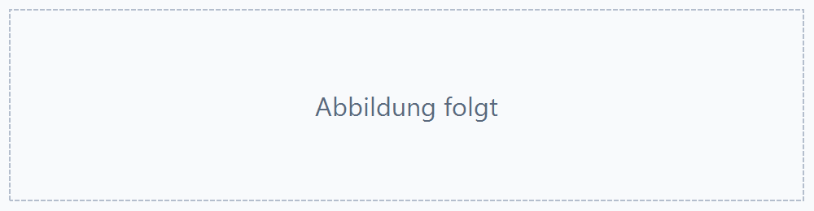
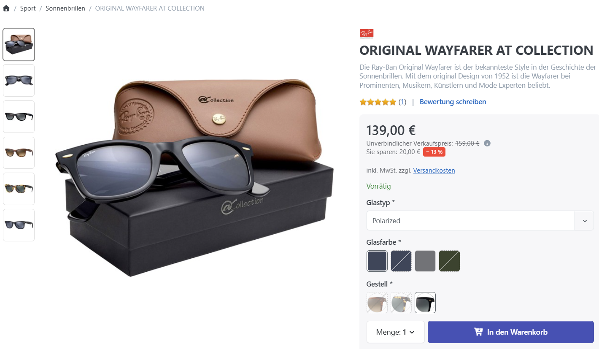

# Produktvarianten einrichten

Hier richten Sie die Auswahlmöglichkeiten und die eigenen Daten der Produktausführungen ein. Das T-Shirt-Beispiel verwendet die Attribute Farbe und Größe. Den Zusammenhang zwischen Attributen, Werten und Kombinationen erklärt die Einführung [Produktvarianten](./).

## Attribute einem Produkt zuweisen 

Legen Sie benötigte Attribute zunächst zentral unter **Katalog > Produkt Attribute** an. Die zentrale Verwaltung und wiederverwendbare Options-Sets beschreibt [Produktattribute verwalten](../../produktattribute-verwalten/).

1. Öffnen Sie das Produkt unter **Katalog > Produktverwaltung**. Speichern Sie ein neu angelegtes Produkt zunächst.
2. Wechseln Sie zu **Attribute** und fügen Sie über **Neu** das gewünschte Attribut hinzu.
3. Wählen Sie den **Typ**, legen Sie Pflichtauswahl und Reihenfolge fest und speichern Sie die Zuordnung.
4. Hinterlegen Sie anschließend die Werte des Attributs. Wiederholen Sie die Schritte für weitere Merkmale.

| **Einstellung**          | **Wirkung**                                                                                                                                     |
| ------------------------ | ----------------------------------------------------------------------------------------------------------------------------------------------- |
| Attribut                 | Wählt das zentral angelegte Produktattribut aus.                                                                                                |
| Typ                      | Bestimmt, ob Kunden einen Wert auswählen oder selbst etwas eingeben.                                                                            |
| Anzeigetext              | Abweichende Beschriftung für die Eingabe am Produkt. Ohne eigenen Text wird der Attributname verwendet.                                         |
| Benutzerdefinierte Daten | Technische Zusatzdaten für individuelle Erweiterungen. Die Verwendung stimmen Sie mit dem zuständigen Entwickler ab.                            |
| Ist erforderlich         | Verlangt eine Auswahl beziehungsweise Eingabe, bevor das Produkt in den Warenkorb gelegt werden kann.                                           |
| Reihenfolge              | Bestimmt die Position des Attributs in der Produktansicht.                                                                                      |
| Werte                    | Öffnet die Werteverwaltung beziehungsweise übernimmt Werte aus einem Options-Set. Bei freien Eingaben werden keine auswählbaren Werte angelegt. |

### Den passenden Eingabetyp wählen 

| **Typ**              | **Geeignet für**                                                                                  |
| -------------------- | ------------------------------------------------------------------------------------------------- |
| Dropdown-Liste       | Eine Auswahl aus vorgegebenen Werten, beispielsweise S, M oder L.                                 |
| Radiobuttonliste     | Eine Einzelauswahl, deren Optionen unmittelbar sichtbar sein sollen, beispielsweise Ja oder Nein. |
| Kontrollkästchen     | Mehrere gleichzeitig wählbare Werte, beispielsweise zusätzliche Ausstattungsmerkmale.             |
| Textbox              | Eine kurze freie Eingabe, beispielsweise einen Gravurtext.                                        |
| Mehrzeilige Textbox  | Längere Eingaben, beispielsweise Hinweise zur Individualisierung.                                 |
| Kalender             | Die Eingabe eines Datums.                                                                         |
| Datei-Upload         | Eine vom Kunden bereitgestellte Datei, beispielsweise ein Druckmotiv.                             |
| Farb- und Bildmuster | Eine visuelle Einzelauswahl über Farben, Bilder oder größere Auswahlkarten.                       |

Für das T-Shirt verwenden Sie beispielsweise **Farb- und Bildmuster** für Farbe und eine **Dropdown-Liste** für Größe. Für Textfelder, Kalender und Datei-Upload legen Sie keine festen Attributwerte an; die Eingabe stammt vom Kunden.

## Attributwerte festlegen 

Öffnen Sie beim zugewiesenen Attribut die Werteverwaltung und legen Sie seine Auswahlmöglichkeiten an. Für Farbe sind das beispielsweise Blau und Weiß, für Größe S, M und L. Alternativ kopieren Sie Werte aus einem zentralen [Options-Set](../../produktattribute-verwalten/). Die Kopie bleibt anschließend unabhängig von der Vorlage.

| **Feld**                    | **Bedeutung**                                                                                                                        |
| --------------------------- | ------------------------------------------------------------------------------------------------------------------------------------ |
| Typ                         | Einfach verwendet einen eigenständigen Attributwert. Produkt verknüpft den Wert mit einem vorhandenen Produkt.                       |
| Verknüpftes Produkt / Menge | Bei Typ Produkt: das verwendete Produkt und dessen Menge je bestelltem Hauptprodukt.                                                 |
| Attribut-Wert               | Die sichtbare Bezeichnung, beispielsweise Blau. Übersetzungen können je Shopsprache gepflegt werden.                                 |
| Alias                       | Optionaler SEO-konformer URL-Alias für Suchfilter; ebenfalls übersetzbar.                                                            |
| Bild / Farben               | Bild beziehungsweise bis zu vier Farben des Werts. Die visuelle Darstellung beschreibt die verlinkte Seite zu Farb- und Bildmustern. |
| Mehr-/Minderpreis           | Bei Typ Einfach: positiver Betrag für einen Aufpreis, negativer Betrag für einen Abschlag.                                           |
| Mehr-/Mindergewicht         | Bei Typ Einfach: erhöht oder vermindert das Gewicht bei Auswahl dieses Werts.                                                        |
| Vorausgewählt               | Wählt diesen Wert beim Aufruf der Produktseite vor. Bei einer Einzelauswahl sollten Sie nur einen Wert vorauswählen.                 |
| Reihenfolge                 | Bestimmt die Anzeigereihenfolge der Werte.                                                                                           |

Beispiel: Das T-Shirt kostet regulär 20 €. Hinterlegen Sie für Weiß einen Mehrpreis von 2 €, kostet die Auswahl Weiß ohne weitere Preisänderungen 22 €. Der Aufpreis wird am Wert Weiß erfasst, nicht am Attribut Farbe. Das Zusammenspiel mit Kombinationspreisen und Rabatten erläutert [Preisregeln verstehen](../preisregeln-verstehen.md).

### Ein vorhandenes Produkt als Attributwert verwenden 

Ein verknüpftes Produkt eignet sich beispielsweise für ein optionales Zubehör. Wählt der Kunde zu einer Leuchte ein Leuchtmittel, können dessen Preis und Lagerbestand berücksichtigt werden. Die hinterlegte Menge gilt je bestellter Leuchte: Bei Menge 2 und drei Leuchten werden sechs Leuchtmittel berücksichtigt.

Bei dieser Variante stammen Preis- und Gewichtsanpassung aus dem verknüpften Produkt. Die entsprechenden manuellen Felder für einen einfachen Attributwert werden ausgeblendet. Prüfen Sie auch die Bestellbarkeit des verknüpften Produkts.

## Varianten mit eigenen Daten verwalten 

Legen Sie beispielsweise für das T-Shirt Blau + M eine Kombination an, wenn Sie dafür eine eigene SKU wie SHIRT-BL-M, einen abweichenden Preis oder einen getrennten Lagerbestand hinterlegen möchten. Für weitere Ausführungen mit eigenen Angaben, etwa Blau + L, legen Sie jeweils eine weitere Kombination an.

### Kombinationen anlegen und ergänzen 


**„Alle Kombinationen erstellen“ ersetzt vorhandene Kombinationen.**

Die Aktion löscht die bisherigen Kombinationen und erstellt sie neu. Bereits gepflegte Produktnummern, Preise, Bildzuordnungen und Bestände werden dabei nicht übernommen. Verwenden Sie diese Aktion für die erstmalige Einrichtung oder wenn Sie die Kombinationen bewusst vollständig neu aufbauen möchten.


1. Prüfen Sie zunächst die zugewiesenen Attribute und ihre Werte.
2. Erzeugen Sie über **Alle Kombinationen erstellen** sämtliche Zusammenstellungen der listenbasierten Attribute. Wenn Sie nur bestimmte Varianten anbieten möchten, legen Sie diese einzeln über **Hinzufügen** an.
3. Öffnen Sie die Kombination über **Bearbeiten** und hinterlegen Sie ihre abweichenden Daten.
4. Prüfen Sie aktive Kombinationen, Bestände und die Bestellung ohne Lagerbestand, bevor Sie die Varianten anbieten.

Automatisch erzeugte Kombinationen sind zunächst aktiv, haben den vorbelegten Bestand 10000 und erlauben Bestellungen ohne Lagerbestand. Diese Werte sind keine Übernahme Ihrer tatsächlichen Warenbestände und müssen vor dem Einsatz geprüft werden.

<figure><figcaption>
Attributkombinationen des T-Shirts mit eigenen Produktnummern, Preisen und Beständen; Blau + M ist zur Bearbeitung geöffnet.
</figcaption></figure>

Wenn später eine weitere Größe hinzukommt, ergänzen Sie die fehlenden Kombinationen einzeln. Für Größe XL und zwei Farben sind das Blau + XL und Weiß + XL. Die Daten der vorhandenen Kombinationen bleiben so erhalten. Freie Texte, Datumsangaben und Uploads werden nicht als eigene Variantenkombinationen vervielfacht.

### Abweichende Variantendaten hinterlegen 

Die Kombination verwendet die gemeinsamen Produktdaten, soweit keine abweichenden Werte gesetzt sind. Ein leerer optionaler Preis bedeutet beispielsweise, dass der Produktpreis weiter gilt; ein eingetragener Preis 0 ist dagegen ein eigener Preis von 0.

| **Feld**                             | **Wirkung**                                                                                                                       |
| ------------------------------------ | --------------------------------------------------------------------------------------------------------------------------------- |
| Aktiv                                | Erlaubt die Bestellung dieser Kombination. Eine deaktivierte Kombination kann nicht bestellt werden.                              |
| Bilder                               | Wählt aus den Produktbildern die Bilder für diese Kombination aus. Die Galerie wird beim Variantenwechsel entsprechend angepasst. |
| SKU / Produktnummer                  | Abweichende Produktnummer dieser Ausführung.                                                                                      |
| Hersteller-Produktnummer             | Abweichende Produktnummer des Herstellers.                                                                                        |
| EAN                                  | Abweichende EAN beziehungsweise GTIN oder vergleichbare Produktkennung.                                                           |
| Preis                                | Eigener Ausgangspreis der Kombination. Weitere Preisregeln können weiterhin wirken.                                               |
| Vergleichspreis                      | Abweichender Vergleichspreis für die Preisdarstellung.                                                                            |
| Lieferzeit                           | Abweichende Lieferzeit der Ausführung.                                                                                            |
| Verpackungseinheit                   | Abweichende Einheit für die Mengenangabe des Produkts.                                                                            |
| Grundeinheit                         | Abweichender Bezugswert für die Grundpreisberechnung.                                                                             |
| Menge                                | Abweichender Packungsinhalt für die Grundpreisberechnung.                                                                         |
| Gewicht                              | Abweichendes Gewicht dieser Ausführung.                                                                                           |
| Länge / Breite / Höhe                | Abweichende Abmessungen, jeweils in der hinterlegten Maßeinheit.                                                                  |
| Lagerbestand                         | Bestand dieser Kombination. Für automatische Bestandsbuchungen muss am Produkt Lagerbestand mit Attributen führen gewählt sein.   |
| Bestellung ohne Lagerbestand möglich | Erlaubt bei Variantenbestandsführung auch Bestellungen über den vorhandenen Bestand hinaus.                                       |

Grundpreis und Vergleichspreis werden unter [Produktpreis festlegen](../produktpreis-festlegen.md) erklärt. Für Bestände und automatische Bestandsbuchungen verwenden Sie [Lagerbestand führen](../lagerbestand-fuhren.md).

Ein Bild am Attributwert gestaltet dessen Auswahlfeld. Die Bilder an der Kombination steuern dagegen die Produktgalerie für die gewählte Ausführung. Ob zunächst alle Produktbilder oder nur allgemeine und zur Auswahl passende Bilder erscheinen, hängt von der Bildanzahl und den [Katalogeinstellungen](../../../konfiguration/einstellungen/katalogeinstellungen.md) ab.

## Bestellbare Kombinationen festlegen 

Mit **Attribut-Kombination ist erforderlich** bestimmen Sie, ob jede Auswahl als Kombination hinterlegt sein muss. Die Einstellung erscheint, sobald Kombinationen vorhanden sind.

| **Situation**                                                                                     | **Verhalten**                                                                                                                           |
| ------------------------------------------------------------------------------------------------- | --------------------------------------------------------------------------------------------------------------------------------------- |
| Die gewählte Kombination ist vorhanden und aktiv.                                                 | Sie kann bestellt werden, sofern Bestand und weitere Kaufbedingungen es erlauben.                                                       |
| Die gewählte Kombination ist vorhanden, aber inaktiv.                                             | Sie kann nicht bestellt werden.                                                                                                         |
| Für die Auswahl gibt es keine Kombination; Attribut-Kombination ist erforderlich ist aktiviert.   | Die Auswahl kann nicht bestellt werden.                                                                                                 |
| Für die Auswahl gibt es keine Kombination; Attribut-Kombination ist erforderlich ist deaktiviert. | Eine fehlende Kombination allein sperrt die Bestellung nicht. Die gemeinsamen Produktdaten und sonstigen Kaufbedingungen gelten weiter. |

Beispiel: Sie bieten Blau in S, M und L an, Weiß aber nur in S und M. Legen Sie diese fünf Kombinationen aktiv an und aktivieren Sie **Attribut-Kombination ist erforderlich**. Weiß + L kann dann nicht bestellt werden. Alternativ können Sie eine vorhandene Kombination Weiß + L ausdrücklich deaktivieren.

Mit **Attribut-Auswahlverhalten > Nicht verfügbare Attribute ausgrauen** können unpassende Auswahlwerte abhängig von der bereits getroffenen Auswahl gekennzeichnet werden. Das Ausgrauen ersetzt nicht die Prüfung beim Hinzufügen zum Warenkorb. Bei sehr vielen nicht verfügbaren Kombinationen kann die Vorschau aus Leistungsgründen eingeschränkt sein.

Für getrennte Variantenbestände wählen Sie unter **Inventar** die Methode **Lagerbestand mit Attributen führen**. Hat Blau + M keinen Bestand mehr und erlaubt keine Bestellung ohne Lagerbestand, bleibt beispielsweise Blau + L mit Bestand weiterhin bestellbar. Die Pflicht zur Auswahl eines Attributwerts und die Pflicht zu einer vorhandenen Kombination sind zwei unterschiedliche Einstellungen.

## Darstellung und Erweiterungen 

### Farb- und Bildmuster verwenden 

Verwenden Sie den Typ **Farb- und Bildmuster**, wenn Kunden Werte über Farben, Bilder oder Auswahlkarten wählen sollen. Bilder, mehrfarbige Muster, Preisvorschau und abweichende Darstellung am einzelnen Produkt beschreibt [Farb- und Bildmuster verwenden](../../produktattribute-verwalten/farb-und-bildmuster-verwenden.md).

### Plugin-Funktionen 

Mit dem kostenpflichtigen Enterprise-Plugin [AttributeRules](../../../plugins/attributerules-regeln-fur-produktattribute.md) können Sie Attribute abhängig von anderen Auswahlen einblenden, beispielsweise ein Gravurfeld nur bei gewählter Gravur. Das Plugin kann außerdem Attribute einschließlich ihrer Werte und Regeln von einem anderen Produkt übernehmen. Das Kopieren von Werten aus zentralen Options-Sets gehört dagegen zur regulären Attributverwaltung.
