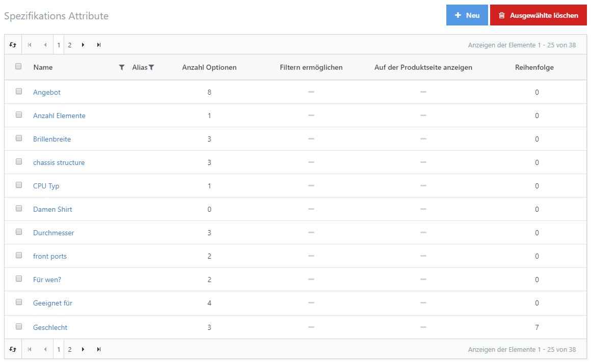
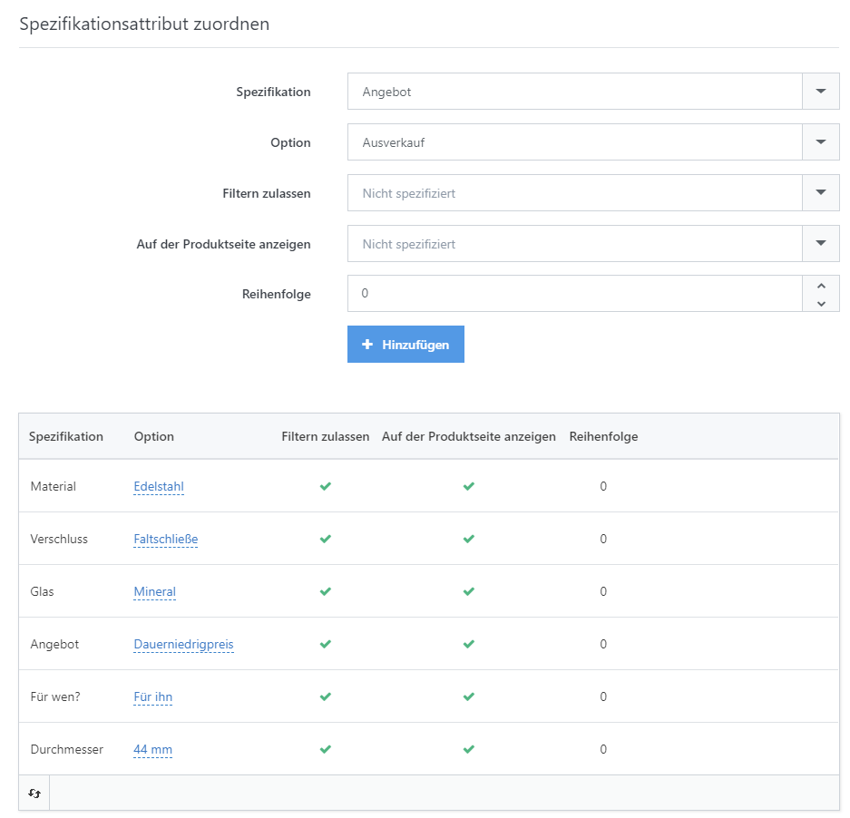
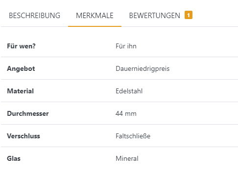
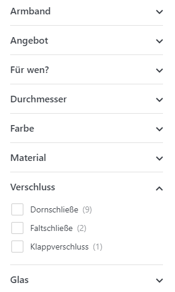

# Spezifikationsattribute verwalten

Spezifikationsattribute bilden standardisierte Produkteigenschaften ab. Sie erleichtern Kunden das Vergleichen, Filtern und Auffinden von Produkten und vermeiden mehrfach gepflegte Angaben. Daraus ergeben sich folgende Vorteile:

* Für die Anzeige freigegebene Spezifikationsattribute werden auf der Produktdetailseite in Form eines **Datenblatts** dargestellt, das die Eigenschaften Ihres Produkts im Detail anzeigt.
* Wenn Käufer in Ihrem Shop **Produkte vergleichen**, führt die Vergleichstabelle die dort verfügbaren Spezifikationsattribute der ausgewählten Produkte zusammen. Auch ein Merkmal, das nur einem der Produkte zugeordnet ist, kann als eigene Zeile erscheinen.
* Mit dem kostenpflichtigen Enterprise-Plugin MegaSearch Plus können Spezifikationsattribute als Suchfilter im **Filter Sidebar Widget** angeboten werden. Welche Filter erscheinen, hängt von den Filtereinstellungen und den passenden Produkten ab. Weitere Informationen finden Sie unter [Mit dem Filter Sidebar Widget arbeiten](produkte-verwalten/mit-dem-filter-sidebar-widget-arbeiten.md).

## Anwendungsszenario

Stellen Sie sich vor, Sie betreiben einen Shop für Drucker. Dann dürften Käufer erwarten, dass Sie sie über die folgenden Spezifikationen eines Druckers informieren:

* **Die Technologie des Druckers:** Inkjet, Laser
* **Internetverbindung:** Wireless, Memory Card, USB
* **Ausdruck:** S/W, Farbe
* **Doppelseitiger Druck:** Ja, Nein
* **Auflösung:** 600 dpi, 1200 dpi, ...
* **Unterstützte Papierformate:** A3, A4, A5, B5, Umschläge, ...

In einer freien Produktbeschreibung wären diese Angaben weder für Filter noch für Produktvergleiche strukturiert nutzbar. Als globale Spezifikationsattribute pflegen Sie Namen und Optionen zentral und ordnen sie anschließend den betreffenden Produkten zu.

|                                                                                                                                                        |                                                                                                                                                        |
| ------------------------------------------------------------------------------------------------------------------------------------------------------ | ------------------------------------------------------------------------------------------------------------------------------------------------------ |
| 
<strong>Alle Spezifikationsattribute</strong>  
           | 
<strong>Attribute mit einem Produkt verknüpfen</strong>  
 |
| 
<strong>Datenblatt in der Produktdetailansicht</strong>  
 | 
<strong>Filter Sidebar Widget</strong>  
                  |

## Spezifikationsattribute hinzufügen

Öffnen Sie **Katalog > Spezifikations Attribute** und legen Sie ein neues Attribut an. Unter **Allgemein** pflegen Sie seinen Namen und die zentralen Einstellungen. Name und Alias können Sie je Shopsprache übersetzen; die Reihenfolge gilt dagegen sprachübergreifend. Speichern Sie das Attribut mit **Speichern und fortsetzen**, bevor Sie auf der Registerkarte **Optionen** über **Option hinzufügen** die möglichen Werte anlegen.

### Zentrale Einstellungen

| **Einstellung**                              | **Beschreibung**                                                                                                                                                                                                            |
| -------------------------------------------- | --------------------------------------------------------------------------------------------------------------------------------------------------------------------------------------------------------------------------- |
| **Name**                                     | Bezeichnung des Attributs, beispielsweise Drucktechnologie. Sie kann je Shopsprache gepflegt werden.                                                                                                                        |
| **Alias**                                    | Optionaler Alias für Suchfilter, der ebenfalls je Sprache hinterlegt werden kann. Die Verwendung als Suchfilter setzt MegaSearch Plus voraus.                                                                               |
| **Anzeigegruppe**                            | Ordnet das Attribut einer Anzeigegruppe zu, etwa Technische Daten oder Abmessungen. Wählen Sie eine vorhandene Gruppe oder geben Sie einen neuen Gruppennamen ein. Dadurch lassen sich die Merkmale im Frontend gruppieren. |
| **Reihenfolge**                              | Sortierung des zentralen Attributs. Kleinere Werte erscheinen zuerst; 0 ist zulässig. Die Zuordnung am einzelnen Produkt hat eine eigene Reihenfolge.                                                                       |
| **Wesentliches Merkmal**                     | Kennzeichnet Merkmale, die zusätzlich im Warenkorb und Checkout angezeigt werden können, beispielsweise auf der Bestellbestätigungsseite. Die Anzeige im Mini-Warenkorb hängt von dessen Einstellungen ab.                  |
| 
Auf der Produktseite anzeigen  
 | Zentrale Vorgabe für die Sichtbarkeit auf der Produktdetailseite. Sie gilt für Produktzuordnungen ohne eigene Festlegung.                                                                                                   |

#### Suchfilter mit MegaSearch Plus

Die folgenden Felder stehen ebenfalls unter **Allgemein**, wirken jedoch nur mit dem kostenpflichtigen Enterprise-Plugin **MegaSearch Plus**. Änderungen werden nach der nächsten Aktualisierung des Suchindex wirksam. Weitere Informationen finden Sie unter [MegaSearch](../../benutzer-handbuch/plugins/megasearch.md).

| **Einstellung**                          | **Beschreibung**                                                                                                                                                                    |
| ---------------------------------------- | ----------------------------------------------------------------------------------------------------------------------------------------------------------------------------------- |
| Filtern ermöglichen                      | Zentrale Vorgabe für die Verwendung als Suchfilter. Produktzuordnungen können eine abweichende Festlegung enthalten; beachten Sie dazu auch die Filtereinstellungen des Plugins.    |
| Darstellung der Suchfilter               | Bestimmt die Darstellung des Filters, beispielsweise als Liste, Farb- und Bildmuster oder numerischer Bereich. Für numerische Bereiche benötigen die Optionen passende Zahlenwerte. |
| 
Sortierung der Suchfilter  
 | Bestimmt die Sortierung der angebotenen Filterwerte. Bei der Darstellung als numerischer Bereich wird dieses Feld ausgeblendet.                                                     |
| Optionsnamen indexieren                  | Nimmt die Optionsnamen in den Suchindex auf, damit Produkte über diese Begriffe gefunden werden können.                                                                             |

### Optionen anlegen und bearbeiten

Optionen sind die möglichen Werte eines Spezifikationsattributs. Für das Attribut **Material** können Sie beispielsweise die Optionen **Holz**, **Metall** und **Kunststoff** anlegen. Beim Anlegen und Bearbeiten pflegen Sie **Optionsname** und **Alias** bei Bedarf je Sprache. Danach folgen **Bild**, **RGB-Farbe**, **Numerischer Wert** und **Reihenfolge**. Bild und Farbe dienen der Darstellung entsprechender Suchfilter mit MegaSearch Plus. Für zahlenbasierte Attribute wie Gewicht hinterlegen Sie zusätzlich einen numerischen Wert: Bei der Option 2 kg ist dies beispielsweise 2. MegaSearch Plus verwendet diesen Wert für numerische Bereichsfilter. Für Materialoptionen wie Holz, Metall oder Kunststoff ist kein Zahlenwert erforderlich. Im aktuellen Suchindex wird der Wert 0 nicht als numerischer Produktfilterwert aufgenommen. Die Reihenfolge bestimmt die Sortierung der Optionen und ist nicht sprachabhängig.


**Tipp**

Wenn Sie mehrere Werte auf einmal hinzufügen möchten, trennen Sie diese durch ein Semikolon und klicken Sie auf das Kästchen **Mehrere, durch Semikolon (;) getrennte Optionsnamen eingeben**. Wenn Sie Ihre Optionen speichern, wird eine Option für jeden durch Semikolon getrennten Wert erstellt.

Diese Mehrfacheingabe steht beim Anlegen von Optionen zur Verfügung. Geben Sie Übersetzungen und Aliase in derselben Reihenfolge ein. Die Sortierwerte werden ab dem angegebenen Startwert fortlaufend vergeben. Bild, Farbe und Zahlenwert werden bei dieser Sammelanlage nicht übernommen; bearbeiten Sie diese Angaben anschließend je Option.


## Spezifikationsattribute Produkten zuordnen

Speichern Sie das Produkt zuerst und öffnen Sie in seiner Bearbeitung die Registerkarte **Spezifikations Attribute**. Hier ordnen Sie dem Produkt die vorbereiteten Merkmale und Werte zu. Die Anzeige- und Filtervorgaben können Sie dabei übernehmen oder gezielt für diese Zuordnung überschreiben.

### **Fields Reference**

| **Felder**                  | **Beschreibung**                                                                                                                                                                                                                                                                  |
| --------------------------- | --------------------------------------------------------------------------------------------------------------------------------------------------------------------------------------------------------------------------------------------------------------------------------- |
| **Attribut**                | Wählen Sie das Spezifikationsattribut, das Sie dem Produkt zuweisen möchten, z. B. _Drucktechnologie._                                                                                                                                                                            |
| **Attributsoption**         | Wählen Sie einen vorbereiteten Wert, beispielsweise Inkjet. Sie können auch einen neuen Optionsnamen direkt eingeben. Beim Hinzufügen wird daraus eine zentral wiederverwendbare Option dieses Attributs.                                                                         |
| **Filtern zulassen**        | Übernimmt ohne eigene Festlegung die zentrale Filtervorgabe. Mit einer eigenen Auswahl legen Sie fest, ob diese Zuordnung als Suchfilter genutzt werden soll. Die Wirkung setzt MegaSearch Plus voraus und hängt von dessen Einstellungen für Filtervorgaben auf Produktebene ab. |
| **Auf Produktseite zeigen** | Übernimmt ohne eigene Festlegung die zentrale Anzeigevorgabe. Eine eigene Auswahl überschreibt diese Vorgabe für die Zuordnung am aktuellen Produkt.                                                                                                                              |
| **Reihenfolge**             | Sortierung der Zuordnung am Produkt. Kleinere Werte erscheinen zuerst; 0 ist zulässig.                                                                                                                                                                                            |

Legen Sie die Zuordnung über die Schaltfläche zum Hinzufügen an. Wiederholen Sie den Vorgang für weitere Merkmale oder mehrere Werte desselben Attributs. Bereits zugeordnete Werte und ihre Einstellungen bearbeiten Sie in der Tabelle darunter und übernehmen die Anpassungen mit **Änderungen speichern**. Das Löschen einer Zeile entfernt nur die Zuordnung an diesem Produkt; das zentrale Attribut und seine Option bleiben bestehen.

### Mehrfache Wert-Zuweisung

Ändern Sie unter **Katalog > Spezifikations Attribute > Attribut** die zentrale Vorgabe **Auf der Produktseite anzeigen** oder **Filtern ermöglichen**, wirkt sie auf alle Produktzuordnungen, die diese Vorgabe übernehmen. Bereits ausdrücklich am Produkt gesetzte Werte werden dadurch nicht pauschal ersetzt. Wenn eine Zuordnung wieder der zentralen Einstellung folgen soll, entfernen Sie dort die eigene Festlegung. Die Anzeigegruppe, der Name und die Optionen werden weiterhin zentral am Attribut gepflegt.
