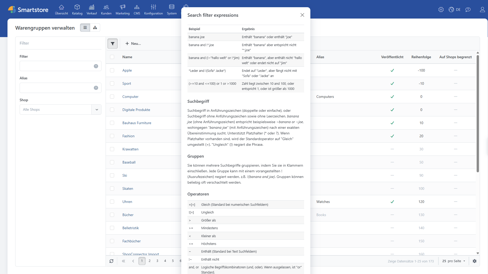

# Warengruppen organisieren

Öffnen Sie im Administrationsbereich **Katalog > Warengruppen**, um Warengruppen anzulegen, zu bearbeiten oder zu löschen. Über die Schaltflächen am oberen Rand wechseln Sie zwischen Listen- und Baumansicht. In der Listenansicht suchen und filtern Sie Warengruppen; in der Baumansicht ordnen Sie Warengruppen und Untergruppen per Drag-and-drop.

## Listenansicht

Filtern Sie die Listenansicht nach **Warengruppenname** oder **Alias**.

## Baumansicht

Die Baumansicht bildet die Warengruppenstruktur des Shop-Frontends und damit die Hauptnavigation ab. Ziehen Sie Warengruppen per Drag-and-drop an die gewünschte Position oder in eine andere übergeordnete Warengruppe.

## Ansicht der Warengruppendetails

Beim Anlegen oder Bearbeiten öffnet sich die Detailansicht der Warengruppe. Die zugehörigen Einstellungen sind auf mehrere Registerkarten verteilt. Über die Schaltflächen oben rechts zeigen Sie eine Vorschau an, speichern die Warengruppe oder löschen sie. Beim Löschen entscheiden Sie, ob Unterwarengruppen ebenfalls entfernt oder auf einer höheren Ebene erhalten bleiben.

### Allgemein 

|                                           |                                                                                                                                                                                                                                                                                                                                                                                                                                                                     |
| ----------------------------------------- | ------------------------------------------------------------------------------------------------------------------------------------------------------------------------------------------------------------------------------------------------------------------------------------------------------------------------------------------------------------------------------------------------------------------------------------------------------------------- |
| Externer Link                             | Zieladresse, auf die Links zu dieser Warengruppe statt auf ihre eigene Seite führen, etwa in Menüs und Warengruppenlisten.                                                                                                                                                                                                                                                                                                                                          |
| Übergeordnete Warengruppe                 | Ordnet diese Warengruppe einer anderen Warengruppe unter. Ohne Auswahl liegt sie auf der obersten Ebene.                                                                                                                                                                                                                                                                                                                                                            |
| Reihenfolge                               | Legt die Reihenfolge fest, in der die Warengruppen innerhalb der übergeordneten Warengruppe angezeigt werden. Die Anzeigenreihenfolge wird automatisch angepasst, wenn Sie Ihre Warengruppen wie oben beschrieben in der Strukturansicht ordnen.                                                                                                                                                                                                                    |
| Veröffentlicht                            | Macht die Warengruppe für Shopbesucher sichtbar. Eine unveröffentlichte Warengruppe erscheint nicht in der öffentlichen Warengruppenstruktur.                                                                                                                                                                                                                                                                                                                       |
| In Menüs ignorieren                       | Blendet die veröffentlichte Warengruppe aus Menüs aus, ohne sie unveröffentlicht zu schalten. Die Seite bleibt über ihre URL erreichbar. Ob Produkte aus ausgeblendeten Unterwarengruppen in der übergeordneten Warengruppe erscheinen, hängt von „Produkte von Unterkategorien einschließen“ ab.                                                                                                                                                                   |
| Auf der Homepage zeigen                   | Zeigt die Warengruppe auf der Startseite an.                                                                                                                                                                                                                                                                                                                                                                                                                        |
| Name                                      | 
Dies ist der Standardname der Warengruppe, der dem Shopbesucher im Frontend Ihres Shops angezeigt wird, solange Sie nicht unterschiedliche Werte für andere Sprachen angegeben haben.  Für weitere Informationen zu Sprachen lesen Sie <a href="../../benutzer-handbuch/konfiguration/sprachen-verwalten.md">Sprachen verwalten</a>.
                                                                                                                   |
| Vollständiger Name                        | Optionaler Titel der Warengruppenseite. Wenn das Feld leer ist, wird der Name verwendet.                                                                                                                                                                                                                                                                                                                                                                            |
| Obere Beschreibung                        | Text oberhalb der Produktliste. Mit „Andere Beschreibung anzeigen“ wechseln Sie zur unteren Beschreibung. Beide Texte können Sie je Sprache pflegen.                                                                                                                                                                                                                                                                                                                |
| Untere Beschreibung                       | Optionale zweite Beschreibung unterhalb der Produkte. Sie können sie je Sprache pflegen.                                                                                                                                                                                                                                                                                                                                                                            |
| Badge-Text                                | Dies ist der Standardwert für den Badge-Text. Badges werden innerhalb von Menüs neben den Menüeinträgen dargestellt.                                                                                                                                                                                                                                                                                                                                                |
| Badge-Style                               | Legt den Stil des Badges fest, das innerhalb von Menüs neben den Menüeinträgen dargestellt wird.                                                                                                                                                                                                                                                                                                                                                                    |
| Bild                                      | Das Bild wird im Frontend überall dort angezeigt, wo Warengruppen in einer Übersicht sichtbar sind, z. B. in der Übersicht der Untergruppen innerhalb einer übergeordneten Warengruppe.                                                                                                                                                                                                                                                                             |
| 
Standard Listendarstellung  
 | Legt fest, wie Produktlisten standardmäßig dargestellt werden sollen. Der Kunde kann die Darstellung im Shop ändern.                                                                                                                                                                                                                                                                                                                                                |
| Kunde kann Listengröße ändern             | Aktivieren Sie diese Option, wenn Shopbesucher die Anzahl der angezeigten Produkte selbst wählen dürfen. Andernfalls legen Sie die feste Anzahl im Feld „Listengröße“ fest.                                                                                                                                                                                                                                                                                         |
| Listengröße                               | Legt die Anzahl der Produkte pro Seite fest, wenn Kunden die Listengröße nicht selbst ändern können.                                                                                                                                                                                                                                                                                                                                                                |
| Optionen für die Listengröße              | Kommagetrennte Auswahlwerte für die Anzahl der Produkte pro Seite, beispielsweise 5, 10, 15, 20. Die erste Zahl ist die Vorbelegung.                                                                                                                                                                                                                                                                                                                                |
| Alias                                     | Ein optionaler, sprachneutraler Referenzname für die interne Nutzung.                                                                                                                                                                                                                                                                                                                                                                                               |
| Design Vorlage                            | Die Designvorlage legt fest, wie die Warengruppe und ihre Produkte dem Shopbesucher angezeigt werden.                                                                                                                                                                                                                                                                                                                                                               |
| Rabatte                                   | Legt die auf das Objekt anzuwendenden Rabatte fest. In dieser Registerkarte können Sie Rabatte für die jeweilige Warengruppe aktivieren. Denken Sie daran, dass hier nur Rabatte des Rabatttyps _Bezogen auf die Kategorien_ verwaltet werden können. Für weitere Informationen zu Rabatten lesen Sie bitte [Rabatte verwalten](../../benutzer-handbuch/marketing-promotion/rabatte-verwalten.md).                                                                  |
| Auf Shops begrenzt                        | Beschränkt die Warengruppe auf ausgewählte Shops. Unterwarengruppen und Produkte erhalten diese Zuordnung erst, wenn Sie die Einstellungen speichern und die Schaltfläche zur Übernahme auf Unterwarengruppen und Produkte verwenden. Dabei werden vorhandene Shop-Zuordnungen der betroffenen Einträge überschrieben. Weitere Informationen: [Mit mehreren Shops arbeiten](../../benutzer-handbuch/allgemeine-konzepte/mit-mehreren-shops-arbeiten.md).            |
| Auf Kundengruppen begrenzt                | Beschränkt die Warengruppe auf ausgewählte Kundengruppen. Unterwarengruppen und Produkte erhalten diese Zugriffsrechte erst, wenn Sie die Einstellungen speichern und die Schaltfläche zur Übernahme auf Unterwarengruppen und Produkte verwenden. Dabei werden vorhandene Zugriffsrechte der betroffenen Einträge überschrieben. Weitere Informationen: [Zugriffsbeschränkungen (ACL)](../../benutzer-handbuch/allgemeine-konzepte/zugriffsbeschrankungen-acl.md). |

### Suchmaschinen (SEO) 

In dieser Registerkarte können Sie spezifische SEO-Werte für die Warengruppe festlegen, z. B. **Meta Title**, **Meta Keywords** oder einen SEO-freundlichen **URL-Alias**. Für weitere Informationen über die Felder in der Registerkarte **Suchmaschinen** lesen Sie bitte [SEO](../../benutzer-handbuch/allgemeine-konzepte/seo.md).

### Produkte 

Hier ordnen Sie der Warengruppe bereits angelegte Produkte zu. Über „Produkt hinzufügen“ können Sie mehrere Produkte auswählen. In der Liste bearbeiten Sie die Reihenfolge und markieren Produkte als „Hervorgehobenes Produkt“ der Warengruppe. Sie können Zuordnungen auch wieder entfernen. Mit Produktregeln lassen sich passende Produkte automatisch zuordnen; über „Regeln erneut anwenden“ stoßen Sie die Auswertung bei Bedarf erneut an.

### Plugin-Funktionen 

Installierte Plugins können weitere Registerkarten oder Felder ergänzen.

Mit dem Enterprise-Plugin „Mega Menu“ konfigurieren Sie die Darstellung dieser Warengruppe im Mega Menu. Weitere Informationen finden Sie unter [das Mega Menu Plugin](../../benutzer-handbuch/plugins/mega-menu.md).

Mit dem Enterprise-Plugin „ContentSlider“ können Sie für diese Warengruppe einen Slider einrichten und seine Slides verwalten. Weitere Informationen finden Sie unter [das ContentSlider Plugin](../../benutzer-handbuch/plugins/content-slider.md).

Das Enterprise-Plugin „Widerruf“ ergänzt unter „Allgemein“ die Felder „Widerrufsfrist“ und „Widerruf vor Versand erlauben“. Weitere Informationen finden Sie unter [Widerruf](../../benutzer-handbuch/plugins/withdrawal.md).

Das Enterprise-Plugin „Datenexporte“ ergänzt die Warengruppenliste um das Menü „Exportieren“. Dort können Sie ausgewählte oder alle Warengruppen im CSV- oder XML-Format exportieren. Weitere Informationen finden Sie unter [Datenexporte](../../benutzer-handbuch/plugins/commonexportproviders.md).
