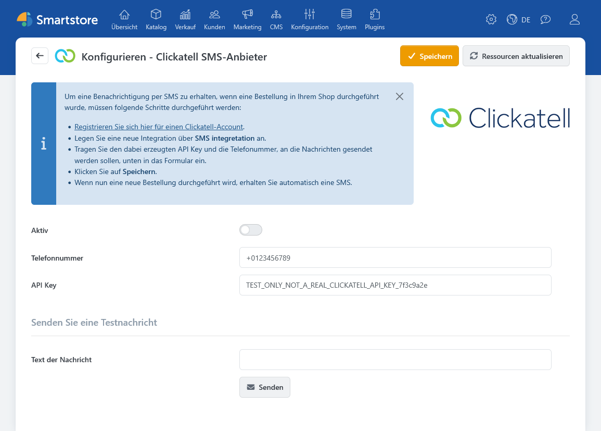

# Clickatell SMS-Anbieter

Das Plugin **Clickatell SMS-Anbieter** benachrichtigt die Shopadministration per SMS, wenn eine neue Bestellung eingeht. Die automatische Nachricht enthält die Bestellnummer. Das Plugin versendet keine Bestell-SMS an Kunden.

Für den Betrieb benötigen Sie ein Clickatell-Konto mit einer SMS-Integration und dem zugehörigen API-Key. Das Clickatell-Konto kann Kosten verursachen.

## Konfiguration

Öffnen Sie unter **Plugins > Plugins verwalten** die Konfiguration von **Clickatell SMS-Anbieter**.

| Einstellung       | Beschreibung                                                                                                                                   |
| ----------------- | ---------------------------------------------------------------------------------------------------------------------------------------------- |
| **Aktiv**         | Versendet bei einer neuen Bestellung eine SMS. Bei ausgeschalteter Option wird keine automatische Bestell-SMS ausgelöst.                       |
| **Telefonnummer** | Empfänger der SMS. Geben Sie die Nummer im internationalen Format ein, zum Beispiel `+49231987654`. Mehrere Nummern trennen Sie mit Semikolon. |
| **API Key**       | API-Schlüssel der Clickatell-SMS-Integration. Behandeln Sie ihn vertraulich.                                                                   |

## Testnachricht senden

Geben Sie unter **Text der Nachricht** einen Testtext ein und klicken Sie auf **Senden**. Für den Test verwendet das Plugin die gespeicherten Zugangsdaten und Empfängernummern. Speichern Sie die Konfiguration deshalb zuerst. Anschließend zeigt Smartstore eine Erfolgs- oder Fehlermeldung an.


**Text der Nachricht** gilt nur für den Test. Die automatische Bestellnachricht verwendet einen festgelegten Text mit der jeweiligen Bestellnummer.


## Benachrichtigung bei neuen Bestellungen

Sobald eine neue Bestellung eingeht, sendet das aktive Plugin eine Nachricht nach dem Muster „Ein neuer Auftrag mit der Nummer … ist eingegangen.“ Smartstore fügt dem Auftrag außerdem eine interne Notiz zum SMS-Versand hinzu.


Eine Erfolgsmeldung beim Test oder die interne Auftragsnotiz bestätigt keine Zustellung auf dem Empfängertelefon. Das Plugin wertet die unmittelbare API-Antwort aus, prüft aber keinen späteren Zustellstatus.



**Datenübertragung:** Smartstore übermittelt den API-Key, die hinterlegten Empfängernummern und den Nachrichtentext über eine HTTPS-Verbindung an die Clickatell-API. Die automatische Nachricht enthält die Bestellnummer, aber weder Kundennamen noch Kunden-Telefonnummer oder Lieferadresse.

