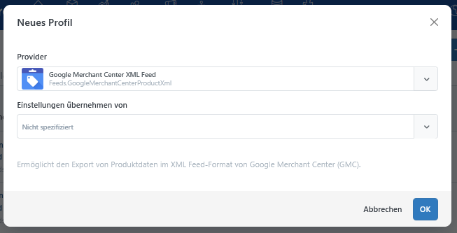
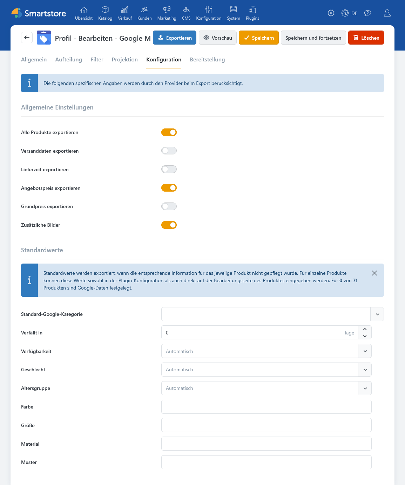
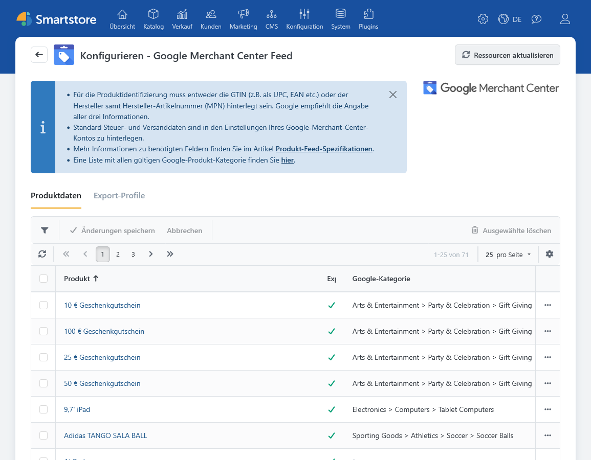
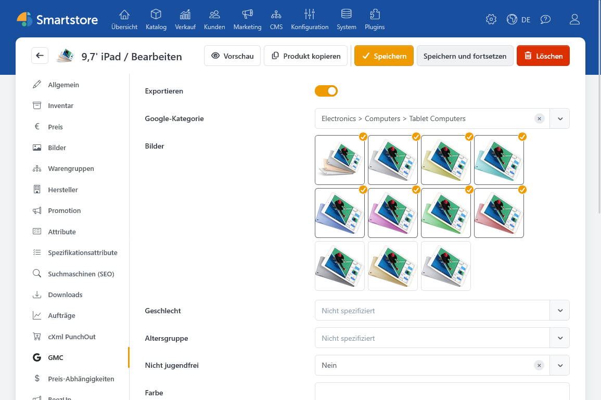
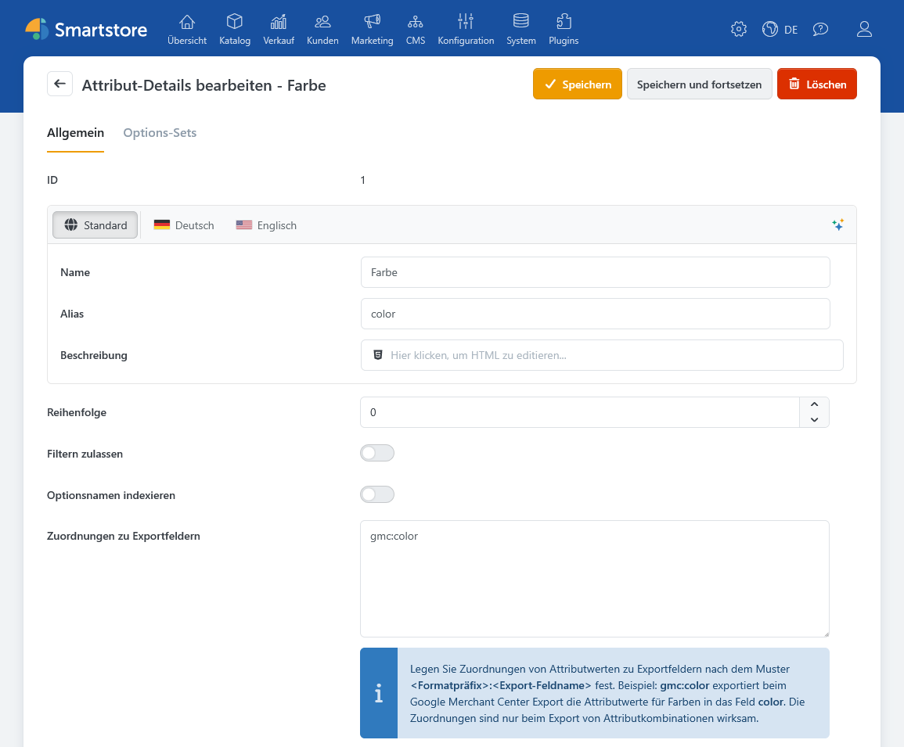

# Google Merchant Center Feed

Mit dem Plugin **Google Merchant Center Feed** stellen Sie Ihre Smartstore-Produkte als XML-Feed für das Google Merchant Center bereit. Über ein Exportprofil wählen Sie die Produkte aus, legen die Feed-Einstellungen fest und bestimmen, wie die Datei bereitgestellt wird.


Allgemeine Informationen finden Sie unter [Produkt-Feeds exportieren](../katalog/produkte-verwalten/produkt-feeds-exportieren.md).


## Voraussetzungen

Pflegen Sie vor dem ersten Export insbesondere Produktname, Beschreibung, Preis, Verfügbarkeit und Bilder. Für die Produktidentifikation verwendet der Feed die GTIN oder Marke und Hersteller-Artikelnummer (MPN). Fehlt die MPN, kann das Plugin die SKU verwenden. Prüfen Sie außerdem, ob für die Produkte eine passende Google-Produktkategorie hinterlegt ist.

Welche Angaben Google für Ihre Produkte verlangt, hängt von der Produktart und den Einstellungen Ihres Merchant-Center-Kontos ab.

## Exportprofil erstellen

1. Öffnen Sie **Konfiguration > Exportieren**.
2. Wählen Sie **Neues Profil** und den Anbieter **Google Merchant Center XML Feed**.
3. Legen Sie auf den Registerkarten **Allgemein**, **Filter** und **Projektion** unter anderem Shop, Sprache, Währung, Produktauswahl und den Umgang mit Attributkombinationen fest.
4. Öffnen Sie **Konfiguration**, um die GMC-spezifischen Einstellungen vorzunehmen.
5. Speichern Sie das Profil und führen Sie einen ersten Testexport aus.

Unter **Plugins > Google Merchant Center > Export-Profile** werden bereits vorhandene GMC-Profile angezeigt. Dort können Sie ein Profil öffnen und seine Ausführung aufrufen. **Neue Profile legen Sie in der allgemeinen Exportverwaltung an.** Die Registerkarten und Funktionen eines Profils beschreibt [Exportprofile verwalten](../datenaustausch/exportprofile-verwalten.md).

## GMC-Einstellungen im Exportprofil

Die folgenden Optionen finden Sie im GMC-Exportprofil auf der Registerkarte **Konfiguration**.

| Option                        | Beschreibung                                                                                                                                                                                                                                                                                                           |
| ----------------------------- | ---------------------------------------------------------------------------------------------------------------------------------------------------------------------------------------------------------------------------------------------------------------------------------------------------------------------- |
| **Alle Produkte exportieren** | Ist die Option aktiv, berücksichtigt der Export grundsätzlich die durch Profil und Filter ermittelten Produkte. Einzelne Produkte können über ihre GMC-Einstellung **Exportieren** ausgeschlossen werden. Ist die Option aus, werden nur Produkte mit individuell gespeicherten und aktivierten GMC-Daten aufgenommen. |
| **Versanddaten exportieren**  | Ergänzt für versandfähige Produkte verfügbare Gewichts-, Maß-, Versandursprungs- und Bearbeitungszeitangaben.                                                                                                                                                                                                          |
| **Lieferzeit exportieren**    | Überträgt die Smartstore-Lieferzeit als `transit_time_label`. Prüfen Sie bei der Verwendung, ob dieses Feld für Ihren Feed noch sinnvoll ist.                                                                                                                                                                          |
| **Angebotspreis exportieren** | Gibt einen gültigen Angebotspreis zusätzlich zum regulären Preis aus; gegebenenfalls einschließlich des Angebotszeitraums.                                                                                                                                                                                             |
| **Grundpreis exportieren**    | Ergänzt unterstützte Grundpreisangaben, sofern sie am Produkt vorhanden sind.                                                                                                                                                                                                                                          |
| **Zusätzliche Bilder**        | Gibt neben dem Hauptbild weitere Produktbilder aus. Der Feed unterstützt ein Hauptbild und bis zu zehn zusätzliche Bilder.                                                                                                                                                                                             |

### Standardwerte

Im selben Reiter können Sie eine **Standard-Google-Kategorie** sowie Vorgaben für Verfügbarkeit, Geschlecht, Altersgruppe, Farbe, Größe, Material und Muster festlegen. Diese Werte greifen, soweit kein vorrangiger Wert für das Produkt oder eine exportierte Attributkombination vorliegt.

Bei der **Verfügbarkeit** kann Smartstore den Status aus Produkt- und Bestandsdaten automatisch ermitteln. Für vorbestellbare Produkte kann zusätzlich ein Verfügbarkeitsdatum ausgegeben werden. Mit **Verfällt in** legen Sie fest, ob und wie viele Tage nach dem Export ein Ablaufdatum in den Feed geschrieben wird; `0` unterdrückt dieses Feld.

**Nicht angegeben** unterdrückt den betreffenden Standardwert. Ein Wert aus einer zugeordneten Attributkombination kann dennoch Vorrang haben.

### Versandursprungsland

Das Land wird unter **Konfiguration > Einstellungen > Versand > Versand erfolgt ab** gepflegt. Ist dort ein Land hinterlegt und **Versanddaten exportieren** aktiviert, kann der Feed dessen zweistelligen Ländercode als `ships_from_country` ausgeben. Fehlt das Land, entfällt nur dieses Feed-Feld; andere verfügbare Versanddaten können weiterhin ausgegeben werden. Beachten Sie bei mehreren Shops die jeweils geltende Shop-Einstellung.

Weitere Angaben zur Adresse finden Sie unter [Versand-Einstellungen](../konfiguration/einstellungen/versand-einstellungen.md).

## GMC-Daten am Produkt pflegen

Produktspezifische Angaben können Sie in der Produktliste des Plugins oder im Produkteditor auf der Registerkarte **GMC** bearbeiten.

In der Produktliste können Sie nach Produktname, SKU und vorhandenen GMC-Daten filtern. Weitere Felder lassen sich über die Konfiguration des Grids einblenden, um die benötigten Angaben direkt in der Tabelle zu bearbeiten. Mit **Ausgewählte löschen** entfernen Sie die GMC-spezifischen Einstellungen der markierten Produkte, nicht die Produkte selbst.

| Option                                                       | Beschreibung                                                  |
| ------------------------------------------------------------ | ------------------------------------------------------------- |
| **Exportieren**                                              | Produkt gezielt in den Feed aufnehmen oder davon ausschließen |
| **Google-Kategorie**                                         | Kategorie für dieses Produkt statt der Profilvorgabe          |
| **Bilder**                                                   | Bilder gezielt für den Feed auswählen                         |
| **Geschlecht, Altersgruppe, Farbe, Größe, Material, Muster** | Produktspezifische Merkmale                                   |
| **Nicht jugendfrei, Multipack, Bundle**                      | Zusätzliche Google-Produktmerkmale                            |
| **Energieeffizienz**                                         | Energieeffizienzklasse A bis G                                |
| **Label 0–4**                                                | Eigene Gruppierungsmerkmale, etwa für Kampagnen oder Saisons  |

Eine produktspezifische Google-Kategorie hat Vorrang vor der Standardkategorie des Profils. Fehlen beide, kann der Export weiterlaufen, protokolliert jedoch die fehlende Kategorie. Prüfen Sie das Exportprotokoll deshalb auch dann, wenn eine XML-Datei erstellt wurde.

Wenn Sie am Produkt Bilder für GMC auswählen, berücksichtigt der Export ausschließlich diese Auswahl. Ohne Auswahl verwendet er geeignete Produktbilder in ihrer üblichen Reihenfolge. Das erste Bild erscheint als `image_link`; weitere Bilder erscheinen bei aktivierter Profiloption als `additional_image_link`.

## Attribute und Varianten zuordnen

Für exportierte Attributkombinationen kann das Plugin Werte wie Farbe oder Größe aus Produktattributen übernehmen. Öffnen Sie dazu **Katalog > Produkt Attribute**, bearbeiten Sie das zentrale Attribut und tragen Sie unter **Zuordnungen zu Exportfeldern** pro Zeile eine Zuordnung ein.

Die Zuordnung wird am **zentralen Produktattribut** gepflegt und wirkt, wenn das Exportprofil Attributkombinationen als eigenständige Produkte ausgibt. Dann verwendet der Feed den jeweiligen, gegebenenfalls übersetzten Attributwert der Kombination.

Die folgenden Zuordnungen werden unterstützt:

| Eintrag         | Bedeutung                                        |
| --------------- | ------------------------------------------------ |
| `gmc:gender`    | Geschlecht, für das die Variante vorgesehen ist. |
| `gmc:age_group` | Altersgruppe der Variante.                       |
| `gmc:color`     | Farbe der Variante.                              |
| `gmc:size`      | Größe der Variante.                              |
| `gmc:material`  | Material der Variante.                           |
| `gmc:pattern`   | Muster oder Design der Variante.                 |

Weitere Informationen finden Sie unter [Produktattribute verwalten](../katalog/produktattribute-verwalten.md).

## Feed prüfen und bereitstellen

1. Starten Sie das Profil unter **Konfiguration > Exportieren** mit **Jetzt ausführen**.
2. Prüfen Sie die erzeugte XML-Datei und das **Ereignisprotokoll**.
3. Kontrollieren Sie stichprobenartig Kategorie, Preis, Verfügbarkeit, Produkt-URL, Bilder und Identifikationsmerkmale.
4. Öffnen Sie im Profil **Bereitstellung** und prüfen Sie das Ziel **Öffentlicher Ordner**. Nach dem ersten Export können Sie die dort angezeigte Feed-URL im Google Merchant Center hinterlegen.
5. Planen Sie bei Bedarf eine regelmäßige Ausführung, damit die Datei aktuell bleibt.

Ein gespeichertes Exportprofil allein erzeugt noch keine aktuelle Feed-Datei. Allgemeine Hinweise zu Bereitstellungszielen stehen unter [Exportprofile verwalten](../datenaustausch/exportprofile-verwalten.md); die regelmäßige Ausführung ist unter [Geplante Aufgaben verwalten](../system-and-wartung/geplante-aufgaben-verwalten.md) beschrieben.

### Wenn Produkte oder Angaben fehlen

Prüfen Sie zuerst die Produktfilter des Profils und die Einstellung **Alle Produkte exportieren**. Kontrollieren Sie danach **Exportieren** am Produkt, die Google-Kategorie sowie das Ereignisprotokoll. Bei Varianten prüfen Sie zusätzlich die Projektion von Attributkombinationen und die Zuordnung der Produktattribute. Fehlende Bilder, Preise oder Versandangaben sollten Sie an den jeweiligen Produkt- und Shop-Einstellungen nachverfolgen.

## Weiterführende Informationen

* [Produkt-Feeds exportieren](../katalog/produkte-verwalten/produkt-feeds-exportieren.md)
* [Exportprofile verwalten](../datenaustausch/exportprofile-verwalten.md)
* [Produktattribute verwalten](../katalog/produktattribute-verwalten.md)
* [Wie funktionieren Produktvarianten?](../katalog/produkte-verwalten/wie-funktionieren-produktvarianten/)
* [Versand-Einstellungen](../konfiguration/einstellungen/versand-einstellungen.md)
* [Geplante Aufgaben verwalten](../system-and-wartung/geplante-aufgaben-verwalten.md)
