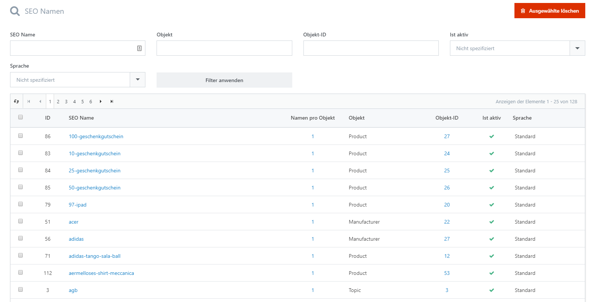

# SEO Namen verwalten

Unter **System > SEO Namen** sehen Sie die gespeicherten SEO-Namen Ihrer Shop-Inhalte, beispielsweise von Produkten, Warengruppen, Herstellern und Inhaltsseiten. Ein SEO-Name ist der lesbare Teil einer Adresse: In https://www.beispielshop.de/rote-jacke lautet er beispielsweise rote-jacke. Die Übersicht enthält sowohl aktuelle als auch frühere Namen.

## Aktuelle und frühere Namen unterscheiden

Wenn Sie den SEO-Namen in der Bearbeitung eines Produkts oder eines anderen Inhalts ändern, bleibt der bisherige Name als inaktiver Eintrag erhalten. Der neue Name wird aktiv. Wird die alte Adresse aufgerufen, kann sie auf den aktiven Namen desselben Objekts weiterleiten, sofern ein passender aktiver Eintrag vorhanden ist.

Beispiel: Sie ändern den SEO-Namen eines Produkts von rote-jacke auf rote-winterjacke. Der Eintrag rote-winterjacke ist danach aktiv; rote-jacke bleibt inaktiv gespeichert und ermöglicht die Weiterleitung alter Links.

Die Übersicht zeigt zu jedem Namen das zugehörige Objekt, dessen ID, den Aktivierungsstatus und die Sprache. **Namen pro Objekt** gibt an, wie viele SEO-Namen zum jeweiligen Objekt gespeichert sind. Sie können die Auswahl nach diesen Zuordnungen und dem SEO-Namen eingrenzen.

## SEO-Namen bearbeiten

Öffnen Sie einen Eintrag über seinen SEO-Namen. Die Detailansicht enthält folgende Angaben in der Reihenfolge des Editors:

| **Feld**  | **Bedeutung**                                                                                                                                                                                                               |
| --------- | --------------------------------------------------------------------------------------------------------------------------------------------------------------------------------------------------------------------------- |
| Ist aktiv | Kennzeichnet den aktuell verwendeten SEO-Namen. Ein inaktiver Name kann als früherer Name weiterhin eine Weiterleitung ermöglichen. Der Status sagt nicht aus, ob beispielsweise das zugehörige Produkt veröffentlicht ist. |
| Sprache   | Sprache, für die der Name hinterlegt ist. Standard bezeichnet einen Eintrag ohne Zuordnung zu einer bestimmten Sprache.                                                                                                     |
| Objekt    | Zeigt den technischen Objekttyp, beispielsweise Product, Category oder Manufacturer. Die Angabe ist schreibgeschützt und bestimmt zusammen mit der Objekt-ID, zu welchem Inhalt der Name gehört.                            |
| Objekt-ID | Zeigt die Kennung des zugehörigen Produkts, der Warengruppe oder eines anderen Inhalts. Die Angabe ist schreibgeschützt. Über die Schaltfläche Objekt öffnen Sie den zugeordneten Datensatz.                                |
| SEO Name  | Lesbarer Bestandteil der Adresse, beispielsweise rote-jacke. Tragen Sie hier keine vollständige URL mit Domain ein. Der Name darf nicht bereits für einen anderen Eintrag verwendet werden.                                 |

Für ein Objekt ist je Sprache ein aktiver SEO-Name vorgesehen. Wenn Sie einen inaktiven Eintrag aktivieren möchten und bereits ein aktiver Name für dieselbe Zuordnung existiert, weist die Bearbeitung dies zurück.


Für eine reguläre Umbenennung ändern Sie den SEO-Namen direkt beim Produkt, der Warengruppe oder dem jeweiligen Inhalt. Die direkte Änderung eines Eintrags in dieser Übersicht überschreibt dessen bisherigen Namen und legt dafür keinen historischen Eintrag an. Die bisherige Adresse kann dadurch ihre Weiterleitung verlieren.


Grundlagen zu lesbaren URLs und den übrigen SEO-Einstellungen finden Sie unter [SEO](../../entdecken/allgemeine-konzepte/seo.md).

## SEO-Namen löschen

Sie können einzelne Einträge in ihrer Detailansicht löschen oder mehrere Einträge auswählen und mit **Ausgewählte löschen** entfernen. Das zugehörige Produkt oder der andere Inhalt wird dabei nicht gelöscht.


Löschen Sie inaktive Einträge nicht allein deshalb, weil sie inaktiv sind. Sie können weiterhin für alte Links benötigt werden. Nach dem Löschen eines historischen Namens kann dessen Weiterleitung nicht mehr über diesen Eintrag erfolgen. Löschen Sie einen aktiven Namen, kann der zugehörige Inhalt unter dieser Adresse nicht mehr erreicht werden.

