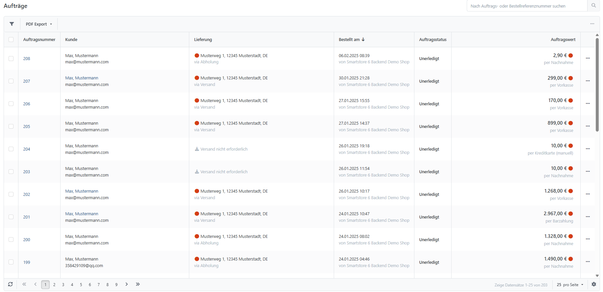
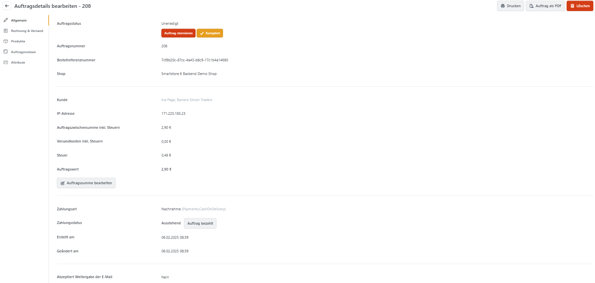
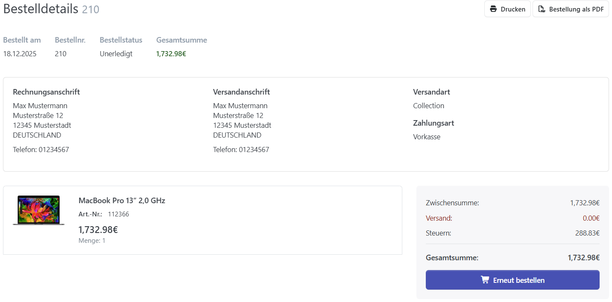

# Aufträge verwalten

Öffnen Sie zur Auftragsverwaltung im Administrationsbereich **Verkauf > Aufträge**. In den Auftragsdetails prüfen Sie die bestellten Produkte, Zahlung und Versand und bearbeiten den Auftrag bei Bedarf nach.

Aufträge können Sie drucken und bei aktivierter PDF-Ausgabe einzeln oder gesammelt als PDF ausgeben. Weitere Datenexporte richten Sie über [Exportprofile](../../benutzer-handbuch/datenaustausch/export/exportprofile-verwalten.md) ein; das Ausgabeformat hängt vom verwendeten Export-Plugin ab.

## Ansicht Auftragsdetails

Auftragsstatus, Zahlungsstatus und Lieferstatus beschreiben unterschiedliche Teile der Bearbeitung. Die verfügbaren Aktionen richten sich nach dem aktuellen Zustand des Auftrags und den Funktionen der verwendeten Zahlungsart. Häufig benötigte Status- und Zahlungsaktionen stehen auch für mehrere ausgewählte Aufträge in der Auftragsübersicht bereit.

### Allgemein

Hier sehen Sie die grundlegenden Auftragsdaten, die Zusammensetzung des Auftragswerts und die Zahlungsinformationen.

#### Auftrag abschließen oder stornieren 

Der Auftragsstatus wird beim Bearbeiten von Zahlung und Versand automatisch aktualisiert. Ein bezahlter Auftrag erreicht den Status **Komplett**, sobald er als geliefert gilt oder keinen Versand benötigt.

Mit **Auftrag stornieren** setzen Sie den Auftragsstatus auf **Abgebrochen**. Dabei werden die bestellten Mengen wieder dem Lagerbestand gutgeschrieben und gegebenenfalls zugehörige wiederkehrende Zahlungen beendet. Die Auftragsstornierung löst keine Erstattung beim Zahlungsanbieter aus. Eine bereits erhaltene Zahlung müssen Sie gesondert erstatten.


**„Komplett“ schließt mehrere Bearbeitungsschritte ab.**

Die Aktion setzt einen noch nicht bezahlten Auftrag, soweit sein Zahlungsstatus dies zulässt, auf bezahlt und einen versandpflichtigen Auftrag auf geliefert. Wenn das automatische Buchen beim Auftragsabschluss eingerichtet ist und die Zahlungsart es unterstützt, wird zuvor die reservierte Zahlung eingezogen. Verwenden Sie die Aktion erst, wenn Zahlung und Lieferung tatsächlich entsprechend abgewickelt sind.


#### Auftragssumme bearbeiten 

Über **Auftragssumme bearbeiten** korrigieren Sie die gespeicherten Beträge des Auftrags. Die Felder erscheinen in folgender Reihenfolge:

| **Betrag**                   | **Beschreibung**                                                       |
| ---------------------------- | ---------------------------------------------------------------------- |
| Zwischensumme                | Wert der bestellten Produkte inklusive und zuzüglich Mehrwertsteuer.   |
| Rabatt auf die Zwischensumme | Nachlass auf die Zwischensumme inklusive und zuzüglich Mehrwertsteuer. |
| Versandkosten                | Versandbetrag inklusive und zuzüglich Mehrwertsteuer.                  |
| Zusätzliche Zahlungsgebühren | Gebühren der Zahlungsart inklusive und zuzüglich Mehrwertsteuer.       |
| Steuersätze                  | Aufteilung des Steuerbetrags nach Steuersatz.                          |
| Mehrwertsteuer               | Gesamter Steuerbetrag des Auftrags.                                    |
| Rabatt auf die Auftragssumme | Nachlass auf den Gesamtbetrag.                                         |
| Guthaben                     | Für den Auftrag verwendeter Guthabenbetrag.                            |
| Rundung                      | Betrag, um den der Auftragswert auf- oder abgerundet wird.             |
| Auftragssumme                | Gesamtbetrag des Auftrags.                                             |

Bei gekoppelten Brutto- und Nettofeldern berechnet die Eingabe eines Betrags den zugehörigen Gegenwert. Über das Schloss am Feld können Sie diese Kopplung umschalten, sofern sie angeboten wird. Prüfen Sie vor dem Speichern auch Steuerbetrag und Auftragssumme.


Die Bearbeitung der Auftragssumme ändert die gespeicherten Auftragsbeträge. Sie berechnet nicht die Produktpositionen neu und löst weder eine zusätzliche Abbuchung noch eine Erstattung aus.


#### Zahlung bearbeiten 

Beim Zahlungsstatus stehen abhängig vom Auftrag und Zahlungsanbieter folgende Aktionen bereit:

| **Aktion**               | **Wirkung**                                                                                                                                                        |
| ------------------------ | ------------------------------------------------------------------------------------------------------------------------------------------------------------------ |
| Auftrag bezahlt          | Vermerkt den Zahlungseingang, zum Beispiel nach einer Überweisung. Dabei wird kein Geld eingezogen.                                                                |
| Buchen                   | Zieht eine zuvor reservierte Zahlung über den Zahlungsanbieter ein.                                                                                                |
| Erstattung               | Veranlasst die vollständige Erstattung über den Zahlungsanbieter. Nach einer bereits erfolgten Teilerstattung verwenden Sie für den Restbetrag die Teilerstattung. |
| Erstattung (Offline)     | Vermerkt die vollständige Erstattung, ohne den Zahlungsanbieter zu kontaktieren. Die tatsächliche Rückzahlung führen Sie außerhalb dieser Aktion durch.            |
| Teilerstattung           | Veranlasst die Rückzahlung des eingegebenen Teilbetrags über den Zahlungsanbieter. Der Dialog zeigt den noch erstattbaren Betrag.                                  |
| Teilerstattung (Offline) | Vermerkt den eingegebenen Erstattungsbetrag, ohne eine Rückzahlung beim Zahlungsanbieter auszulösen.                                                               |
| Stornieren               | Hebt eine reservierte, noch nicht gebuchte Zahlung über den Zahlungsanbieter auf.                                                                                  |
| Stornieren (Offline)     | Vermerkt die Stornierung einer reservierten Zahlung, ohne den Zahlungsanbieter zu kontaktieren.                                                                    |

Die Zahlungsaktion **Stornieren** hebt die Reservierung der Zahlung auf. Um auch den Auftrag abzubrechen und die Bestände zurückzubuchen, verwenden Sie gesondert **Auftrag stornieren**. Eine Erstattung ändert ebenfalls nicht die bestellten Mengen oder den Lagerbestand.

### Rechnung & Versand

Hier sehen und bearbeiten Sie die Rechnungs- und Lieferadresse des Auftrags. Außerdem werden Versandart und Lieferstatus angezeigt. Lieferungen und Teillieferungen verwalten Sie im Bereich **Lieferungen**. Weitere Informationen finden Sie unter [Sendungen verwalten](sendungen-verwalten.md).

### Produkte

Hier sehen Sie die bestellten Produkte mit ihren gewählten Attributen, Mengen und Preisen. Vorhandene Retouren und zu den Positionen erzeugte Geschenkgutscheine sind ebenfalls verknüpft.

#### Positionen ändern, hinzufügen oder entfernen 

Über **Bearbeiten** ändern Sie Einzelpreis, Menge, Steuersatz, Rabatt und Gesamtpreis einer Position. Zum Speichern wählen Sie außerdem, welche weiteren Daten angepasst werden sollen:

| **Option**            | **Wirkung**                                                                                                                                                                                                                    |
| --------------------- | ------------------------------------------------------------------------------------------------------------------------------------------------------------------------------------------------------------------------------ |
| Lagerbestand anpassen | Bucht die Mengenänderung im Lagerbestand. Bei einer Erhöhung der bestellten Menge wird Bestand abgezogen, bei einer Verringerung oder dem Löschen der Position wird er zurückgebucht. Die Option ist voreingestellt aktiviert. |
| Bonuspunkte abziehen  | Zieht für die Bestellung gewährte Bonuspunkte bei einer Mengenverringerung anteilig ab. Die Option erscheint bei Aufträgen nach dem Status Unerledigt, wenn bereits Punkte für den Auftrag vergeben wurden.                    |
| Summen anpassen       | Passt die Positions- und Auftragssummen anhand der Änderung an. Diese Option steht nur bei Aufträgen im Status Unerledigt zur Verfügung und ist dann voreingestellt aktiviert.                                                 |

Die Summenanpassung berücksichtigt die Änderung der Position. Sie berechnet den Auftrag nicht vollständig nach den aktuellen Rabatt- und Versandregeln neu. Prüfen Sie deshalb die resultierenden Beträge.

Mit **Produkt hinzufügen** ergänzen Sie eine Position. Wählen Sie das Produkt und gegebenenfalls seine Attribute aus und prüfen Sie Menge, Steuersatz sowie Einzel- und Gesamtpreis. Bei Geschenkgutscheinen erfassen Sie zusätzlich die Empfänger- und Absenderdaten. Auch hier wählen Sie, ob Lagerbestand und, bei unerledigten Aufträgen, Summen angepasst werden sollen.

Ein Produkt-Bundle kann nicht nachträglich hinzugefügt werden. Bei einem Gruppenprodukt wählen Sie eines seiner zugeordneten Produkte. Positionen mit bereits zugeordneten Geschenkgutscheinen lassen sich nicht löschen.


Bei Änderungen an bereits bearbeiteten Aufträgen bleiben die Auftragssummen ohne gesonderte Korrektur unverändert. Prüfen Sie sie unter **Allgemein**. Das Ändern oder Entfernen einer Position löst keine Erstattung aus.


#### Retouren und Downloads 

Über **Retoure erstellen** legen Sie für eine geeignete Position einen Retourenfall an. Die weitere Bearbeitung beschreibt [Retourenwünsche verwalten](retourenwunsche-verwalten.md).

Bei herunterladbaren Produkten können Sie den Downloadzähler zurücksetzen. Ist die Downloadfreigabe am Produkt auf manuell eingestellt, können Sie den Download hier aktivieren oder deaktivieren. Zusätzlich lässt sich eine Lizenzdatei für die bestellte Position hochladen.

### Auftragsnotizen

Auftragsnotizen dokumentieren einzelne Schritte des Bestellvorgangs, beispielsweise Auftragseingang, Zahlungsereignisse oder Versandzeitpunkt. Über **Notiz zum Auftrag hinzufügen** ergänzen Sie eigene Informationen.

Aktivieren Sie **Für den Benutzer sichtbar**, wenn der Kunde die Notiz in den Auftragsdetails seines Kontos sehen soll. Für eine solche Notiz wird außerdem eine Kundenbenachrichtigung angestoßen, sofern die entsprechende Nachrichtenvorlage aktiv ist. Ohne diese Option bleibt die Notiz intern.

### Attribute

Hier werden zusätzliche technische Auftragsdaten als Schlüssel-Wert-Paare gespeichert. Sie können Einträge hinzufügen, bearbeiten und löschen. Die Daten werden vor allem von Plugins und individuellen Erweiterungen verwendet. Änderungen sollten Sie mit dem zuständigen Entwickler abstimmen.

### Plugin-Funktionen 

Installierte Plugins können zusätzliche Bereiche und Aktionen in den Auftragsdetails bereitstellen. Auch die verfügbaren Zahlungsaktionen hängen vom jeweiligen Zahlungs-Plugin ab. Informationen dazu finden Sie unter [Zahlungsanbieter und Zahlungsarten](../../benutzer-handbuch/plugins/paymentproviders.md).

Wenn die verwendete Zahlungsart die Speicherung von Karten- oder Lastschriftdaten vorsieht, können unter **Allgemein** entsprechende Bearbeitungsfelder erscheinen. Diese ändern die im Auftrag gespeicherten Daten und übertragen keine Änderung an den Zahlungsanbieter.

## Die Kundenansicht

Kunden finden ihre Bestellungen unter **Mein Konto > Bestellungen**. Dort sehen sie Auftrags-, Zahlungs- und Lieferstatus sowie die bestellten Produkte, Adressen, Sendungen und die für sie freigegebenen Auftragsnotizen. Die Auftragsdetails lassen sich drucken und, bei aktivierter PDF-Ausgabe, als PDF herunterladen.

Mit **Erneut bestellen** werden die Produkte der früheren Bestellung wieder in den Warenkorb gelegt, soweit sie noch bestellbar sind. Es entsteht dadurch noch kein neuer Auftrag; der Kunde durchläuft anschließend den Bestellvorgang. Die Aktion wird angeboten, wenn sie in den Auftrags-Einstellungen aktiviert ist.

Je nach Auftrag können Kunden außerdem eine noch offene Zahlung über **Zahlung veranlassen** fortsetzen oder einen Retourenwunsch einreichen. Die jeweilige Aktion erscheint nur, wenn die Zahlungsart beziehungsweise die Retoureneinstellungen und der Auftragszustand sie zulassen.

## Auftrag löschen 

Beim Löschen wird der Auftrag als gelöscht markiert und aus der regulären Auftragsverwaltung und Kundenansicht ausgeblendet. War er noch nicht storniert, werden die bestellten Mengen zurückgebucht, gewährte Kauf-Bonuspunkte zurückgenommen und zugehörige wiederkehrende Zahlungen beendet. Das Löschen löst keine Rückzahlung beim Zahlungsanbieter aus.
