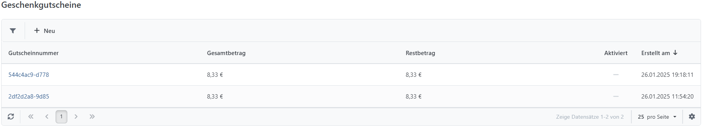
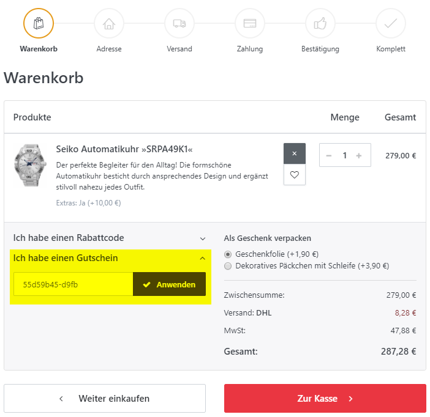

# Geschenkgutscheine verwalten

Geschenkgutscheine schaffen zusätzliche Kaufanreize und erreichen häufig neue Kunden, die den Gutschein als Geschenk erhalten.

## Wie Sie Geschenkgutscheine verwalten

Damit Kunden Geschenkgutscheine kaufen können, legen Sie ein Produkt an und kennzeichnen es in der Registerkarte **Allgemein** als Geschenkgutschein. Wählen Sie den Typ **Physisch** oder **Virtuell**. Bei virtuellen Gutscheinen geben Kunden zusätzlich zu den Namen auch die E-Mail-Adressen von Absender und Empfänger an. Eine persönliche Nachricht ist optional. Prüfen Sie bei einem rein elektronischen Gutschein außerdem die Versandeinstellung des Produkts: Der Gutscheintyp allein schaltet den Versand nicht ab.

Beim Kauf erstellt Smartstore für jedes gekaufte Stück einen eigenen Gutschein mit einem generierten Code. Alle Gutscheine finden Sie unter **Verkauf > Geschenkgutscheine**. Dort können Sie nach dem Code und dem Aktivierungsstatus filtern. Sie können auch direkt einen Gutschein anlegen, ohne dass dafür eine Bestellung vorliegen muss.

Öffnen Sie einen Gutschein, um seinen Typ, Betrag und Aktivierungsstatus zu bearbeiten. Der Betrag wird in der primären Shopwährung geführt; das Restguthaben ergibt sich aus diesem Betrag abzüglich der bisherigen Einlösungen. Bei gekauften Gutscheinen führt ein Verweis zum zugehörigen Auftrag. Sie können einen Gutscheincode eingeben oder generieren lassen und die Angaben zu Empfänger, Absender und Nachricht ergänzen.

Ein Gutschein lässt sich erst einlösen, wenn er aktiviert ist. Sie können ihn einzeln aktivieren oder für gekaufte Gutscheine unter **Konfiguration > Einstellungen > Auftrags-Einstellungen** festlegen, bei welchem Auftragsstatus die automatische Aktivierung erfolgen soll. Ebenso lässt sich ein Status für die automatische Deaktivierung auswählen. Diese Automatik ist an den zugehörigen Auftrag gebunden; direkt angelegte Gutscheine aktivieren Sie selbst.

## Wie Ihre Kunden Geschenkgutscheine einsetzen können

Bei der automatischen Aktivierung eines virtuellen Gutscheins erstellt Smartstore eine E-Mail an den Empfänger, sofern die E-Mail-Adressen von Empfänger und Absender hinterlegt sind. Ein zusätzlicher manueller Versand ist dann normalerweise nicht erforderlich. Das bloße Aktivieren eines Gutscheins in seiner Bearbeitungsmaske löst dagegen keine Benachrichtigung aus.

Für den manuellen Versand speichern Sie zunächst den Gutschein einschließlich aller Änderungen. Öffnen Sie anschließend **Empfänger benachrichtigen**, wählen Sie die Sprache und senden Sie die Nachricht. Dafür müssen gültige E-Mail-Adressen von Empfänger und Absender gespeichert sein. Die Benachrichtigung übermittelt den Gutscheincode, aktiviert den Gutschein aber nicht.

Kunden geben den Code in der Warenkorbübersicht ein. Das verfügbare Guthaben wird bis zur Höhe der Auftragssumme angerechnet. Ein verbleibendes Restguthaben kann für spätere Einkäufe verwendet werden; auch mehrere Gutscheine lassen sich kombinieren. Die Verwendungshistorie des Gutscheins zeigt für jede Einlösung den verwendeten Betrag, das Datum und den zugehörigen Auftrag.

Für die Einlösung gelten folgende Bedingungen:

* Gutscheine müssen aktiviert sein und noch Guthaben besitzen.
* Gekaufte Gutscheine können nur in dem Shop eingelöst werden, in dem sie gekauft wurden.
* Für Warenkörbe mit wiederkehrenden Produkten ist die Einlösung nicht möglich.
* Ein Code kann nicht gleichzeitig in den Warenkörben verschiedener Kunden verwendet werden.

