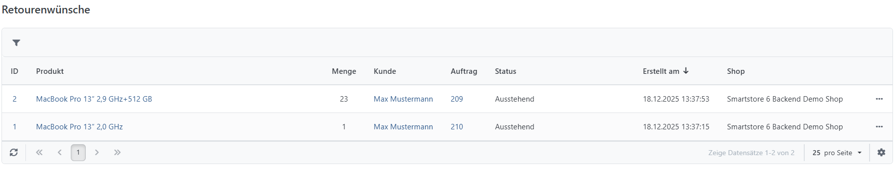
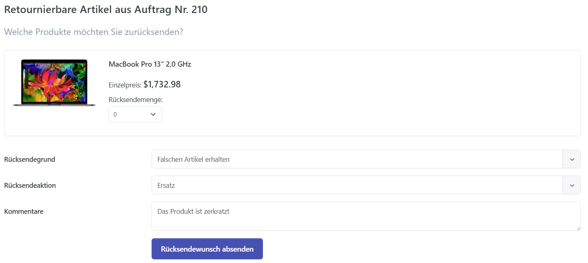
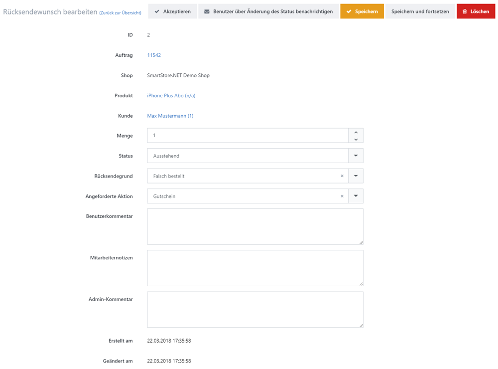

# Retourenwünsche verwalten

Kunden können über ihr Kundenkonto einen Retourenwunsch einreichen, beispielsweise bei einem Defekt, einer abweichenden Erwartung oder einem falsch gewählten Produktattribut. Die verfügbaren Retourenoptionen konfigurieren Sie unter **Konfiguration > Einstellungen > Aufträge** auf der Registerkarte **Retouren**. Eingereichte Fälle verwalten Sie über **Verkauf > Widerrufe und Retouren**.

Die Übersicht lässt sich nach Fallart, Status, Abschlusskennzeichen, Abschluss- und Erstellungszeitraum sowie Auftragsnummer, Kundenname und E-Mail-Adresse filtern. Bei mehreren Shops steht zusätzlich ein Shopfilter bereit. Über die direkte Nummernsuche öffnen Sie einen bekannten Fall.

## Die Kundendetailansicht

Kunden können einen Retourenantrag stellen, wenn **Retourenanträge aktiviert** ist und der zugehörige Auftrag den Status **Komplett** hat. Zusätzlich gilt der konfigurierte **Erlaubte Zeitraum für Retourenanträge (in Tagen)**. Smartstore berechnet diesen Zeitraum derzeit ab der Erstellung des Auftrags; 0 bedeutet unbegrenzt.

Über **Mein Konto > Bestellungen > Artikel zurücksenden** öffnen Kunden das Formular. Sie wählen die gesamte Bestellung oder einzelne Artikel mit der gewünschten Rücksendemenge. Bereits erfasste Retouren- und Widerrufsmengen werden bei der verfügbaren Menge berücksichtigt.

Anschließend wählen sie **Rücksendegrund** und **Rücksendeaktion** und können **Kommentare** ergänzen. Die angebotenen Gründe und Aktionen legen Sie in den Retoureneinstellungen fest, bei Bedarf je Sprache. Reparatur, Ersatz oder Gutschein sind mögliche Einträge und keine fest vorgegebenen Funktionen.

Mit **Retourenantrag absenden** wird für jede ausgewählte Bestellposition ein eigener Fall angelegt. Der Shopbetreiber erhält eine Benachrichtigung, sofern die entsprechende Nachrichtenvorlage aktiv ist. Im Kundenkonto unter **Widerrufe und Retouren** können Kunden den Status, das Abschlusskennzeichen und den nächsten Bearbeitungsschritt verfolgen.

## Die Administratoren-Detailansicht

Öffnen Sie einen Fall über seine Nummer. Die Detailansicht verknüpft Auftrag, Kunde, Produkt und vorhandene Lieferungen. Bei einer Retoure bearbeiten Sie unter **Allgemein** die folgenden Angaben:

Mit **Abgeschlossen** kennzeichnen Sie den Fall als erledigt. Über **Status** dokumentieren Sie den Bearbeitungsstand, beispielsweise **Ware erhalten** oder **Rücksendung genehmigt**. Darunter zeigt **Nächster Schritt** den zum Status gehörenden Hinweis. **Maximaler Erstattungsbetrag** ist eine berechnete Orientierung aus dem gespeicherten Brutto-Einzelpreis und der Retourenmenge; die Anzeige führt keine Erstattung aus.

Danach folgen **Menge**, **Rücksendegrund** und **Angeforderte Aktion**. Bei direkt eingereichten Retourenanträgen können Sie außerdem den **Benutzerkommentar** bearbeiten. **Mitarbeiternotizen** können in Nachrichtenvorlagen verwendet werden. Für ausschließlich interne Informationen nutzen Sie den **Admin-Kommentar**.

### Retoure akzeptieren

Für Fälle im Status **Ausstehend** oder **Ware erhalten** steht **Akzeptieren** zur Verfügung. Prüfen und speichern Sie zuvor die Retourenmenge. Im Bestätigungsdialog wählen Sie, ob Smartstore den **Lagerbestand anpassen** und gegebenenfalls **Bonuspunkte abziehen** soll. Die Bestandsanpassung ist voreingestellt aktiviert; verwenden Sie sie nur, wenn die Ware wieder zum Bestand gehören soll.

**Summen anpassen** wird nur bei einem noch unerledigten Auftrag angeboten. Bei abgeschlossenen Aufträgen bleiben die gespeicherte Bestellmenge und die Auftragssumme durch das Akzeptieren unverändert. Die Aktion setzt den Retourenstatus auf **Rücksendung genehmigt** und führt die gewählten Anpassungen aus.


Eine manuelle Auswahl von **Rücksendung genehmigt** im Feld **Status** ersetzt die Aktion **Akzeptieren** nicht: Sie bucht weder Lagerbestand noch Bonuspunkte. Auch **Akzeptieren**, die Auswahl einer Rücksendeaktion und der Status **Artikel gutgeschrieben** lösen in der Grundfunktion keine Auszahlung, Ersatzlieferung oder Gutscheinerstellung aus.


Eine erforderliche Rückzahlung bearbeiten Sie gesondert am Auftrag. Weitere Informationen finden Sie unter [Aufträge verwalten](auftrage-verwalten.md).

### Abschluss und Benachrichtigung

Beim Wechsel von einem laufenden Status zu **Artikel repariert**, **Artikel gutgeschrieben**, **Antrag abgewiesen** oder **Abgebrochen** setzt Smartstore das Abschlusskennzeichen automatisch. Sie können **Abgeschlossen** auch manuell ändern. Wenn Sie einen Fall wieder aufnehmen, prüfen Sie Status und Abschlusskennzeichen getrennt; ein Zurücksetzen des Status entfernt das Kennzeichen nicht automatisch.

Speichern Sie Änderungen mit **Speichern und fortsetzen**, bevor Sie **Benutzer über Änderung des Status benachrichtigen** wählen. Diese Aktion verwendet den gespeicherten Stand und stößt die Statusnachricht an, sofern die entsprechende Nachrichtenvorlage aktiv ist. Das normale Speichern versendet diese Nachricht nicht automatisch.

Über **Löschen** entfernen Sie den Fall nach einer Bestätigung. Dadurch werden zuvor ausgeführte Bestands-, Bonuspunkte- oder Zahlungsaktionen nicht rückgängig gemacht.

### Retoure im Administrationsbereich anlegen

Sie können eine Retoure auch selbst unter **Verkauf > Aufträge > Auftrag > Produkte** über **Retoure erstellen** an der betreffenden Position anlegen. Die neue Retoure übernimmt zunächst die gesamte Positionsmenge. Prüfen Sie anschließend Menge, Rücksendegrund und angeforderte Aktion.

### Zusätzliche Funktionen durch Plugins

Das kostenpflichtige Enterprise-Plugin [**Withdrawal (Widerruf)**](../../benutzer-handbuch/plugins/withdrawal.md) erfüllt die aktuellen gesetzlichen Anforderungen der EU an die elektronische Widerrufsfunktion und ergänzt den separaten Widerrufsablauf. Eingegangene Widerrufe erscheinen in derselben Übersicht. Mit **Verarbeitung starten** wandeln Sie einen solchen Fall in eine Retoure im Status **Ausstehend** um; danach stehen die normalen Retourenaktionen bereit. Bei zugeordneten Widerrufsdaten zeigt das Plugin außerdem die Registerkarte **Angaben zum Widerruf**. Die Retoureneinstellungen steuern diesen separaten Ablauf nicht. Weitere Informationen finden Sie unter [Widerruf](../../benutzer-handbuch/plugins/withdrawal.md).

Das kostenpflichtige Enterprise-Plugin [**Wallet**](../../benutzer-handbuch/plugins/#wallet-guthabenkonto) kann bei aktivierter Funktion eine zusätzliche Auswahl für die Erstattung auf das Kundenguthaben anbieten. In der Retourenbearbeitung wird der entsprechende Kundenwunsch angezeigt. Diese Funktion gehört nicht zur allgemeinen Auswahl **Rücksendeaktion**.
