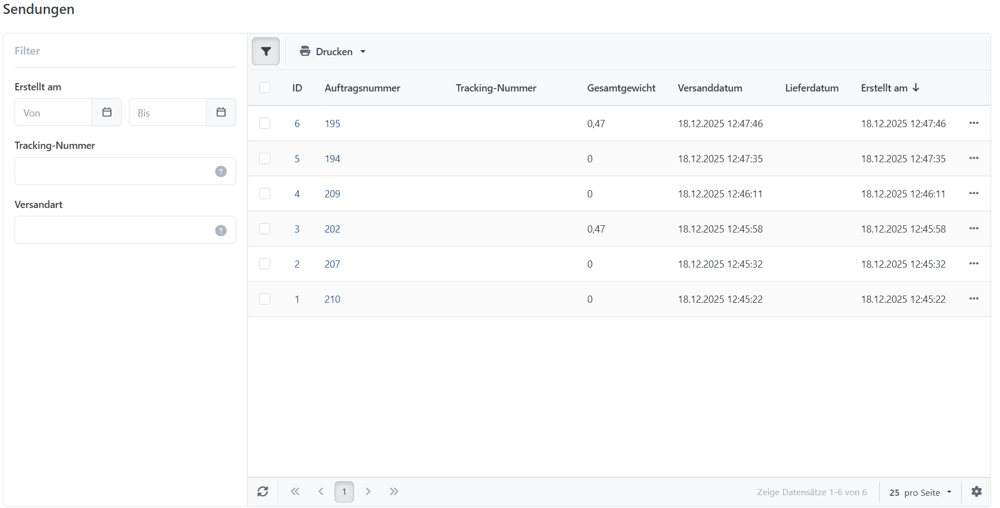
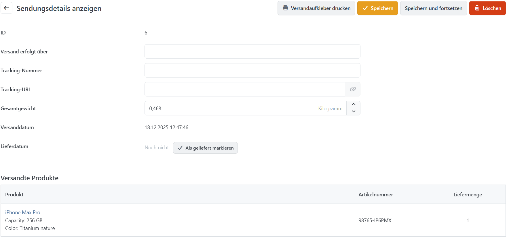

# Sendungen verwalten

Zu einer Bestellung mit versandpflichtigen Produkten können Sie eine oder mehrere Sendungen anlegen. So behalten Sie und Ihre Kunden auch bei Teillieferungen den Versandstatus im Blick. Die zentrale Sendungsverwaltung erreichen Sie über **Verkauf > Sendungen**. Dort suchen Sie nach Erstellungszeitraum, **Tracking-Nummer** oder **Versandart** und öffnen eine Sendung über ihre Nummer.

## Sendung anlegen

Öffnen Sie unter **Verkauf > Aufträge** den gewünschten Auftrag und wechseln Sie zu **Rechnung & Versand**. Im Bereich **Lieferungen** wählen Sie **Sendung hinzufügen**. Die Aktion steht zur Verfügung, solange versandpflichtige Mengen noch keiner Sendung zugeordnet sind.

Tragen Sie bei Bedarf unter **Versand erfolgt über** das Transportunternehmen und unter **Tracking-Nummer** die Sendungsnummer ein. Ob Sie zusätzlich eine **Tracking-URL** hinterlegen müssen, hängt vom verwendeten Versand-Plugin ab; dies wird im Abschnitt **Sendungsverfolgung für Kunden** erläutert. Diese Angaben können Sie auch später in den Sendungsdetails nachtragen.

Unter **Menge zu liefern** legen Sie für jede Position fest, wie viele Einheiten in diese Sendung aufgenommen werden. Voreingestellt ist die noch nicht zugeordnete Menge. Setzen Sie den Wert auf 0, wenn die Position in dieser Sendung nicht enthalten sein soll. Für eine Teillieferung wählen Sie eine kleinere Menge; die übrigen Einheiten können Sie später einer weiteren Sendung zuordnen. Mindestens eine Position muss eine Menge größer als 0 enthalten.

Mit **Speichern** legen Sie die Sendung an und kehren zum Auftrag zurück. Die Sendung gilt dadurch noch nicht als versendet.

## Sendungsdetails

Die Detailansicht zeigt die Produkte und Mengen dieser Sendung. Hier bearbeiten Sie **Versand erfolgt über**, **Tracking-Nummer** und **Tracking-URL**. Die Tracking-URL muss eine vollständige Webadresse sein; über die Schaltfläche daneben können Sie den Link öffnen. Das **Gesamtgewicht** wird beim Anlegen aus den hinterlegten Positionsgewichten berechnet und lässt sich anschließend korrigieren. Speichern Sie Ihre Änderungen, bevor Sie eine Statusaktion ausführen.

### Versand und Lieferung bestätigen

Sobald Sie die Sendung verschickt haben, wählen Sie **Als versendet markieren**. Smartstore trägt den aktuellen Zeitpunkt als **Versanddatum** ein. Sind noch weitere Mengen oder Sendungen des Auftrags offen, wird dessen Lieferstatus entsprechend als teilweise versandt geführt.

Nach dem Versand steht **Als geliefert markieren** zur Verfügung. Diese Aktion setzt das **Lieferdatum** auf den aktuellen Zeitpunkt. Der gesamte Auftrag gilt erst als geliefert, wenn keine weiteren Mengen oder Sendungen mehr ausstehen. Beide Aktionen stoßen eine Kundenbenachrichtigung an, sofern die jeweilige Nachrichtenvorlage aktiv ist.

Mit **Löschen** entfernen Sie die Sendung nach einer Bestätigung. Die Produktmengen einer bereits angelegten Sendung lassen sich in der Detailansicht nicht direkt bearbeiten.

## Versandaufkleber als PDF ausgeben

Bei aktivierter PDF-Ausgabe laden Sie über **Versandaufkleber drucken** in den Sendungsdetails das PDF für diese Sendung herunter. Es enthält die Lieferadresse, Sendungsinformationen sowie die enthaltenen Produkte und Mengen.

In der zentralen Sendungsverwaltung finden Sie unter **Drucken** die Aktionen **Versandaufkleber drucken (ausgewählte)** und **Versandaufkleber drucken (alle)**. Für die erste Aktion markieren Sie die gewünschten Zeilen. Die Ausgabe für alle Sendungen berücksichtigt die Suchfilter der Übersicht nicht. Überschreiten Sie die konfigurierte Höchstzahl für die PDF-Ausgabe, wählen Sie eine kleinere Anzahl von Sendungen aus.

## Sendungsverfolgung für Kunden

Kunden öffnen die Sendungsdetails aus ihrer Bestellung unter **Mein Konto > Bestellungen**. Dort sehen sie Produkte, Mengen sowie Versand- und Lieferdatum. Ist neben der Tracking-Nummer eine Tracking-URL vorhanden, können sie darüber die Sendungsverfolgung aufrufen.

Sie müssen die **Tracking-URL** nicht immer selbst eintragen: Unterstützt das für den Auftrag verwendete und im Shop aktive Versand-Plugin die automatische Sendungsverfolgung, kann Smartstore den Link für die Kundenansicht aus der **Tracking-Nummer** erzeugen. Lassen Sie das URL-Feld dafür leer. Eine von Ihnen eingetragene URL hat Vorrang vor dem automatisch erzeugten Link.

Die mitgelieferten Versandkostenanbieter für Festpreis, Bestellwert und Gewicht erzeugen derzeit keinen Tracking-Link. Wenn Sie einen dieser Anbieter verwenden, hinterlegen Sie für jede Sendung die vollständige **Tracking-URL**, damit Kunden die Sendungsverfolgung über einen Link öffnen können. Ohne URL wird die Tracking-Nummer als Text angezeigt.

Der Eintrag unter **Versand erfolgt über**, beispielsweise DHL, ist nur die Bezeichnung des Transportunternehmens. Er aktiviert keine automatische Link-Erzeugung. Eine zentrale Tracking-URL-Vorlage lässt sich bei den genannten Versandkostenanbietern nicht einstellen.
