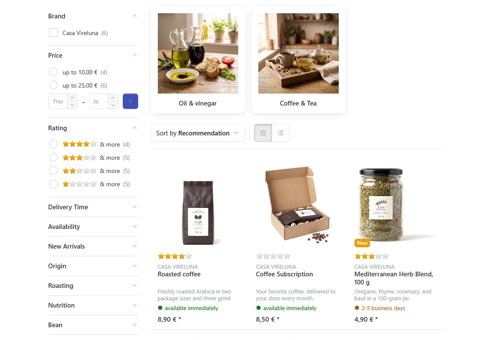
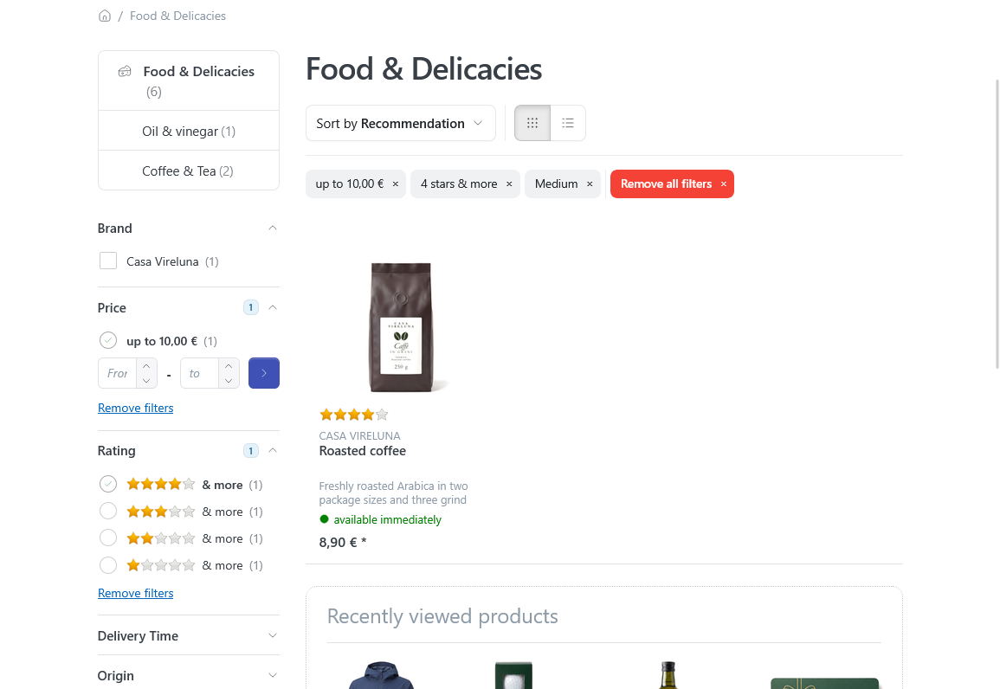
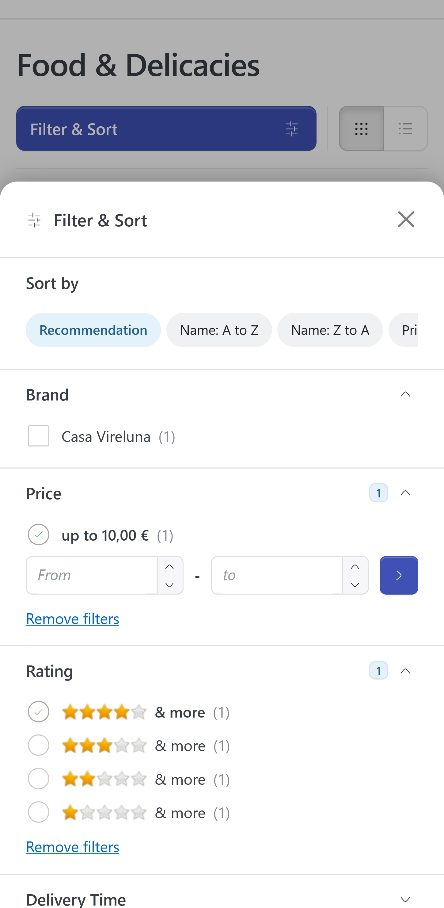

# Filter Sidebar

The storefront search displays products in a results list that customers can narrow down using the filter sidebar. The same sidebar also appears on category and manufacturer pages and in product tag results. Which filter groups and values are available depends on the current product list and the store settings.

## Filtering Products

The sidebar organizes filters into collapsible groups. Depending on the page and the available products, the following groups may appear:

| Filter group | Function |
| --- | --- |
| Category | Select products from one or more categories. This group is not offered on a category page. |
| Brand | Narrow down products by one or more brands. This group is not offered on a manufacturer page. |
| Price | Select a predefined price range or enter a minimum and maximum price. |
| Rating | Show products with at least a selected star rating. |
| Delivery time | Select one or more delivery times. |
| Availability | Include or exclude unavailable products. The effect of the selection depends on the store's default setting. |
| New Arrivals | Show products considered new within the specified period. This group requires a configured period. |

Customers can select multiple values for category, brand, and delivery time. Price and rating allow only one selection each.


Filter values can show the number of matching products. If a group contains many values, a search field appears to help customers find values within that group.


### Removing Active Filters

Selected filters appear above the product list. Customers can remove individual filters or clear all filters there. They can also clear all selections in a group from the sidebar. If a combination of filters returns no products, the active filters remain visible so customers can remove them.

### Mobile View


{% column width="50%" %}
On smaller screens, customers open the sidebar using **Filter &amp; Sort**. The filters then appear in an expandable panel.



<figure><figcaption></figcaption></figure>



## Configuration

Under **Configuration > Settings > Search > Result filtering**, you can set the minimum number of hits required for a filter value and the maximum number of values shown per group. You can disable the **Brand**, **Price**, **Rating**, **Delivery time**, **Availability**, and **New arrivals** groups individually and change their display order.

For more information, see [Search](../../manage/configuration/general-settings-preferences/search.md).


Not every configured group appears in every product list. For example, the price filter is offered only if the customer is allowed to see prices. The **New Arrivals** group requires a period to be set for labeling products as new.


## Extensions

The paid Enterprise plugin [MegaSearch Plus](../../manage/plugins/megasearch.md) adds filters for **product attributes**, such as color or size, and **specification attributes**, such as material. Depending on the attribute, values can appear as a list, color or image swatches, or a numeric range.


MegaSearch Plus requires the [MegaSearch](../../manage/plugins/megasearch.md) plugin.


Whether an attribute appears as a filter depends on the plugin settings, the attribute's filtering settings, and the matching products. For background on product attributes, see [Understanding Product Variants](../../manage/catalog/managing-products/understanding-product-variants.md). [Managing Specification Attributes](../../manage/catalog/managing-specification-attributes.md) covers specification attributes. The interaction between their filtering settings is described in [Faceted Search / Filter](../../manage/configuration/general-settings-preferences/faceted-search-filter.md).
