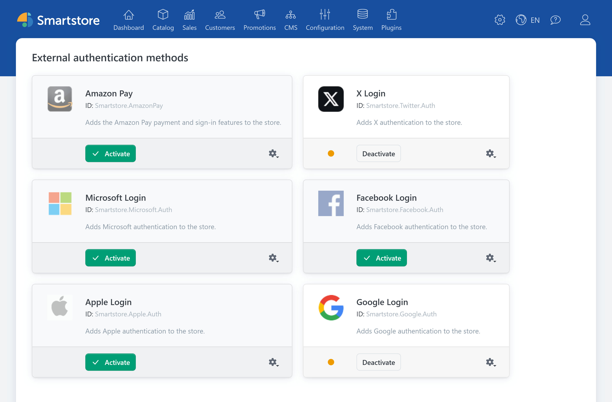
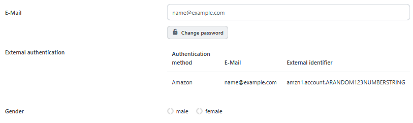

# External authentication methods

Under **Customers > External authentication methods**, you manage the providers customers can use to sign in to the store with an external account. The overview shows the methods registered in your installation. Which providers are available depends on the installed plugins.

For instructions on setting up a provider, entering credentials, and testing sign-in, see [Setting up external authentication](../plugins/external-auth.md).

## Provider overview

Each provider appears as a separate entry with a display name and system ID. A description and activation status are shown when available. Depending on the provider and your access permissions, the following actions are available:

| Action | Function |
| --- | --- |
| **Activate / Deactivate** | Turns the external authentication method on or off. |
| **Configure** | Opens the provider's settings, for example to enter credentials and the redirect URL. |
| **Edit** | Opens a dialog for the display name and description of editable providers. |

A provider must be configured and activated before customers can use its sign-in button. Test sign-in in the store after activation. The [general setup process](../plugins/external-auth.md#general-setup-process) covers both steps.


For editable providers, use the **Edit** dialog to change the display name and description. A drag handle on the provider card indicates that you can change its position in the list.


### Activation

Click **Activate** on the provider's entry after completing its configuration. For an active provider, the button reads **Deactivate**. Deactivating a provider removes its sign-in button from the store. Existing links between external identities and customer accounts remain stored and can be used again after reactivation.


Before permanently deactivating a provider, make sure affected customers have another way to sign in. For more information, see [Customer login behavior](../plugins/external-auth.md#customer-login-behavior).


### Configuration

Select **Configure** from the actions menu to open the settings page of the relevant plugin. Enter the credentials required by the provider and register the redirect URL shown by Smartstore with the provider exactly as displayed. If you operate multiple stores, check the applicable [store settings scope](../configuration/general-settings-preferences/defining-the-scope-of-settings.md) and the corresponding domain.

## Customer account

Open a customer account under **Customers > Customers**. If external sign-ins are linked to the account, the details view shows an **External authentication** section. It displays the authentication method, the email address supplied by the provider, and the external identifier. This section does not offer actions to edit or delete the link.

For the other areas of the details view, see [Managing Customers](managing-customers.md). A matching email address alone does not automatically link an existing customer account to an external sign-in. For more information, see [Customer login behavior](../plugins/external-auth.md#customer-login-behavior).

## Access permissions

Separate access permissions control whether employees can view the provider overview, configure providers, or activate and deactivate methods. Assign these permissions to customer roles. For instructions, see [Controlling Access Permissions](../configuration/controlling-access-permissions.md).

For detailed information about setup, login behavior, and troubleshooting, see [Setting up external authentication](../plugins/external-auth.md).
