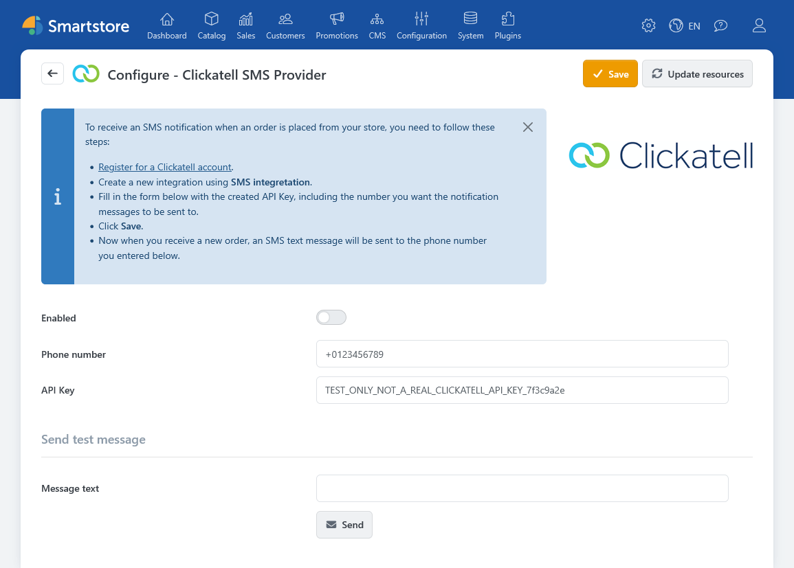

# Clickatell SMS Provider

The **Clickatell SMS Provider** plugin notifies store administrators by SMS when a new order is placed. The automatic message contains the order number. The plugin does not send order SMS messages to customers.

To use the plugin, you need a Clickatell account with an SMS integration and its API key. The Clickatell account may incur charges.

## Configuration

Under **Plugins > Manage Plugins**, open the configuration for **Clickatell SMS Provider**.

| Setting | Description |
|---|---|
| **Enabled** | Sends an SMS when a new order is placed. When this option is disabled, no automatic order SMS is sent. |
| **Phone number** | Recipient of the SMS. Enter the number in international format, for example `+49231987654`. Separate multiple numbers with semicolons. |
| **API Key** | API key for the Clickatell SMS integration. Keep it confidential. |

## Sending a test message

Enter a test message under **Message text** and click **Send**. The plugin uses the saved credentials and recipient numbers for the test, so save the configuration first. Smartstore then displays a success or error message.


**Message text** applies only to the test. The automatic order notification uses a predefined message containing the relevant order number.


## Notifications for new orders

When a new order is placed, the enabled plugin sends a message such as “New order with number … has been placed.” Smartstore also adds an internal note about the SMS to the order.


A success message for the test or an internal order note does not confirm delivery to the recipient's phone. The plugin evaluates the immediate API response but does not check a later delivery status.



**Data transfer:** Smartstore sends the API key, the configured recipient numbers, and the message text to the Clickatell API over HTTPS. The automatic message contains the order number, but no customer name, customer phone number, or shipping address.
