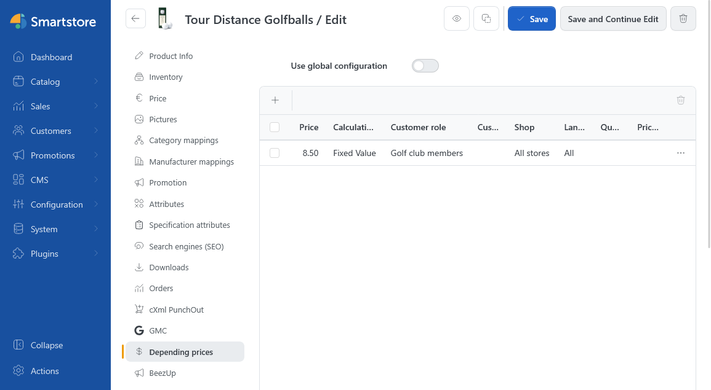
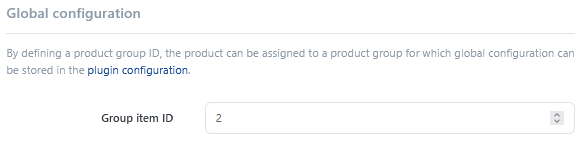
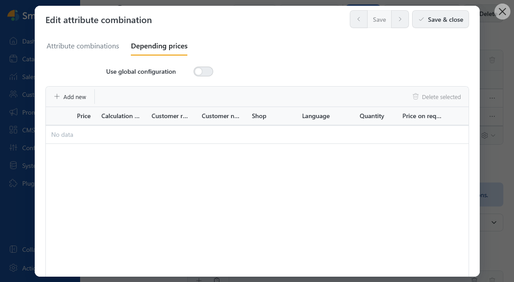
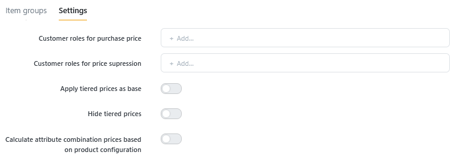

# DependingPrices

> Tailor-made prices

The **DependentPrices** plugin allows you to set different prices for the same product based on criteria such as customer role, individual customers, or stores.

## Understanding price dependencies

Each row in the table defines a price dependency: you set a price or a price change and specify who it applies to and from which quantity. Smartstore selects one matching record for the customer and their order. It does not add multiple records together.

For a single product, maintain the records directly on the product. To use the same prices for several products, assign them a shared **group item ID**. You can also create separate records for attribute combinations.

## Setting a price for a product

1. Open a saved product and switch to **Depending prices**.
2. Leave **Use Global Configuration** disabled if you want to maintain the price directly on this product.
3. Click **New**. Enter the **Price** and **Calculation Method**, then set the conditions you need. The fields are explained below.
4. Apply the table row with **Save Changes**.

### Price and calculation method

In the **Price** field, enter a monetary amount or a percentage, depending on the calculation method. Monetary amounts are entered in the store's base currency.

A **Fixed Value** directly sets the alternative unit price. For an **Adjustment** or a **Percentage Change**, Smartstore normally uses the regular product price as the calculation base. If an attribute combination has its own price, that price is the calculation base. A special price does not replace this base.

| **Calculation method** | **Example with a calculation base of €100** |
| ---------------------- | ------------------------------------------- |
| Fixed Value | A price of 80 sets the unit price to €80. |
| Adjustment | A price of 10 raises the unit price to €110. A price of −10 lowers it to €90. |
| Percentage | A price of 10 lowers the unit price by 10% to €90. A price of −10 raises it by 10% to €110. |

The plugin setting **Use Tier Price as Base** lets you use a calculated positive tier price instead as the calculation base for adjustments and percentage changes.


The sign of an adjustment works differently here than it does for regular tier prices: a positive value raises the price. A price value of 0 is allowed only with **Price on Request**. This also applies to imports and the API.


Enable **Price on Request** if the customer should see a request notice instead of a numeric price.

### Price application and minimum order quantity

Restrict a record only where your use case requires it. An unrestricted field applies to all relevant customers, stores, or languages.

| **Field** | **Description** |
| --------- | ------- |
| Customer role | Select, for example, your retail customer role. The customer must belong to this active group. |
| Customer number | Enter the number from the customer record to set an individual customer price. The precedence rule below applies to directly assigned customer prices. |
| Shop | Select the store where the record should apply. |
| Language | Select the store language where the record should apply. |
| Quantity | Enter the minimum order quantity. A blank value or 0 means there is no quantity restriction. |

Unless a price is assigned directly to a customer number, all specified conditions must match. A retail price for Store A therefore applies only to members of the relevant retail group in Store A once the minimum order quantity has been reached.

### Individual customer prices and multiple customer roles

A directly assigned price with a matching **Customer Number** takes precedence over general prices and customer role prices. The minimum order quantity is checked, but store, language, and customer role do not further restrict this individual customer price.

You can set several quantity tiers for the same customer. If the price is €90 from 1 unit and €75 from 10 units, the €90 price applies to 9 units and the €75 price applies from 10 units.

If a customer belongs to several active customer roles, the prices selected for those groups are compared by their calculated amounts. A matching customer role record with **Price on Request** takes precedence over a numeric customer role price. A directly assigned customer number price still takes precedence.


Create only one record for a given assignment and identical conditions. Duplicate records are not merged, and selection of the lowest final price is not guaranteed for such duplicates.


You can edit existing rows, delete them individually, or select several for deletion. **Cancel** discards table changes that have not yet been saved.

## Shared prices for multiple products

A **group item ID** lets several products share the same price dependencies. The ID is a positive number that you assign. This plugin-specific group is independent of the store's categories and of the grouped product type.

1. Open the plugin configuration and go to **Item Groups**.
2. Create the shared price dependencies and enter the same **Group item ID** for these records.
3. Open the first product. Under **Price Dependencies**, enable **Use Global Configuration** and enter the group item ID.
4. Save the product and assign the other products in the same way.

Global configuration hides the local table on the product. Existing local records remain, however, and may still be considered when a price is selected.

The **Item groups** table also shows directly assigned records. You can assign a record specifically through **Product ID** or **Attribute Combination ID**. The filters help you search by customer number, customer role, language, store, calculation method, product ID, and group item ID.

## Prices for variants

Open the desired **Attribute Combination** and switch to **Price Dependencies**. Use the table as you would on a product; the records here belong to the selected combination.

By default, Smartstore uses the combination's price dependencies when a specific variant is selected. If there is no matching record for the combination, Smartstore does not automatically fall back to price dependencies maintained directly on the product. Assigned group item records may still be considered.

If the product's price dependencies should apply instead, enable **Calculate attribute combination prices based on product configuration** in the plugin settings. This option determines which DependingPrices records are used. For instructions on creating variants, see [Understanding product variants](../catalog/managing-products/understanding-product-variants.md).


Attribute combinations with their own price are supported. Additional surcharges and discounts for individual attribute values are not supported together with DependingPrices.


## Configuration

The plugin configuration contains **Item groups** and **Settings**. If you have multiple stores, first choose the desired scope under Settings.

| **Option** | **Description** |
| ----------- | ---------- |
| Customer roles for purchase price | Uses the purchase price if no DependingPrices record matches and the customer belongs to one of the selected active customer roles. A matching price record takes precedence. A purchase price of 0 is not used. |
| Customer roles for price suppression | Hides the price and purchase actions for the selected customer roles if the display check finds no selected record with a positive price. This controls what is displayed; it does not replace access or purchase permissions. |
| Apply tiered prices as base | Uses a calculated positive tier price as the calculation base for adjustments and percentage changes. This is not limited to tier prices starting at quantity 1. |
| Hide tiered prices | Controls whether tier prices are displayed on product detail pages when alternative prices or selling at purchase price apply. Tier price calculation remains active. |
| Calculate attribute combination prices based on product configuration | Uses the product's DependingPrices records instead of the records for the selected attribute combination. |

## Checking the resulting selling price

The selected price dependency supplies an alternative price. Product discounts and regular tier price calculation may change it afterward. A fixed DependingPrices price is therefore not necessarily the final selling price. [Understanding pricing rules](../catalog/managing-products/understanding-pricing-rules.md) explains how the rules interact, [Setting a product price](../catalog/managing-products/setting-product-price.md) describes how to set up regular prices and tiers.

If direct customer price entry or **Price on Request** is enabled on the product, normal price calculation, including DependingPrices, is skipped. For grouped products, the prices of the linked individual products apply; DependingPrices does not calculate a separate overall bundle price.

After setup, check the price for the relevant customer in the desired store, with the specific selection for variants and the corresponding order quantity for quantity prices. Compare the product list, product detail page, and cart.

## Import & API

CSV processing extends the [product import](../catalog/managing-products/importing-exporting-products.md). Assign each row to the relevant product, for example by its **ID**. Here, the ID identifies the product, not a DependingPrices record. A sample file is linked in the plugin configuration.

A row is processed for DependingPrices if it contains **DP\_Price** or **DP\_CustomerGroupPrices**. The following additional columns are evaluated:

| **Column** | **Description** |
| ---------- | ----------- |
| DP\_Price | Price value for a single record. |
| DP\_CalculationMethod | Fixed, Adjustment, or Percental, with exactly this spelling. |
| DP\_CustomerGroupId, DP\_LanguageId, DP\_StoreId | IDs of the desired customer role, language, and store. Unset restrictions are processed as 0. |
| DP\_CustomerNumber | Customer number for a customer-specific record. |
| DP\_ItemGroupId, DP\_VariantCombinationId | Group item ID and attribute combination ID, respectively. |
| DP\_Quantity | Minimum order quantity for the record. A blank value or 0 means no quantity restriction. Quantity distinguishes price tiers whose other assignment conditions are identical. |
| DP\_PriceOnRequest | `true` enables Price on Request; false disables it. A blank value retains the setting of an existing record. A price value of 0 is allowed only with Price on Request. |
| DP\_CustomerGroupPrices | Several customer role prices in one row, such as `1:90;2:80`. Each entry consists of a customer role ID and a price separated by a colon; entries are separated by semicolons. |
| DP\_Delete | `true` deletes the record found by its assignment conditions. If there is no match, the existing data remains unchanged and no record is created. |

The import finds existing records by product, assignment conditions, and minimum order quantity. You can therefore import several quantity tiers separately when their other conditions are identical. A blank minimum quantity and 0 identify the same unrestricted record. Specify the corresponding minimum quantity when changing or deleting a tier.

With the [Web API](webapi.md) plugin installed and configured, the OData entity **DependingPricesRecords** is also available. It supports: reading, creating, updating, and deleting records, including quantity and Price on Request. Appropriate DependingPrices permissions and authorized API access are required.


