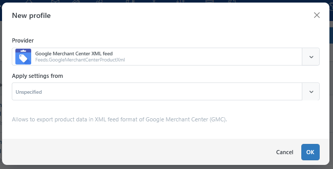
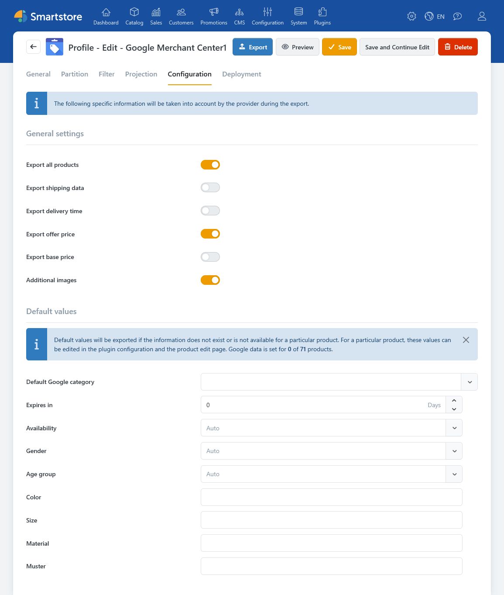
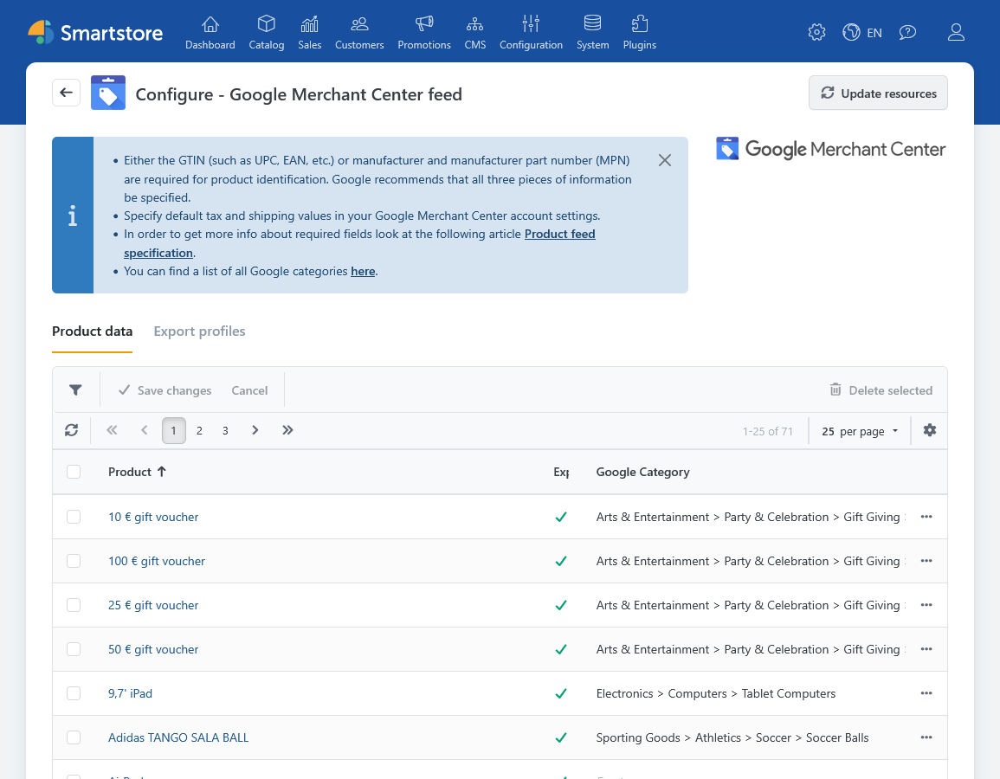
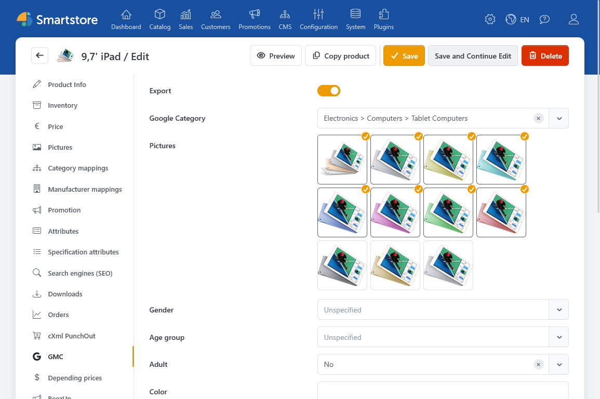
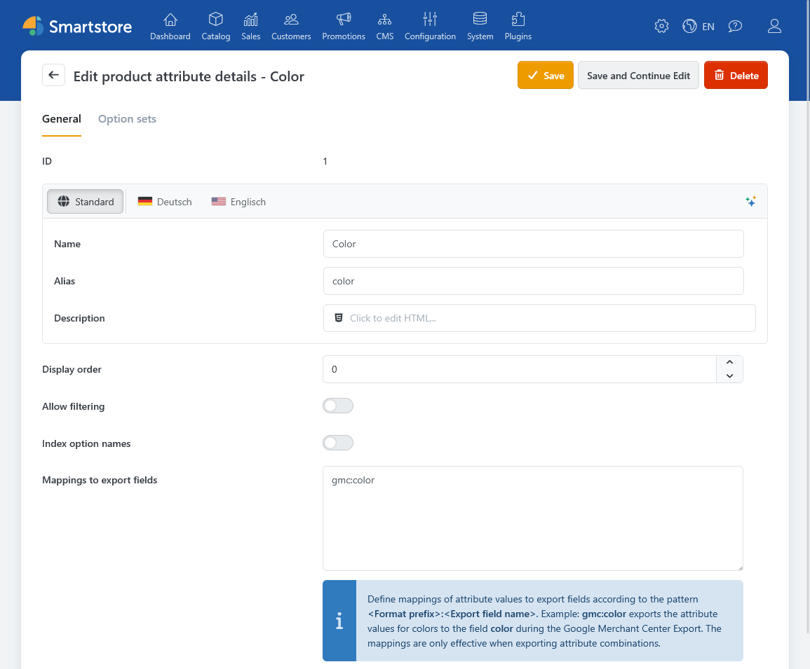

# Google Merchant Center Feed

The **Google Merchant Center Feed** plugin lets you provide your Smartstore products as an XML feed for Google Merchant Center. An export profile determines which products are included, how the feed is configured, and how the file is made available.


For general information, see [Exporting Product Feeds](../catalog/managing-products/exporting-product-feeds.md).


## Requirements

Before your first export, make sure your products have names, descriptions, prices, availability information, and images. For product identification, the feed uses a GTIN or a brand and manufacturer part number (MPN). If the MPN is missing, the plugin can use the SKU instead. Also check that a suitable Google product category is assigned to the products.

The information Google requires depends on the product type and the settings in your Merchant Center account.

## Creating an Export Profile

1. Open **Configuration > Export**.
2. Select **Add New** and choose **Google Merchant Center XML Feed** as the export provider.
3. On the **General**, **Filter**, and **Projection** tabs, configure the store, language, currency, product selection, and handling of attribute combinations as needed.
4. Open **Configuration** to set the GMC-specific options.
5. Save the profile and run an initial test export.

Under **Plugins > Google Merchant Center > Export Profiles**, you can view existing GMC profiles, open them, and start their execution. **Create new profiles in the general export management area.** For details about profile tabs and functions, see [Managing Export Profiles](../data-exchange/managing-export-profiles.md).

## GMC Settings in the Export Profile

The following options are available on the export profile's **Configuration** tab.

| Option                   | Description                                                                                                                                                                                                                                                  |
| ------------------------ | ------------------------------------------------------------------------------------------------------------------------------------------------------------------------------------------------------------------------------------------------------------ |
| **Export all products**  | When enabled, the export generally includes products selected by the profile and its filters. You can exclude individual products with their GMC **Export** setting. When disabled, only products with individually saved and enabled GMC data are included. |
| **Export shipping data** | Adds available weight, dimensions, shipping origin, and handling time information for shippable products.                                                                                                                                                    |
| **Export delivery time** | Exports the Smartstore delivery time as `transit_time_label`. Check whether this field is still useful for your feed before enabling it.                                                                                                                     |
| **Export offer price**   | Exports a valid sale price in addition to the regular price and, where available, the sale period.                                                                                                                                                           |
| **Export base price**    | Adds supported base pricing information when it is available for the product.                                                                                                                                                                                |
| **Additional images**    | Exports additional product images alongside the main image. The feed supports one main image and up to ten additional images.                                                                                                                                |

### Default Values

On the same tab, you can set a **Default Google category** and defaults for availability, gender, age group, color, size, material, and pattern. These values are used when no higher-priority value is available for the product or an exported attribute combination.

Smartstore can determine **availability** automatically from product and stock information. For pre-order products, an availability date can also be exported. The **Expires in** setting controls whether an expiration date is included and, if so, how many days after the export it falls. A value of `0` suppresses this field.

**Not specified** suppresses the corresponding default value. A value supplied by a mapped attribute combination can still take precedence.

### Shipping Origin Country

Set the country under **Configuration > Settings > Shipping > Shipping origin**. If a country is specified and **Export shipping data** is enabled, the feed can include its two-letter country code as `ships_from_country`. If the country is missing, only this feed field is omitted; other available shipping information can still be exported. In a multi-store setup, check which store-specific setting applies.

For more information about the address, see [Shipping Settings](../configuration/general-settings-and-preferences/shipping-settings.md).

## Maintaining GMC Data for Products

You can edit product-specific information in the plugin's product list or on the **GMC** tab in the product editor.

In the product list, you can filter by product name, SKU, and whether GMC data exists. Use the grid configuration to show additional fields and edit the required information directly in the table. **Delete selected** removes the GMC-specific settings of the selected products, not the products themselves.

| Option                                                | Description                                                       |
| ----------------------------------------------------- | ----------------------------------------------------------------- |
| **Export**                                            | Include or exclude the product from the feed.                     |
| **Google category**                                   | Use a product-specific category instead of the profile default.   |
| **Images**                                            | Select the product images to export.                              |
| **Gender, age group, color, size, material, pattern** | Set product-specific characteristics.                             |
| **Adult, multipack, bundle**                          | Set additional Google product attributes.                         |
| **Energy efficiency**                                 | Set the energy efficiency class from A to G.                      |
| **Labels 0–4**                                        | Set custom grouping values, for example for campaigns or seasons. |

A product-specific Google category takes precedence over the profile's default category. If neither is set, the export can continue but logs the missing category. Check the export log even when an XML file has been created.

If you select images for GMC on a product, the export uses only those images. If none are selected, it uses suitable product images in their normal order. The first image is exported as `image_link`; additional images are exported as `additional_image_link` when the profile option is enabled.

## Mapping Attributes and Variants

For exported attribute combinations, the plugin can take values such as color or size from product attributes. Open **Catalog > Product Attributes**, edit the central attribute, and enter one mapping per line under **Mappings to export fields**.

The mapping is maintained on the **central product attribute** and applies when the export profile outputs attribute combinations as individual products. The feed then uses the respective, potentially translated attribute value of each combination.

The following mappings are supported:

| Entry           | Meaning                                   |
| --------------- | ----------------------------------------- |
| `gmc:gender`    | Gender for which the variant is intended. |
| `gmc:age_group` | Age group of the variant.                 |
| `gmc:color`     | Color of the variant.                     |
| `gmc:size`      | Size of the variant.                      |
| `gmc:material`  | Material of the variant.                  |
| `gmc:pattern`   | Pattern or design of the variant.         |

For more information about product attributes and combinations, see [Understanding Product Variants](../catalog/managing-products/understanding-product-variants.md).

## Checking and Providing the Feed

1. Under **Configuration > Export**, select **Run Now** for the profile.
2. Check the generated XML file and the **Activity Log**.
3. Review a sample of products for category, price, availability, product URL, images, and identification data.
4. Open **Deployment** in the profile and check the **Public folder** destination. After the first export, you can enter the displayed feed URL in Google Merchant Center.
5. Schedule regular exports if you need to keep the file up to date.

Saving an export profile does not by itself create an up-to-date feed file. For deployment options, see [Managing Export Profiles](../data-exchange/managing-export-profiles.md). For recurring exports, see [Managing Scheduled Tasks](../system-and-maintenance/managing-scheduled-tasks.md).

### If Products or Data Are Missing

First check the profile's product filters and **Export all products** setting. Then check the product's **Export** setting, its Google category, and the Activity Log. For variants, also check whether attribute combinations are exported as products and whether the product attributes are mapped. Trace missing images, prices, or shipping information back to the relevant product and store settings.

## Further Information

* [Exporting Product Feeds](../catalog/managing-products/exporting-product-feeds.md)
* [Managing Export Profiles](../data-exchange/managing-export-profiles.md)
* [Understanding Product Variants](../catalog/managing-products/understanding-product-variants.md)
* [Shipping Settings](../configuration/general-settings-and-preferences/shipping-settings.md)
* [Managing Scheduled Tasks](../system-and-maintenance/managing-scheduled-tasks.md)
