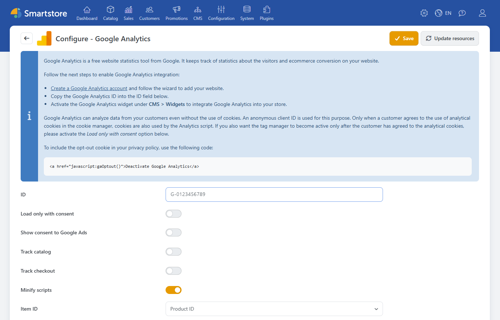

# Google Analytics

The **Google Analytics** plugin connects your Smartstore shop to Google Analytics and provides insights into visitor behavior. Depending on its configuration, the plugin transmits page views and selected events from the product catalog, shopping cart, and checkout so that you can analyze store usage and purchasing behavior in Google Analytics.


The plugin transmits the events enabled in Smartstore. You define how Google Analytics presents this information and how long it is retained in your Google Analytics account.


## Requirements

- a Google Analytics account
- a configured Google Analytics property with a web data stream
- the corresponding measurement ID
- access to the Smartstore administration area

## Configuration

Under **Plugins > Manage Plugins**, open the configuration for the **Google Analytics** plugin. Here you enter the measurement ID, select the required tracking areas, and configure the cookie and consent settings.



| Setting | Description |
|---|---|
| **ID** | Measurement ID of the web data stream in your Google Analytics property, for example `G-0123456789`. |
| **Load only with consent** | The Analytics script is loaded only after the visitor has consented to analytical cookies. For more information, see [Privacy, cookies, and opt-out](#privacy-cookies-and-opt-out). |
| **Show consent to Google Ads** | Adds consent choices for advertising-related data and personalized advertising to the [Cookie Manager](../configuration/cookie-manager.md). Enable this option only if you use Google Ads. |
| **Track catalog** | Tracks supported views and interactions in the product catalog, such as product detail pages, product lists, search queries, product selection, and adding a product to the shopping cart. |
| **Track checkout** | Tracks supported events from the shopping cart and order process, such as viewing the shopping cart, beginning checkout, selecting shipping and payment information, and successfully completing a purchase. |
| **Minify scripts** | Reduces the size of the generated tracking scripts. This option should normally remain enabled. |
| **Item ID** | Determines which identifier is sent to Google Analytics for products. For more information, see [Selecting the item ID](#selecting-the-item-id). |


You can store the settings separately for each store by using the settings scope. For more information, see [Multi-Store Configuration](../configuration/general-settings-preferences/defining-the-scope-of-settings.md).


Below the settings are three input fields containing the tracking code fragments used by the plugin. You do not need to edit these default values for a standard setup. If the ecommerce code still refers to the outdated `analytics.js` script, Smartstore displays a warning at the top of the configuration page. Use **Restore scripts** to restore the current default values in all three code fields, overwriting any custom changes in them.

### Connecting Google Analytics

1. Create a property for your store in Google Analytics.
2. Configure a web data stream for the website.
3. Copy the corresponding measurement ID.
4. Return to the Smartstore administration area and open the **Google Analytics** plugin configuration under **Plugins > Manage Plugins**.
5. Enter the measurement ID in the **ID** field.
6. Enable [**Track catalog** and **Track checkout**](#configuration) as required.
7. Configure the required cookie and consent settings.
8. Click **Save**.

Then activate the **Google Analytics** widget under **CMS > Widgets** so that the plugin can add its tracking scripts to the storefront. For more information, see [Arranging Widgets](../content-management/arranging-widgets.md).


The value `UA-0000000-0`, which is entered during installation, is treated as an unconfigured measurement ID. The plugin does not add tracking while the field is empty or this default value is still in use.


### Selecting the item ID

The **Item ID** setting determines how products are identified in Google Analytics.

| Selection | Usage |
|---|---|
| **SKU** | Uses the SKU of the product or selected variant. |
| **Product ID** | Uses the internal Smartstore product ID. |
| **Product ID with variant ID** | Combines the product ID with the ID of the selected variant. |

If you use Google Ads or a Google Merchant Center feed, the selected item ID should match the product identifier used there.


Do not change the item ID without a specific reason. After a change, products may appear under a new identifier in Google Analytics, separating statistics that belong together.


## Privacy, cookies, and opt-out

Google Analytics processes the page view and enabled store event information transmitted by the plugin. Inform visitors about your use of Google Analytics and the associated data processing in your store's privacy information.

With **Load only with consent**, the Analytics script is loaded only after the visitor has consented to analytical cookies. If you also use Google Ads, enable **Show consent to Google Ads** to add choices for advertising-related data and personalized advertising to the [Cookie Manager](../configuration/cookie-manager.md).

The plugin provides an opt-out function for visitors who want to disable Google Analytics tracking. For example, add the following link to your store's privacy page:

```html
<a href="javascript:gaOptout()">Deactivate Google Analytics</a>
```

After the visitor selects the link, the browser stores the opt-out for the configured measurement ID. For information about adding the link to a content page, see [Managing Pages and Topics](../content-management/managing-pages-topics.md). Also review the data retention, consent settings, and other privacy options directly in your Google account.

## Further information

- [Arranging Widgets](../content-management/arranging-widgets.md)
- [Cookie Manager](../configuration/cookie-manager.md)
- [Multi-Store Configuration](../configuration/general-settings-preferences/defining-the-scope-of-settings.md)
