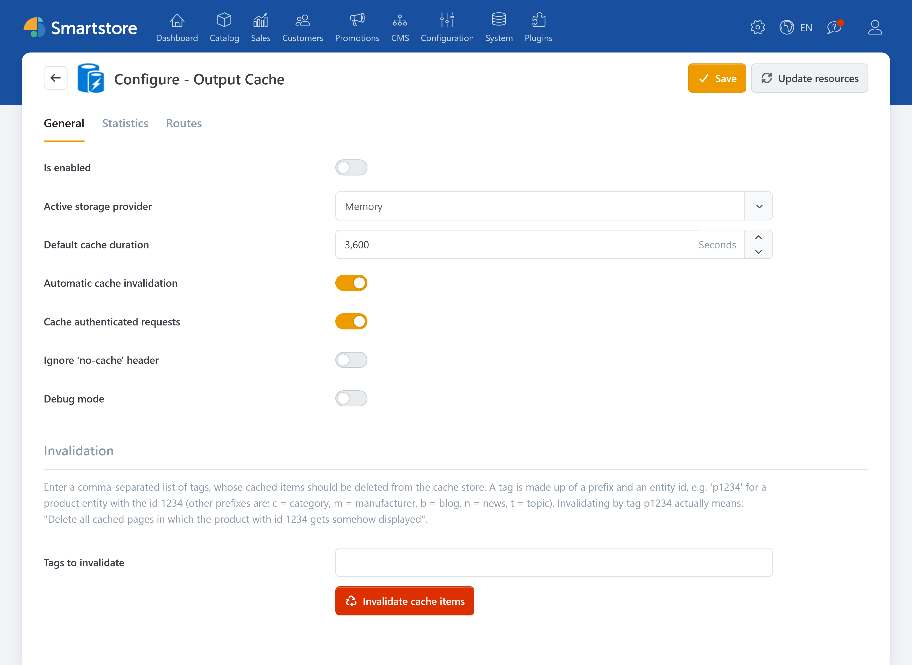
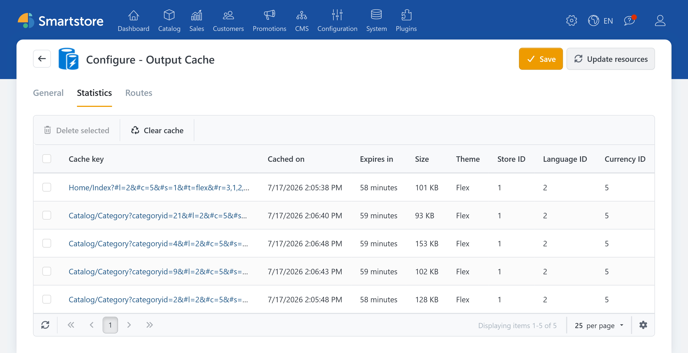

# Output Cache

> Fast pages, fresh content

**Output Cache** stores the generated output of selected storefront pages on the server. For matching requests, Smartstore can reuse cached page content instead of generating it again. Dynamic parts, such as customer-specific components, are generated for each request when needed. This can reduce processing time and speed up page delivery, especially for busy category and overview pages.

Automatic invalidation can remove cached pages when relevant store content changes. The page is generated again and cached on the next matching request.

## Benefits

### Faster page load times

Frequently visited pages do not have to be rebuilt from scratch on every request. This can noticeably reduce waiting times on busy pages.

### Less load on the system

Smartstore has to do less computation because the ready-made page content can be reused. That means fewer repeated processing steps for every request and the shop runs smoother overall.

### More stable user experience during high traffic

When many visitors use the store at the same time, some pages may load more slowly because requests have to be processed in parallel. After the first request, cached page content can be reused for subsequent matching requests, reducing the load during busy periods.

### Control over how long content is kept

You can set how long a page remains in the cache before it’s regenerated. This determines how strongly “speed” is prioritized over “maximum freshness.” Short cache durations keep content more current, while longer cache durations improve performance.

## Configuration

| **Option**                               | **Description**                                                                                                                                                                                                                          |
| ---------------------------------------- | ---------------------------------------------------------------------------------------------------------------------------------------------------------------------------------------------------------------------------------------- |
| Is active                                | Determines whether output caching is active.                                                                                                                                                                                             |
| Active storage provider                  | Determines where cached content is stored. Local storage is fast but is not suitable for web farms. In a web farm, use a database or a distributed storage provider such as Redis.                                                       |
| Default cache duration                   | Sets the duration in seconds that pages should be cached on the server by default.                                                                                                                                                       |
| Automatically invalidate pages           | Determines whether cached pages are automatically invalidated when at least one dependency changes. Dependencies include products, categories, and blog posts.                                                                           |
| Allow caching for authenticated requests | Determines whether caching is active even when the customer is logged in. However, note that variation occurs only by customer roles, not by individual customers. Disable this option if your shop generates customer-specific content. |
| Ignore 'no-cache' headers                | Determines whether Smartstore ignores the request header `Cache-Control: no-cache` and serves existing cache entries anyway.                                                                                                             |
| Debug mode                               | Adds the response headers `X-SmartStore-Cached-On` and `X-SmartStore-Cached-Until`.                                                                                                                                                      |

### Invalidation

Tags identify content shown on cached pages. If a product still appears with outdated details after a change, you can use the entity's tag to remove the affected cache entries. For example, the tag for a product with ID 1234 is `p1234`.


**Attention**

Only experienced users should change routes or invalidate cache entries.


On the General tab, enter one or more comma-separated tags and click **Invalidate cache items**. Unlike clearing the entire cache, this leaves entries without those tags intact. The removed pages are regenerated on the next request, so that request may take longer and use more server resources. Use this option when you need a targeted refresh, for example when automatic invalidation did not take effect.

## Statistics and Routes

On the Statistics tab, you can see cached entries, including when they were created, their remaining lifetime, and their size. Select a cache key to view an entry's details, such as its route, URL, and tags.

You can delete individual or selected entries, or clear the entire cache. This helps when outdated page output is still being served: Smartstore rebuilds deleted pages on the next request. Clearing the entire cache affects all entries and may temporarily increase server load.

On the Routes tab, you can see which page and component routes are eligible for output caching. Only explicitly enabled page routes are cached. Component routes determine whether their content is cached with the page or generated again for each request. Choosing routes carefully helps prevent unsuitable or outdated content from being served from the cache.

For page routes, you can enable or disable caching, set the cache duration, and remove associated cache entries. This is useful when only pages on one route show outdated output. You can also add and delete custom routes.


