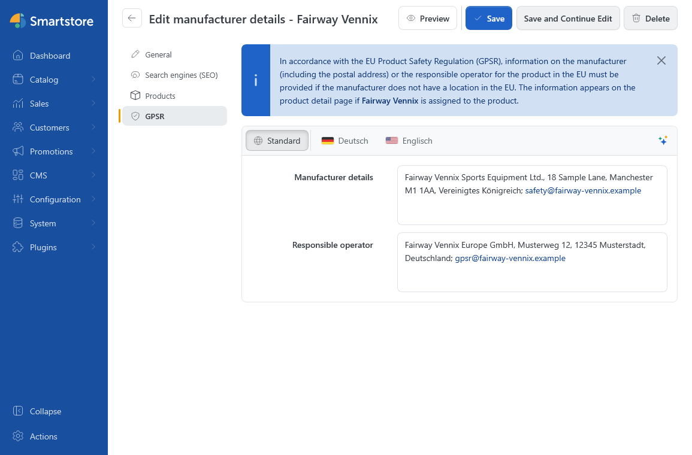
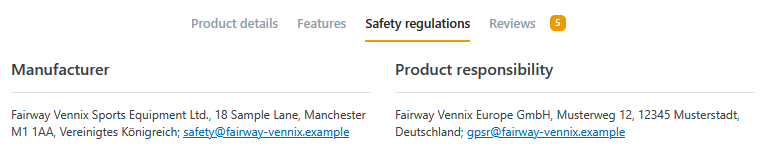
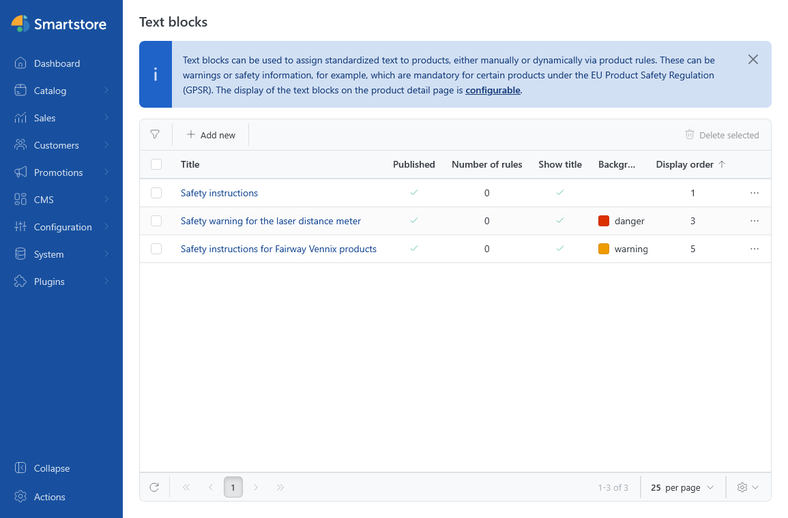
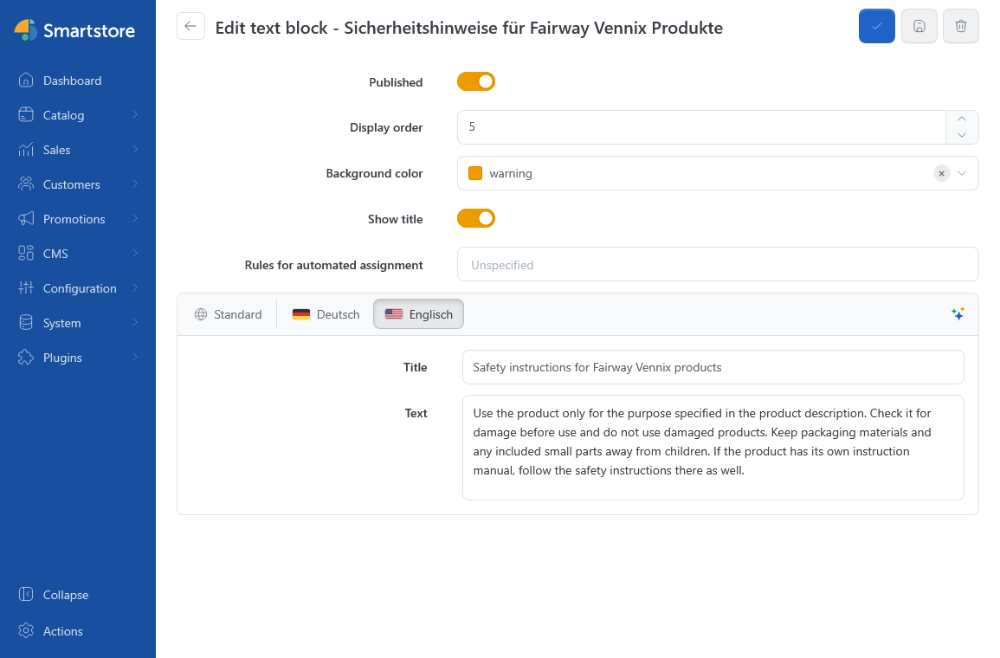
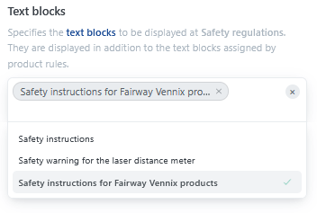
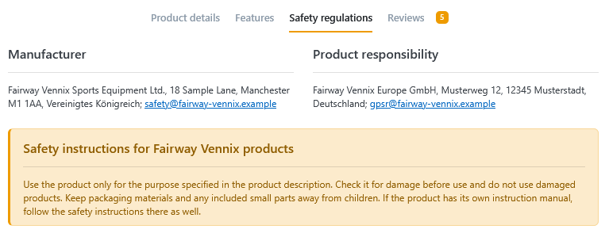
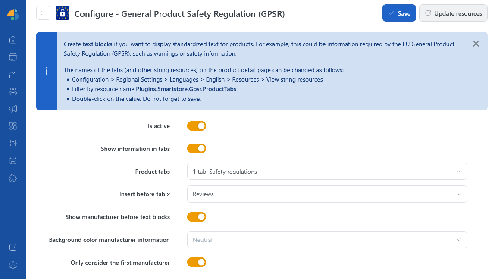

# Product Safety Regulation (GPSR)

The GPSR plugin adds features for maintaining and displaying product information related to [Regulation (EU) 2023/988](https://eur-lex.europa.eu/eli/reg/2023/988/oj/eng) (GPSR).

In particular, the following information can be maintained and displayed on product detail pages:

* Manufacturer information
* Product warnings
* Safety instructions


The examples cited in this article are neither legally binding nor legally compliant. They serve solely for explanation and application purposes.


## Displaying Manufacturer Data

Enter the manufacturer information under **Catalog** → **Manufacturers** and open the **GPSR** tab.

| **Option**           | **Description**                                                                                                                   | **Example**                                                                                                                    |
| -------------------- | --------------------------------------------------------------------------------------------------------------------------------- | ------------------------------------------------------------------------------------------------------------------------------ |
| Manufacturer details | 
- Manufacturer or brand name - Postal address - Electronic address (Email / Website)
                                 | Fairway Vennix Sports Equipment Ltd., 18 Sample Lane, Manchester M1 1AA, Vereinigtes Königreich; safety@fairway-vennix.example |
| Responsible Person   | 
- If the manufacturer is not established in the EU - Name - Postal address - Electronic address (Email / Website)
 | Fairway Vennix Europe GmbH, Musterweg 12, 12345 Musterstadt, Deutschland; gpsr@fairway-vennix.example                          |

The GPSR information for an assigned manufacturer can be displayed on the product detail page. If multiple manufacturers are assigned to a product, the plugin uses only the first by default. You can change this in the plugin configuration.

## Adding Text Blocks

Warnings and safety instructions can be added as text blocks manually, or automatically via rules. To do this, navigate to **CMS** → **Text Blocks** in the backend.

Additional text blocks can be added via **Add new**.

| **Option**                     | **Description**                                                                                                     | **Example**                                                                                                                                                                                                                                                                                                       |
| ------------------------------ | ------------------------------------------------------------------------------------------------------------------- | ----------------------------------------------------------------------------------------------------------------------------------------------------------------------------------------------------------------------------------------------------------------------------------------------------------------- |
| Published                      |                                                                                                                     | On                                                                                                                                                                                                                                                                                                                |
| Display order                  | Sets the display priority. For example, 1 stands for the first item in the list.                                    | 5                                                                                                                                                                                                                                                                                                                 |
| Background color               | Sets the background color of the alert box. Leave empty if the text should not be displayed in an alert box.        | warning                                                                                                                                                                                                                                                                                                           |
| Show title                     | Determines whether the title is displayed.                                                                          | On                                                                                                                                                                                                                                                                                                                |
| Rules for automatic assignment | The text block is automatically assigned to products if they meet one of the selected rules and the rule is active. |                                                                                                                                                                                                                                                                                                                   |
| Title                          | Title of the text block.                                                                                            | Safety instructions for Fairway Vennix products                                                                                                                                                                                                                                                                   |
| Body                           | The content of the text block.                                                                                      | Use the product only for the purpose specified in the product description. Check it for damage before use and do not use damaged products. Keep packaging materials and any included small parts away from children. If the product has its own instruction manual, follow the safety instructions there as well. |


Media such as images and PDFs can also be easily integrated via HTML links in text blocks.


## Assigning Text Blocks

To assign one or more text blocks to a product, navigate to the desired product and select the GPSR tab.

Select the desired text blocks from the list to display them on the product detail page.

The display of manufacturer data and text blocks can be changed in [the configuration](product-safety-regulation-gpsr.md#configuration-of-the-gpsr-plugin).

## Configuration of the GPSR Plugin

| Option                                        | Description                                                                                                                                                                         |
| --------------------------------------------- | ----------------------------------------------------------------------------------------------------------------------------------------------------------------------------------- |
| Active                                        |                                                                                                                                                                                     |
| Show information in tabs                      | Determines whether the GPSR information is displayed in tabs on the product detail page. If disabled, it is displayed in blocks below the long text.                                |
| Product tabs                                  | Defines the tabs on the product detail page where product safety information is displayed.                                                                                          |
| Insert before tab x                           | Specifies the name of the tab before which the GPSR tabs should be inserted. Leave empty to append them.                                                                            |
| Display manufacturer before text blocks       | Determines whether manufacturer information appears before text blocks.                                                                                                             |
| Background color for manufacturer information | Sets the background color of the alert box where manufacturer information is displayed. Leave empty if the manufacturer should not be displayed in an alert box.                    |
| Consider first manufacturer only              | Determines whether only information from the first manufacturer assigned to the product should be displayed. If disabled, information from all assigned manufacturers is displayed. |


