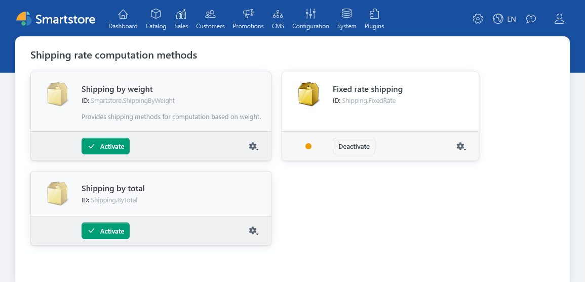
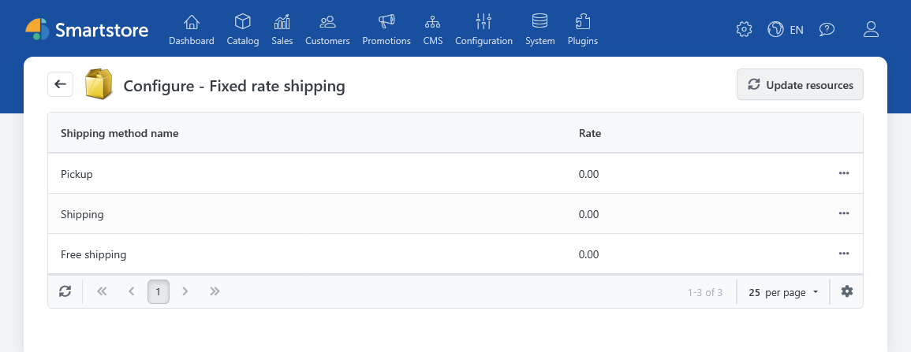
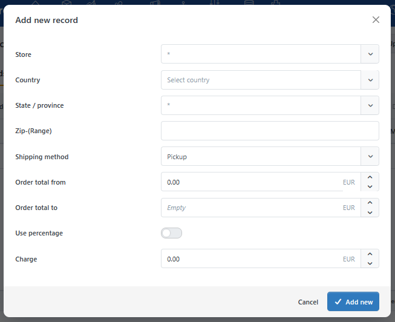
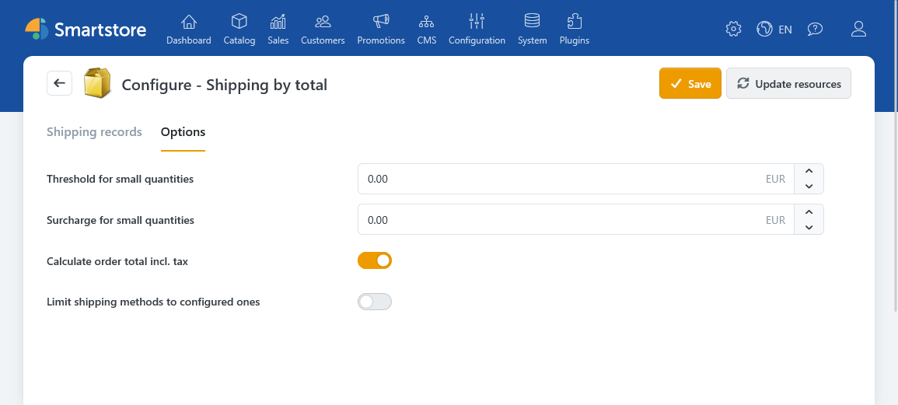

# Shipping methods

The **Shipping** plugin provides two shipping rate computation methods: **Fixed Rate Shipping** and **Shipping by Total**. Both use the shipping methods configured in the store. A shipping method defines its name, description, and display order, among other things; the computation method supplies its rate.

For instructions on creating and restricting shipping methods, see [Setting up Shipping Methods](../configuration/setting-up-shipping-methods.md). General rules, such as free shipping above a specified order value, are covered in [Shipping Settings](../configuration/general-settings-preferences/shipping-settings.md).

## Setup

1. Create the required shipping methods under **Configuration > Regional Settings > Shipping Methods**.
2. Open **Configuration > Regional Settings > Shipping Rate Computation Methods** and activate the method you want to use.
3. Open its configuration and enter fixed rates or shipping conditions.
4. Check the options shown at checkout using shipping addresses and carts that are relevant to your store.

Multiple computation methods can be active at the same time. Smartstore collects their shipping options and sorts them first by the shipping method's display order, then by rate. If both methods offer the same shipping method, multiple options for it may appear.

## Fixed Rate Shipping

With **Fixed Rate Shipping**, you enter a fixed charge for each shipping method. Open the computation method's configuration and edit the amount directly in the list. The charge remains the same regardless of the order value or weight.

One use case is a shipping method with a constant charge for a particular destination. Set up restrictions on the shipping method itself as described in [Setting up Shipping Methods](../configuration/setting-up-shipping-methods.md).

## Shipping by Total

With **Shipping by Total**, you create shipping conditions. Each condition belongs to a shipping method and defines the order value and, optionally, the destination for which a charge applies.

| Field | Description |
|---|---|
| **Store** | Restricts the condition to one store. Without a selection, it applies across stores. |
| **Country and state / province** | Restrict the condition to a destination. Without a restriction, it also applies to other matching destinations. |
| **Zip** | Accepts individual postal codes, comma-separated values, and patterns using `*` or `?`. An empty field does not restrict the postal code. |
| **Shipping method** | Determines which shipping method the charge applies to. |
| **Order total from / to** | Defines the valid value range. Both entered limits are inclusive. An empty upper limit means there is no upper limit. |
| **Charge** | Specifies either a fixed amount or a percentage calculation. |

If you activate **Use percentage**, you can also enter a **base charge** and a **maximum charge**. Otherwise, enter a fixed charge amount.

There is no business rule that gives priority to the condition with the most specific destination. Avoid overlapping conditions for the same shipping method, order value, and destination. Pay particular attention to value boundaries because both the lower and upper limits are inclusive.

### Options

On the **Options** tab, you decide whether the relevant order value is calculated **including tax**. Products with free shipping and products that do not require shipping are excluded from this value.

You can also set a **small quantity surcharge** and the order value up to which it applies. The surcharge is added only when the shipping charge is already greater than zero. For information about products with free shipping and product-specific shipping surcharges, see [Creating and Editing Products](../../manage/catalog/managing-products/creating-and-editing-products.md).


**Check the “Limit shipping methods to configured ones” setting:** By default, a shipping method without a matching condition may be offered as a fallback with a charge of `0`. Activate this setting if shipping methods without a matching condition should not appear.


## Interaction with Other Shipping Settings

The general [Shipping Settings](../configuration/general-settings-preferences/shipping-settings.md) include rules for free shipping above a specified order value and for choosing a shipping method at checkout. [Customer Roles](../customers/managing-customer-roles.md) can also grant free shipping. Consider these settings when checking a calculated rate at checkout.

The Shipping plugin calculates shipping options and charges. Creating and editing actual shipments is covered in [Managing Shipments](../sales/managing-shipments.md).
