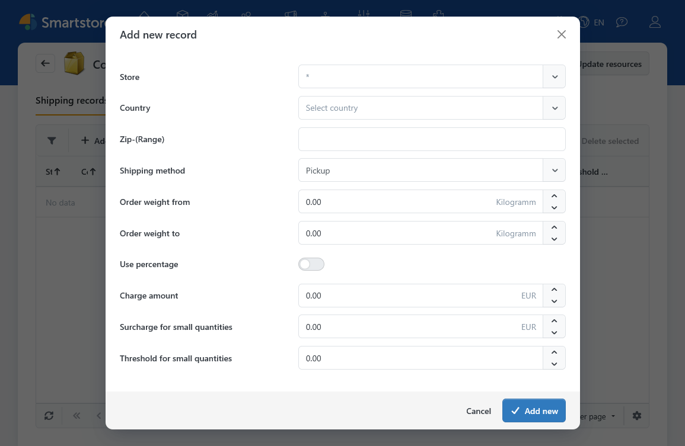
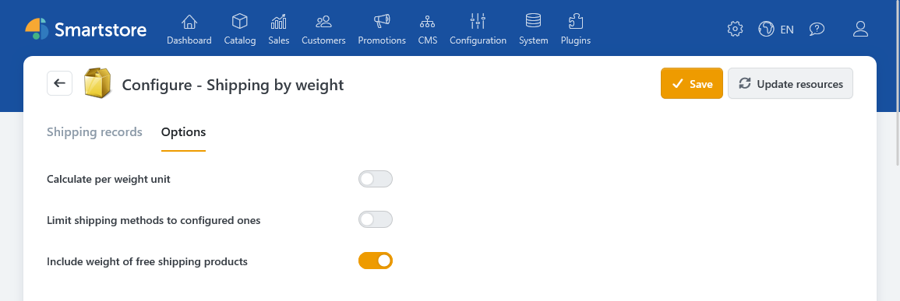

# Shipping by weight (ShippingByWeight)

The **Shipping by weight** plugin calculates shipping costs based on the total weight of a cart. You define shipping conditions for a shipping method, a weight range, and, if needed, a store or destination. The charge can be a fixed amount, an amount per unit of weight, or a percentage of the cart value.

Shipping methods are configured separately from their rates. [Setting up Shipping Methods](../configuration/setting-up-shipping-methods.md) explains how to create them and how to exclude a method for certain customers or destinations.

## Setup

1. Create the required shipping methods under **Configuration > Regional Settings > Shipping Methods**.
2. Open **Configuration > Regional Settings > Shipping Rate Computation Methods** and activate **Shipping by weight**.
3. Open the computation method's configuration. On the **Shipping records** tab, create at least one condition for each shipping method you want to offer through the plugin.
4. On the **Options** tab, review the calculation per unit of weight, the treatment of free-shipping products, and what happens when no condition matches.

## Adding a shipping condition

On the **Shipping records** tab, click **Add new record**. Each condition applies to one shipping method and one weight range. You can narrow its scope by store, country, and postal code.

| Field | Description |
| --- | --- |
| **Store** | Select a store or `*` for all stores. |
| **Country** | Select a destination country or `*` for all countries. |
| **Zip** | Leave the field empty or enter `*` to match any postal code. You can enter individual values or patterns containing `*` or `?`. Separate multiple entries with commas. |
| **Shipping method** | Select the shipping method to which the condition applies. |
| **Order weight from / to** | Define the valid weight range in the displayed base weight unit. **Both limits are inclusive.** |
| **Use percentage / Charge percentage (of subtotal)** | Calculate the charge as a percentage of the applicable cart value, not of the weight. |
| **Charge amount** | Enter a fixed amount. If **Calculate per weight unit** is enabled, the amount is multiplied by the total weight. |
| **Surcharge / Threshold for small quantities** | Add a surcharge when the applicable cart value is below the specified threshold. A threshold of `0` disables the surcharge. |

The weight unit comes from [Managing Weights, Quantity Units & Dimensions](../configuration/managing-weights-quantity-units-dimensions.md). Check your product weights before defining weight ranges.


Avoid overlapping conditions for the same shipping method and destination. A weight exactly equal to the **to** value still falls within that range. For example, the ranges `0–5` and `5–10` overlap at `5`.


## Charges and options

For a **fixed charge**, the plugin applies the entered amount once. Enable **Calculate per weight unit** if the amount should apply per unit of weight. For a **percentage charge**, the cart value is the calculation base. The weight multiplier does not apply. The percentage is calculated from shippable cart items, including tax.

The **Options** tab also contains these settings:

| Option | Effect |
| --- | --- |
| **Include weight of free-shipping products** | Determines whether their weight counts when selecting a weight range and calculating a charge per unit of weight. This option is enabled by default. |
| **Limit shipping methods to configured ones** | When disabled, a shipping method with no matching condition can be offered at a charge of `0`. When enabled, that shipping method is not offered in this case. |

The **small quantity surcharge** is added when the applicable cart value is below the threshold. Depending on the customer's tax display setting, the plugin compares the threshold with the cart value including or excluding tax.

## Checking the result at checkout

Test your conditions with carts at the weight limits and with the relevant destination countries and postal codes. Also test a cart for which no condition matches. This shows whether the fallback behaves as intended.

Other settings can affect the shipping price shown at checkout:

- [Shipping Settings](../configuration/general-settings-preferences/shipping-settings.md) include general free-shipping rules.
- [Customer roles](../customers/managing-customer-roles.md) can also grant free shipping.
- [Creating and Editing Products](../catalog/managing-products/creating-and-editing-products.md) explains free-shipping products and product-level additional shipping charges.
