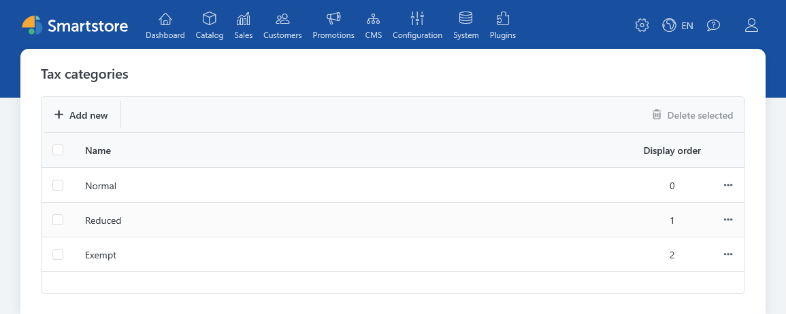
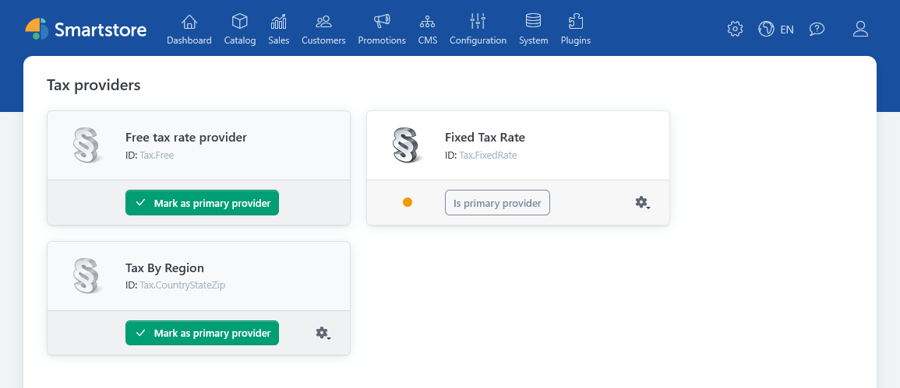
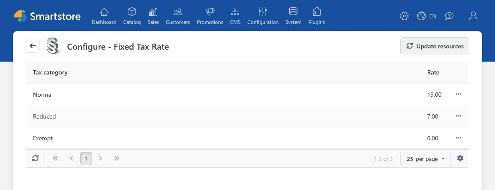
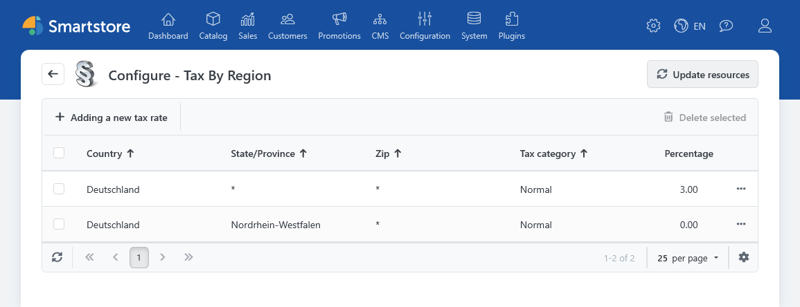
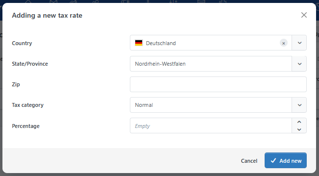

# Tax (Standard Tax Calculation)

The **Tax** plugin provides two tax providers: **Fixed Rate** and **Tax by Region**. Both calculate rates for the tax categories assigned to your products. You choose which provider to use in the tax provider administration. When setting up the plugin, also consider the [general tax calculation settings](../configuration/setting-up-tax-calculation.md).

## Preparing tax categories

First, create the tax categories you need under **Configuration > Regional Settings > Tax Categories** and assign them to taxable products. A tax category does not itself specify a percentage: You enter the applicable rate in the tax provider. A product can also be marked as **Tax Exempt** independently of its tax category.

## Choosing a tax provider

Open **Configuration > Regional Settings > Tax > Taxes**. Select the tax provider you want to use and mark it as the primary provider. Then configure its tax rates.

### Fixed Rate

With **Fixed Rate**, you enter a percentage for each tax category. The rate applies regardless of the country, region, or postal code of the relevant tax address.

### Tax by Region

With **Tax by Region**, you enter rates for a combination of **country**, optional **region**, optional **postal code**, and **tax category**.

This lets you set a general rate for a country and more specific rates for individual regions or postal codes. A matching specific entry takes precedence over a more general one. If the provider finds no matching entry, it returns 0%.


If EU VAT calculation is enabled and the relevant address belongs to a country that is not subject to VAT in Smartstore, **Tax by Region** uses the *fixed rate* for the tax category as a fallback. Check those rates even if you use the regional provider.


The [countries and regions](../configuration/managing-countries-regions.md) must be set up before you enter regional tax rates.

## General tax settings

Under **Configuration > Finance**, use the [tax settings](../configuration/general-settings-preferences/tax-settings.md) to specify, among other things, whether you enter product prices including tax and whether the store displays prices including or excluding tax. You can also control tax notices, the display of tax rates in the cart, and the display of zero tax amounts.

For tax calculation, choose whether to use the **billing address**, **shipping address**, or a **default tax address**. If the selected customer address is missing, Smartstore can fall back to another available address or the default tax address.
