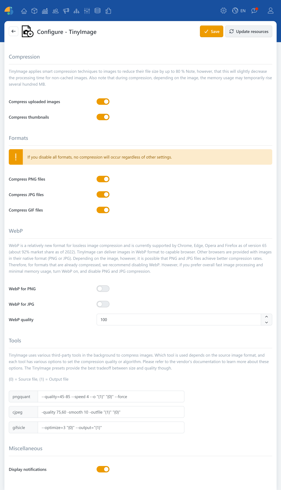

# TinyImage

> Image compression up to 80%

TinyImage is a plugin that can significantly reduce the file size of uploaded images without requiring you to manually recompress every image. You get slimmer media files, shorter loading times, and an overall smoother user experience, especially on pages with lots of images (e.g., product listings, blogs, or content pages).

In the background, TinyImage uses intelligent compression strategies: depending on the image format and the image content, suitable methods are applied to reduce the amount of storage needed. As a result, the image file size can be noticeably reduced, depending on the original image. Dynamically generated thumbnails are also taken into account, so the optimization applies not only to uploaded originals, but also to the preview images used in the display.

## Use cases

* **Compress uploads**: Compresses images directly during upload.
* **Compress thumbnails**: Dynamically optimizes generated thumbnails.

## Formats

TinyImage works format-dependently and supports the image formats [PNG](https://en.wikipedia.org/wiki/PNG), [JPG](https://en.wikipedia.org/wiki/JPEG) and [GIF](https://en.wikipedia.org/wiki/GIF).

### WebP

[WebP](https://en.wikipedia.org/wiki/WebP) supports both lossy and lossless compression. TinyImage can serve PNG and JPG images as WebP when the browser supports it. Image quality can be configured in the plugin settings.


Browsers that do not support WebP will continue to receive images in the original format (PNG or JPG).


## Configuration

### Compression

TinyImage can reduce image file sizes by up to 80%. Images that are not yet cached may take longer to process. Depending on the image, memory usage may temporarily increase by several hundred MB during compression.

| **Option**          | **Description**                              |
| ------------------- | -------------------------------------------- |
| Compress uploads    | Compresses images when they are uploaded.    |
| Compress thumbnails | Compresses dynamically generated thumbnails. |

### Formats

Compression can be enabled separately for PNG, JPG, and GIF. If you disable all three formats, these format-specific tools do not compress images. You can enable WebP output independently.

| **Option**         | **Description**                                                                                                                |
| ------------------ | ------------------------------------------------------------------------------------------------------------------------------ |
| Compress PNG files | Reduces the size of PNG files by selectively decreasing the number of colors.                                                  |
| Compress JPG files | Reduces the size of JPG files. The default settings produce progressive JPEGs. The result is used only if the file is smaller. |
| Compress GIF files | Reduces the size of GIF files, including animated images.                                                                      |

### WebP

The following options determine whether PNG and JPG images are served as WebP. Which combination of WebP output and compression of the original formats produces smaller files depends on the image and quality settings.

| **Option**          | **Description**                                                               |
| ------------------- | ----------------------------------------------------------------------------- |
| WebP instead of PNG | Generates and serves WebP instead of PNG files to browsers that support WebP. |
| WebP instead of JPG | Generates and serves WebP instead of JPG files to browsers that support WebP. |
| WebP quality        | Sets the quality of generated WebP images. The default value is 100.          |

### Tools

TinyImage uses different third-party tools for compression depending on the image format. Each tool provides options for setting output quality. TinyImage's default settings offer the best balance between file size and quality. If you want to adjust them, consult the tool providers' websites. In these options, {0} represents the source file and {1} the output file.

| **Option** | **Description**                       |
| ---------- | ------------------------------------- |
| pngquant   | Sets the options for PNG compression. |
| cjpeg      | Sets the options for JPG compression. |
| gifsicle   | Sets the options for GIF compression. |

With **Display notifications**, you can show a brief summary of the achieved compression after an image upload.


