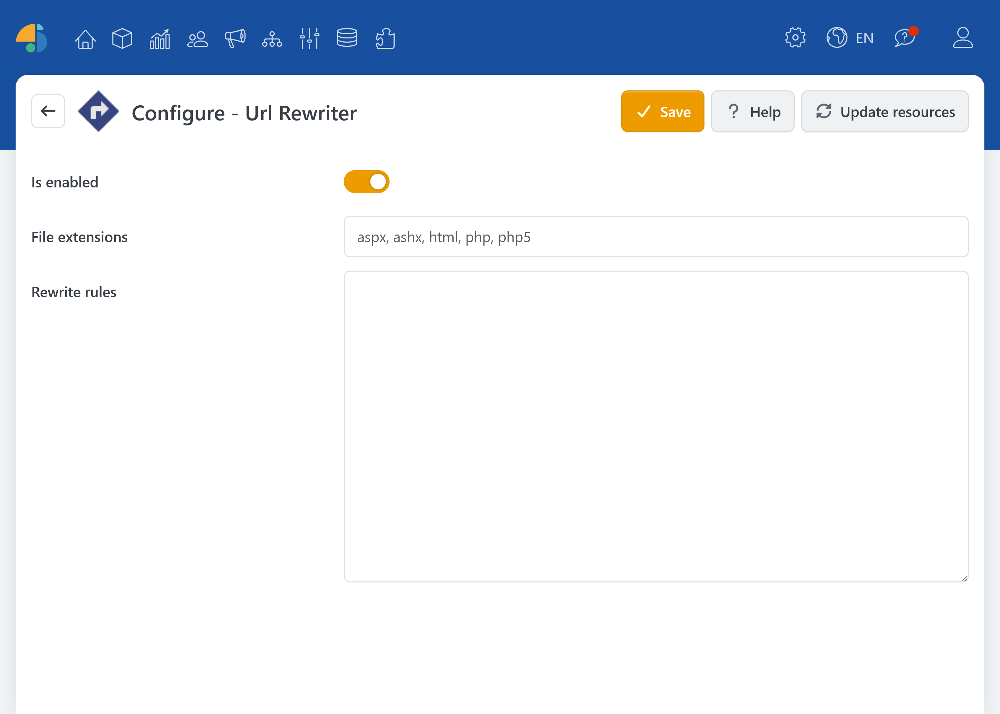

# UrlRewriter

> Define redirects your way

With the UrlRewriter plugin, you can define URL redirection rules in the shop backend. This is especially useful when pages have been moved, product or category URLs have changed, or when you want to route to different targets for specific domains or stores (e.g., in a multi-store environment).

The plugin uses a syntax based on **Apache mod\_rewrite** with a reduced set of features. Each rule contains a pattern and a target. Optional flags determine whether Smartstore sends an external redirect or rewrites the path internally.

## Rules

The rules are entered in the plugin configuration area and are structured line by line:

* Exactly **one** Rewrite rule per line (without the `RewriteRule` directive).
* Comments are allowed and start with `#` or `//` at the beginning of a line.

The plugin supports a `mod_rewrite`-compatible syntax, but without the following directives: `RewriteBase`, `RewriteCond`, `RewriteRule`, `RewriteMap`, `RewriteEngine`.

This makes the tool particularly suitable for common use cases such as **301 redirects**, pattern-based substitutions (e.g., folders/subpaths), and **host-specific rules**.

### Examples

The following rules show patterns, target paths, and optional flags. `R=301` sends a permanent HTTP redirect. Without `R`, the path is rewritten internally and the browser address stays the same. `R` without a status code uses 302.

* **Simple Redirect**: old URL → new URL `/old-page /new-page [R=301,NC]`
* **Pattern with path parts**: e.g. for categories/folders, so the part after the folder is kept `/pdfs/(.*)$ /documents/pdfs/$1 [R=301,NC]`
* **Host-dependent rules**: In multi-store setups, the target URL can vary depending on the domain `/old-url$ /new-url [R=301, NC, H=^myshop1\.de$]`

The pattern matches only the URL path, not query parameters after `?`. The host filter `H` uses a regular expression. In the example, `\.` matches a literal dot; `^` and `$` anchor the host name.

## Configuration

In the backend, go to **Plugins > Url Rewriter**. There you can enable the rules entered in the backend, choose which file extensions to handle, and enter your rewrite rules. External rule files are loaded regardless of the **Is enabled** setting.

| **Option**      | **Description**                                                                                                                                                                         |
| --------------- | --------------------------------------------------------------------------------------------------------------------------------------------------------------------------------------- |
| Is enabled      | Enables or disables rules entered in the backend. Rules from external files are loaded independently of this setting.                                                                   |
| File extensions | Comma-separated file extensions without a dot, such as php or html. Paths with other extensions are skipped by rules entered in the backend; paths without an extension are unaffected. |
| Rewrite rules   | One rule per line. This field is stored across stores; the store selector above does not limit these rules. Use the H flag to restrict a rule to specific host names.                   |

### Advanced Usage

Use the Help button for more flags and syntax guidance. You can also store rules in `mod_rewrite` (Apache syntax) or `rewriterules.config` (IIS syntax) in the tenant directory. Rules entered in the backend are checked first. External rule files are loaded regardless of whether “Is enabled” is selected.


